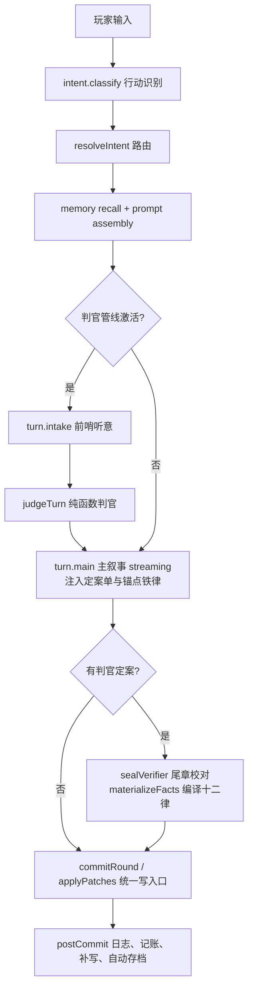
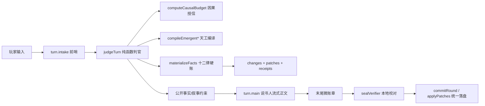
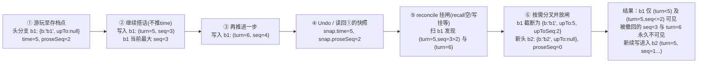

# AI 调用链架构说明（活文档）

> 本文是曲措乡「AI 调用线重构」的当前链路说明，不是历史设计稿。
> 凡是改动 AI 调用入口、回合管线、事实落盘、状态写入口、提示词冰山、结构化输出契约的 PR，都必须同步更新本文；否则视为 PR 不完整。
> 口径标记：**已落地** = main 已有代码；**基础已落地/未接主链** = 模块存在但还不是主回路；**施工中** = 有工单或 PR；**目标** = 尚未落地。

## 1. 一句话总纲

目标链路：**前哨听意 → 纯函数判官先定硬账 → 说书人流式写正文，末尾微账章 → 本地校对后统一落盘**。

核心分工：
- **系统定事实**：谁在场、有什么、能不能成、掉了什么、扣了多少，全部由确定性规则计算。
- **LLM 写叙事**：模型只负责把已定事实写得像江湖，不再凭 prose 决定数值。
- **账户先硬后软**：先产出可重放的事实账本，再让叙事对齐账本；正文末尾只允许微账章，不再用大段 hidden JSON 决定世界。

## 2. 当前 main 的真实链路

WO-15 起这就是线上主回路：**旧状态提取层（turn.extraction/extractionSpecs/extractionEngine/appeaseExtraction）与独立软结算通道（settleTurn/runSoftSettle/softRules/settle.judge）已整块删除**。`judgePipelineEnabled` 开启时，`turn.intake` 前哨听意 → `judgeTurn` 纯函数判官 → 定案单与锚点铁律注入主叙事 → 流式剥 `⟦F⟧` 锚点、`---SEAL---` 尾章校对 → `materializeFacts` 经 `commitRound` 落盘。双调用模式下不再有第二次"从叙事反推状态"的提取调用——自由行动状态只来自判官 facts；settle 回合状态靠 feature 前置硬结算。单调用 JSON 老路（extractionEnabled=false）仍保留到 WO-16。

**当前真实覆盖率**：web 端 `judgePipelineEnabled` 默认 `true`；原 CLI 入口与 `tests/cli/` 回放 fixture 已退役删除（单调用 JSON 老路仅剩显式配置/测试/紧急回退兜底）。激活还需同时满足两个条件——**非 settle 回合**（settle 回合状态在进叙事前已由 feature 层硬结算落账——giftNpc 已扣货、learnNpcSkill 已扣束脩授业、inviteCompanion 已写 companionState，判官再裁会双重结算）且 **`extractionEnabled` 双调用叙事模式**；WO-16A 起纯搭话回合也进判官，但 `envelope.talkOnly` 白名单只许产小额社交事实——give/take/inspect_container/learn 等硬事实整条拦截，不会因搭话误搬物品；任一不满足，新管线不激活、整链 no-op。WO-15 删除的只是「独立软结算通道」（AI 事后裁好感/收拒），feature 前置硬结算不在删除范围；settle 回合开放判官须等后续工单把前置硬写改成「事实请求先裁后落」。场记板 entries、容器坍缩态、备料物、悬空道具尚无宿主系统喂入（属 WO-17/18/22/24），判官多数回合签出空 facts。**WO-16A 替代覆盖后剩余过渡缺口**：respondedNpcs 已改系统推导（intake 听意单 talk target，SEAL 仅推导为空时兜底、低可信不得用于 pact 自证）；memory 已改系统模板串入账（facts 首条模板/搭话「玩家对X说」截断，无 AI 摘要）；搭话好感经 stance 确定性映射走系统好感账本。仍缺：mentionedNewNpcs 新 NPC 传闻注册（待 WO-17 场记板宿主）、判官 inactive 时全部零落账。原文段落记忆库归 WO-17。

**WO-15 保留边界（如实声明）**：
- `forgeDesign`（铸剑坊/金玉行定制设计）不属提取层，已迁入独立小文件 `src/engine/ports/forgeDesign.js` 保活。
- 旁白私语好感裁决（原 narrator_affinity 软结算）不走回合判官管线（私聊是独立流程），已改写为独立结构化调用 `narrator.affinity`：AI 只做三选一分类（投机贴心/寻常闲聊/敷衍冒犯），数值映射、幅度裁剪、日上限账本全部在系统侧（usePrivateTalk）。
- `buildExtractionCfg` 实为所有结构化小调用共用的 cfg 构造器，迁至 `src/domain/rules/prompt/structuredCallCfg.js` 存续（名称未改，供记忆召回/前哨听意/锻造设计等使用）。
- 单调用 JSON 模式（extractionEnabled=false，CLI 回放默认）不受本工单影响，parseResponse 链路留待 WO-16。
- **WO-16A 判官替代覆盖层（已补三项，余两项留宿主）**：
  - 搭话开闸：纯搭话回合进判官但 `talkOnly` 白名单只产小额社交事实（stance 确定性映射 sincere+2/clever+1/casual+1/forceful-1/perfunctory 不产事实，未知按 0），give/take/inspect_container/learn 等硬事实整条拦截不搬物品。
  - 好感落账统一走系统账本语义（复用 WO-16B 已合并的 `domain/rules/state/affection.js`）：魅力修正、0-100 clamp、每日 +12、无好感轨道整条事实跳过（含心账）；负向增量不经日涨上限但也做 clamp 与轨道跳过。
  - respondedNpcs 系统推导（intake 听意单 kind=talk target）永远优先；SEAL/单调用 JSON 的模型自证仅在推导为空时兜底，属低可信过渡，不得用于 pact 自证。
  - memory 过渡：判官 facts 首条模板串/纯搭话「玩家对X说：原文≤30字」系统模板入账，无 AI 摘要；原文段落记忆库归 WO-17。
  - 拾取：地上拾取全在 feature collectGranted 确定性通道，判官 take 不产 GRANT_ITEM（测试钉住防重复入包）；移动途中的掷骰拾取由 WO-16C 条件券通道接管（见状态板）。
  - **仍缺的过渡缺口**：①mentionedNewNpcs 新 NPC 传闻注册（待 WO-17 场记板宿主）；②判官 inactive 的双调用回合仍整体零落账。
- **appease 窄过渡补洞**：赔罪在 feature 层无前置硬结算，软结算删除后无人裁消气。双调用模式补窄结构化小调用 `turn.appease`（非软结算复活、不可扩展注册表）：AI 只三选一（奏效/未奏效/无法判断），奏效由系统钉死注入 `生气解除=true`+`好感度+3` 走既有 mvu 消费链；未奏效/无法判断零写入；settle 判官闸门不受影响、其余 settle 类型不触发；单调用模式不调（主模型 MVU 尾巴仍处理），WO-16 统一清。
- CLI 回归集适配结果：全部 CLI fixture 录制于单调用模式（`extractionEnabled:false`），本来就绕开被删链路；`softSettleEnabled` 开关已随通道删除（设置 UI、apiConfig 默认值、CLI 参数同步移除），3494 项测试全绿、零跳过。

## 3. 已落地地基

| 模块 | 状态 | 说明 |
|---|---|---|
| `withAI` 单一调用网关 | 已落地 | 新调用必须 `definePrompt` 注册后走 `src/engine/ports/withAI.js`，不允许散调 `callModel`。 |
| 原生结构化输出 | 已落地 | OpenAI/Gemini/Anthropic 各有原生 schema 通道；`intent.classify`、`narrator.affinity`、劝服、锻造设计已接入。开放对象在 strict 通道回退 `json_object`，但本地 schema 校验仍跑。**strict 静态门禁**：`scripts/checkStrictSchemas.mjs` 接入 verify:fast——走 strict 通道的 schema 每层 properties 键必须全入 required、禁止联合类型（`["string","null"]` 式可选一律改空串/枚举哨兵，如 persuasion.hit 用 `""` 表未命中）；`strictCompatible:false` 仅限开放词条对象（forge.design）显式豁免，不得作默认逃避；含 `definePrompt("call")` 的模块清单门禁自检，新模块漏登记直接失败。 |
| 流式与缓存观测 | 已落地 | Gemini 原生 SSE；OpenAI/Anthropic/Gemini 都采集 token/cache 命中；dev proxy 逐块转发。 |
| 冰山提示词 | 已落地 | `turn.main` 分成稳定前缀 `sysBlocks` 与动态聊天材料，稳定部分不因房间/人物/好感变化而改写。 |
| 场记板 Clapboard | 已落地 | 事实条目有实体 ID、类别、见证者、`rawText/publicText` 双文本；NPC 只能看见自己见证过且允许公开的内容。 |
| 体感态势与活人切片 | 已落地 | `@体感态势` 把气血/内外功/衣装/钱袋转成感官描述；`@在场活人切片` 按 NPC 分块写性情、状态、所见。 |
| 架构说明 CI 门禁 | 已落地 | `npm run docs-gate` 在 CI 前置执行；改动调用链关键文件而未同 PR 更新本文会失败。 |
| 因果授信 CausalBudget | 已落地 | `computeCausalBudget` 按张力、风险、代价、交情、气运、支线高潮和每日搜刮额度算 T0–T3/GM。阈值为本实现自定刻度。 |
| 天工铸物/原型创招 | 已落地 | `compileEmergentItem`、`compileEmergentSkill` 把授信额度编译成可进战斗/背包的真实物品与武学；越界词条物理驳回。 |
| 首字超时兜底 | 基础已落地/未接主链 | `streamWithFirstTokenFallback` 支持插入过渡行、首字抵达原位替换、超时静默降级；主循环接线属于后续工单。 |
| 十二律落盘引擎 | 已接主链/只承判官事实 | `materializeFacts` 已把十二类事实码编译成 `changes/patches/receipts/logs`，经 `finalizeTurn → commitRound` 统一落盘；`receipts` 挂到落账日志项。WO-15 起它承接判官管线签出的事实，是双调用模式唯一状态落账来源。 |
| 前哨 intake + 判官 + 锚点尾章管线 | 已接主链/常 no-op 退化 | 契约 B `turn.intake`、`judgeTurn`、`storytellerStream` 锚点剥离、`sealVerifier` 尾章校对、`materializeFacts` 落盘已全部接入 `runTurn`/`commitRound`；web 默认开、CLI 回放默认关；激活另需非 settle/非纯搭话回合 + extractionEnabled 双调用叙事模式，否则不激活。entries/containers/prepItems/floatingItems 无宿主喂入，多数回合签空 facts 退化运行。 |
| NPC 传闻/涌现过渡复接 | 已接主链（过渡方案） | SEAL 扩可选键 `mentionedNewNpcs`/`emergedNpc`；`validateEmergenceSeal` 五路校验（正文出现/玩家名/同伴雪豹/驻场册/已有传闻）；合法项接回 `p` 由 recordRumors/materializeEmergence/fixateNpcs 原管线接管，数值仍系统侧定量。判官裁登场（工单丁）等 WO-17。 |
| 任务推进扩展律 ADVANCE_QUEST | 已接主链（B1） | intake `quest_advance` 提议 + judgeTurn 白名单（候选仅系统 `questAdvanceCandidates` 生成）+ materializeFacts 写 flags；推进/奖励由 `questFlagRule` 接管。判官双调用不再要求模型吐 flags_add 任务旗。 |
| 雪豹灵性确定性结算 | 已落地 | 挠痒/自由喂食/送药/送礼肉食全部由系统判定发旗（resolveSnowInteraction 自由文本保守识别：否定/假设/询问不误触发、无肉不触发、flag 幂等），filterSnowModelFlags 剥除模型输出全部 snow 旗——无双通道。 |
| settle 社交好感硬结算 | 已落地 | 送礼/送银/求教/邀同行的好感增量由 feature 确定性写入（系统账本语义：魅力修正/每日 +12 上限/0-100 clamp/无好感轨道跳过），模型只写叙事不写好感 MVU。 |
| 天机落账卡 UI | 已落地/动作结构化直写 | `EffectReceiptCard` 消费 `receipts` 渲染落账条；按钮派发结构化 action（itemId/skillId/factId/op/kind），经 NarrativeLogFeed 原样透传进 `act`，useTurn 在 intent 识别前的系统边界按 id 寻址确定性幂等执行（features/receipts/logic，equip/activate 为 explicit-on 语义），行动识别关闭同样生效，写账走 applyResult 统一边界。例外：`viewPact` 无结构化面板入口，保留文本指令。 |

## 4. 目标链路分层

### 4.1 前哨听意

职责：把自然语言整理成结构化的行动意图，不做世界裁决。它是 LLM 与系统之间的第一道翻译。

已落地部分：`intent.classify` 原生 schema 已能稳定输出行动数组；候选合法性仍由本地 recognizer 校验。

### 4.2 判官先定硬账

职责：在写正文前确定本轮硬事实，输出 `JudgeVerdict`：事实列表、可公开材料、叙事约束、编译凭证引用。

关键约束：
- 判官必须纯函数：同一 `(state, facts/intent, warrants)` 输入必得同一输出。
- 判官不直接写 store，只产出账本。
- 授信额度、可掉品质、能否赐武学、能否洗髓，先由 `CausalBudget` 卡住。

### 4.3 十二律事实落盘

十二律是系统承认的世界事实操作集合。当前定义以工单为准，覆盖：授物、转移、重铸、授技、修行、七维、气血银两因果业障、状态、人情、契约、伙伴、场景。

**任务推进扩展律 `ADVANCE_QUEST`（十二律外的显式扩展，B1）**：十二律没有任务状态机语义，复用 APPLY_CONDITION 的 buff 旗或 ALTER_WORLD_SCENE 的场景键都会造假——任务旗是任务状态机的唯一合法输入。ADVANCE_QUEST 的形状 `{op, questId, flag, questTitle, witnesses}`：intake 以 `quest_advance` proposal 提议（questId/flag 只能抄系统现场生成的候选——两键为 strict 全 required 必填，非 quest_advance 提议一律填空串、空串视同未填；候选见 `questAdvanceCandidates`，口径与任务面板同源：requireLocation 锚定只看地点不看 giver、无锚点有 giver 才要在场、无锚点无 giver 走 stage.at；deliver 收件人在场+实物在包/collect 齐件/gate open/choices 默认不候选（script 模式非全战斗例外，combat 抉择旗与前提未开分支旗永不进候选）；「这里」判定与任务面板同源含 deliver 收件人在场支线/localOnly 与雪豹排除）；judgeTurn 只做白名单核验（questId+flag 必须命中本轮候选，自编/提前阶段/错地点安静丢弃）；`materializeFacts` 只把 flag 写进 flags——阶段推进/奖励/交付扣件全部由 `questFlagRule` 世界规则扫描 flags 自动接管，判官与落盘引擎都不直接碰 questProgress。判官双调用模式下 roundNotes 不再要求模型往 flags_add 吐任务旗（提示与现实矛盾）；单调用老路不变。

`materializeFacts(state, facts, compiledWarrants)` 输出：
- `changes`：状态切片直写，走统一 changes 入口。
- `patches`：`varTree/companionState` 等深写指令，走 `applyPatches`。
- `receipts`：装备/丹药/武学卡所需的落账回执。
- `logs`：给日志层的短句。

### 4.4 说书人写正文

职责：只吃公开事实和叙事约束，写玩家看得见的正文。不能再靠散文里的描述倒推数值。

目标：正文 streaming，末尾带 `---SEAL---` 微账章。微账章只列已经由判官确定的账目引用，不允许新增世界事实。

### 4.5 本地校对后统一落盘

`sealVerifier` 将检查：正文宣称的事实是否有账、账目是否越授信、微账章是否和事实账本一致。校对通过后才统一写入 `commitRound/applyPatches`。

## 5. 当前旧新链路边界

| 位置 | 现状 | 迁移方向 |
|---|---|---|
| 主叙事 | `turn.main` streaming | 保留，但输入改成判官公开事实与叙事约束。 |
| 状态提取 | **已删除（WO-15）** | `turn.extraction`/extractionSpecs/extractionEngine/appeaseExtraction/ports/extraction 整块移除；双调用模式状态只来自判官 facts。 |
| MVU 文本命令 | 仍有大量历史消费方 | 只保留必要字段协议，不再让 AI 自由写状态。 |
| 账本写入 | `commitRound` + `applyPatches` | 保留统一写入口，新增事实账本先编译后提交。 |
| 结算回合 | 软结算通道已删（WO-15） | settleTurn/runSoftSettle/softRules/settle.judge 整块移除；feature 前置硬结算（扣货/授业/入队）保留并继续排除判官。旁白私语好感走独立 `narrator.affinity` 调用。 |

## 5.1 关键契约速查

### 契约 B：`turn.intake` 听意单

形状冻结：`{ read, refIds, actions, proposals }`。
- `read`：不超过 40 字，拆清代词与意图核心。
- `refIds`：玩家援引的场记板条目 ID。
- `actions[]`（WO-16G PR-G1 起 12 字段全 required）：`kind/target/item/itemId/direction/condition/condition_text/stance/outcome/risk/confidence/text`；kind 为封闭枚举，direction 为 `n/s/e/w/none`，outcome 枚举 `无/伤损/得财/破费/调息/修习/服用/受寒中毒/醉酒/其他`，risk 枚举 `无/低/中/高`，confidence 为 0-1 数值；缺省语义空串/none/无/0，禁联合类型。outcome/risk 本阶段只进 schema 与喂料，判官消费属 WO-16F（risk 已被 budgetInput 两层兼容读取）。
- `proposals[]`：玩家声称可促成的发现或交易，`fit` 分 `natural/stretch/absurd`。

原则：小模型只选择系统喂入的候选，不允许自造 ID；`normalizeIntakeResult` 做修复式复核——先剥模型多填的未声明键、给缺省键补默认值，修不好才降级为空听意单。喂料清单（拆句 hints/可用出口/可赠/可用/可拾/可穿戴，`名字(编号)` 统一格式）只在 `buildIntakeUserContent` 一处组装，runTurn 与 shadow 同源调用；不喂银两——仓内无独立玩家钱币状态（WO-16D 审计口径）。

### 契约 C：`JudgeVerdict` 判官定案单

形状：`{ causalTier, pacingWords, facts, warrants, allowSpontaneousPact, reactionGuides, notes, budget }`。
- `facts[]`：十二律铁案，ID 形如 `F<turn>_<seq>`。
- `warrants[]`：空白天机券，ID 形如 `W<turn>_<seq>`，只给额度、品类、来源，不给最终名字。
- `reactionGuides[]`：按 NPC 拆知情/不知情反应约束。
- `budget`：`maxQuality/maxPointBudget/remainingDailyQuota`。

### 尾章：`---SEAL---` 微账章

正文 streaming 中事实锚点写作 `⟦F42_1⟧`，上屏前剥除；检测到 `
---SEAL---` 后屏幕冻结，后续只进尾章缓冲。尾章 JSON 只负责填空：`fills`、可选 `spontaneousPact`、可选 `respondedNpcs`。它不能新增未经判官裁定的事实。

### 落账四件套

`materializeFacts` 只输出，不直接写 store：
- `changes`：背包/房间/角色/武学/修为等切片；
- `patches`：好感、契约、伙伴、场景等深写 patch；
- `receipts`：UI 落账卡数据；
- `logs`：事实短句。

`commitRound` 是唯一统一提交点；`companionState` patch 必须走 `setCompanionState`，不能静默丢弃。

## 5.2 当前施工状态看板

| 工单 | 状态 | 当前事实 |
|---|---|---|
| WO-01～WO-12 | 已合并 | 地基、场记板、因果授信、编译器、十二律、前哨判官都在 main。 |
| WO-13 | 已合并 | web 默认 `judgePipelineEnabled=true`；CLI 老录制默认 false。激活还需非 settle、非纯搭话且 `extractionEnabled` 双调用叙事模式。因 entries/containers/prepItems/floatingItems 还没宿主喂入，很多回合会 no-op 退化，不能当成旧提取已替换。 |
| WO-14 | 已合并；动作结构化直写随修包落地 | `EffectReceiptCard` 消费 receipts 并随判官落账日志显示；按钮结构化 action 按 id 寻址确定性执行，equip/activate 幂等 explicit-on；`viewPact` 保留文本指令例外。 |
| WO-15 | 已合并 #443 | 旧提取层与独立软结算通道整块删除；forgeDesign 迁出保活；旁白私语好感改走 narrator.affinity；appease 走 turn.appease 窄过渡仲裁；settle 维持排除判官；CLI 回归集适配全绿。 |
| WO-16B | 已合并 | settle 社交好感（送礼/送银/求教/邀同行）前移到 feature deterministic 硬结算：`systemAffectionDelta/systemAffectionPin`（domain/rules/state/affection）按 giftRange/weight/preferLabel/learnRange/companion.example 定增量，保留魅力修正、0-100 clamp、每日 +12 上限、无好感轨道跳过；不再由判官或 AI 自由裁定。提示词对 gift/learn_skill/companion_invite 已禁写好感 MVU，commitRound 拦截模型乱写防双计；appease 仍走 turn.appease 窄仲裁过渡。 |
| WO-16 | 破坏性删除包冻结，改由 S10 分片退场 | CLI 入口与回放 fixture 已随 #461 退役删除；单调用 JSON 老路现仅保留给显式配置、测试、紧急回退与 GM 回合。原整体硬删 WIP 分支（devin/1795596800-wo16-single-call-delete）仍冻结不开 PR；按 11-25 夜审计，不再一次性硬删，待 #522 放行与 S8 GM 判官化后由 S10 分四片退场。 |
| WO-16A | 已合并 #445 | 判官替代覆盖层：搭话开闸白名单、respondedNpcs 系统推导、memory 模板串过渡、判官 MUTATE_SOCIAL 好感走统一系统账本语义（复用 WO-16B affection.js）；不删旧路纯增量。 |
| WO-16C-pickup | 已合并 #446 + #447 修包 | 移动拾取判官替代层：rollMovementEvents 掷中后判官只签条件券（quality/category 系统锁定、pointBudget=0 无词条保持旧行为），不进 facts；正文埋 ⟦F⟧ 锚点+尾章 fill 双证据齐备才由 sealVerifier 合成 GRANT_ITEM fact 落包，缺一券作废零落账（叙事可拒捡，系统绝不硬塞）。判官模式下 commitProposalWrites 不再保底发放/打误导 trace；单调用旧路 delta.items_add 原样保留。合并后 Review 修包：①条件券撞图鉴名不做 substitution（数值按 warrant 锁定、noCatalog 盾防读档回填、id 按 warrant 派生不撞重放）；②路遇拾取 memory 改用落盘回执作事实源（verdict 刻意无 facts 不漏记）；③sysBase narrativeOnly 判官路放行 ---SEAL--- 尾章（修「禁输出JSON」与判官铁律打架），判官不在时原样。 |
| WO-17 | 已合并 | 正文按段切分器+他人斜体心理剥离+老存档迁移器：proseChunker 产契约 A ProseChunk（witnesses/location/turn 全系统来源），stripOtherInnerThoughts 按邻近归属证据剥 *斜体心理*（拿不准保留）；qucuo_memory 统一升 v2 新增 prose_chunks（memoryDb.js 共享开库，memories 原表不动）；migrateLegacyConvoAndNotes 幂等无损迁移 convo/小纸条；memoryEval.mjs 封存评测小纸条 40% vs 原文段落+邻段 100% 召回。**尚未接入主链路，写挂与检索归 WO-18**。 |
| WO-18 | 已合并 #452 | 原文段落检索接主链路+时间线谱系：写挂在 commitRound 成功且未 stale 后由 finalizeTurn 派发（回滚叙事永不入库），同步 seq allocator 原子预留防同回合撞号；proseLineage/proseSeq 随快照存取，读档按需分叉（seq 粒度：turn>saveTime 或同 turn seq>快照proseSeq 才算未来，upToSeq 同回合边界，reconcile 带 gameEpoch 护栏+失败不分叉降级；迁移 seq 水位只升不降 mergeProseSeqFloor），无谱系老档建根分支+迁移入根；chunk branchId/显式 seq，IDB v3 branchId 索引；检索按谱系分支索引逐支取段不全库扫（非头 turn<upTo 或同 turn seq<=upToSeq/头 turn<=currentTurn/无 branchId 不可见；运行时无 lineage 宁可无召回，宽松路径测试显式 opt-in）+witnesses viewer 硬过滤；写库 rawText 保全文召回侧按 viewer 动态剥心理；纯本地词法召回与向量开关解耦；邻段池化连续合并；场记板「往事正本」（众人皆知/见证名单/〔刻骨〕），弱相关退「往事索引」单行。 |
| WO-22A | 已合并 #457 | 容器坍缩最小竖切：房间内容表声明 containers（presetItems 剧本写死），varTree.世界.容器 懒初始化记账（merge patch 自动建层，旧档不炸）；判官 inspect_container 先查坍缩——已坍缩只有「翻不出新东西」，未声明容器不进三关，未定容器首翻无论结局（预设/备料/券/残页）翻完即记 COLLAPSE_CONTAINER 事实坍缩；前哨渲染「可翻找容器」只列未坍缩。悬空秘宝/契约留 WO-22B 不实现 |
| S4 runTurn/judgeTurn 纯拆分 | 已合并 #533 | move-only 零行为变化：judgeTurn.js（782→185 行）按 kind 拆到 judge/rules/——shared.js（personaMod/affectionOf/affectionMod/TALK_STANCE_DELTA/FIT_GATE/findNpc/knowsEntry/QUALITY_ORDER）+freeAct/steal/talk/give/appease/learn/inspectContainer/movePickup/quest 九模块，judgeTurn 只留 refIds 核验/遍历派发/汇总；共享状态经 J 上下文对象（facts/warrants/notes 按引用，anyAccepted/freeActMoneyRun 包对象保可写）。runTurn.js（809→387 行）：判官管线段抽 engine/turn/judgePhase.js（runJudgePhase，305 行）、尾章校对+appease开庭前仲裁+WO-16A memory过渡抽 engine/turn/judgeTail.js（177 行）；getGameStateTime 移 judgePhase 再 export 供 runTurn 复用防环依赖。测试断言零改动，只调 import 路径。 |
| S3 自由行动账目放宽 | 已合并 #528 | 破费查价链（judge/freeActPricing.js 纯函数）：原话写数额按原话；没写依次 ①驻场商户货架同名/同类价（QUCUO_SHOPS 静态铺货 buildShopInventory，确定性锚不掷滚动 stock）→②物件志具名权威价 catalogBuyPrice →③priceForQuality(category,"白") 兜底 →④risk 默认 无2/低5/中10/高20；超囊中只扣到零并 notes 囊中不足。得财放宽：不再要求 fit 合格 proposal，按 tier T0 2-10/T1 10-40/T2 40-120 查表直签；natural 取上半区间（lo+ceil((hi-lo)/2)）；fit absurd 不签；同一游戏时辰 free_act 得财只签一次——键 `freeActGain_<floor(turn/2)>`（与调息 restKey 同 pattern）落 varTree.世界.每日搜刮.freeActGain 同账本另键，materialize 与 count/day 合一写防 clobber（set 整写单列会抹另一列）、slice(-20) 防淤积、无键不落空数组保持原 shape。其余 outcome 数值不动。#528 Review 续修：①parseStatedExpense 并认中文数字（三两/十五两/一百二十两，不再误判没写落查价链）；②item 为无时扫原文出现的物件志具名（>=2 字）查具名价；③同回合得财/破费按签发顺序累计流水余额 freeActMoneyRun，先赚后花不再被开场余额误卡（与 materialize facts 顺序落账同序预演）。复审续修：④parseStatedExpense 支付动词近旁优先（「买一两茶叶，付5两银子」货量不误当价）；⑤物件志具名扫描子串归并取最长。**调度初审口径重修**：目标物识别前置——item 明确或原文唯一不歧义具名（多个互不为子串具名同现=歧义不猜，防席面当饼价）才走查价链；服务/请客/打点/歧义无目标物不落 misc 白档，直落 risk 默认；category 来源货架同货物>物件志条目>背包实证，三皆空不定 category 不走白档。parseStatedExpense 严格钱文：只有 N两银/两银子/银/钱 明确钱文或支付动词近旁 N两 才认原话，裸 N两+货名（买一两茶叶）是货量不落价；支付动词近旁优先于一切钱文（身上有50两银子付5两房钱，余额不当价）。物件志权威价=catalogBuyPrice 纯函数（catalog.js 导出，makeCatalogItem 同源——武器/护甲按 atkMul/defMul 抬价，杂物饰品基准，无 id/Date.now），不裸套 priceForQuality 防具名装备经济洞。 |
| WO-24G clue 翻找前可见性 | 已合并 #523 + #524 修包 | `prepMaterialLines` 增 prep_item clue 行【备料·微痕】<containerId><clue>，非空才渲染、cap3 总控不回归；块头「不是既定事实，可用可不用，用了也不能写成已发生」警示钉死——clue 不写成物品已存在、不落账。如实边界：素材块进主叙事 prompt 后仍依赖 AI 采用，不是系统强制逐字输出——玩家「翻找前察觉」是机会而非保证。#523 Review 续修：scripted（有预设物）容器首翻必中预设+即坍缩、备料永不兑现——clue 行按判官同源口径抑制（含旧缓存），备料候选/主 prompt 容器名单/clue 渲染三处统一同源 prepEligibleContainerNames（#524 复审：buildWorldPrepInput 曾把 scripted 容器列给模型致草案被 ingest 丢弃——提示与兑现口径已一致）。 |
| WO-16D-4 放行指标持久化 | 已合并 #521 | releaseMetrics 跨 dev 会话累计：localStorage 独立键 `qc_release_metrics_v1`（选型理由：聚合行仅 provider/model/计数几十字节级，同步跨刷新不丢、容量可控；IndexedDB 承载正文段落绝不能混库）。**终审后真实实现（v2）**：持久层无 epoch 维——gameEpoch 每次页面加载归零、epoch 键无跨会话语义，故按 provider::model 跨会话累计桶存储；persist 读-合-写增量合并（ownDeltas 写成功才清零，多标签不互抹、失败不丢样本）；字节硬顶 180KB 兜底。epoch 分桶只留内存供本存档 TraceViewer 展示，不进持久层。绝不记录 API key/正文/地址，生产默认禁用零写入，不进 varTree/gameStore/存档账。TraceViewer「复制放行指标JSON」导出 `{version:2, cumulative:{intake:[], seal:[]}}`；`npm run release:report -- <file>` 离线分 provider/model 合格率+样本不足提示（兼容 v1 epochs shape），阈值未定退出码恒 0。不改游戏行为。 |
| WO-23C7 生死战后果收口 | 已合并 #519 | Review 三缺口最小 deterministic 修：①任务关键 NPC（未完成任务 giver，含未开始/active/failed——`questCriticalNpcNames` 保守口径）生死战入口禁用给原因「此人牵扯未了之事」，不为任务手补死亡分支；②投放链统一过滤——竞价双路/游走 schedule/过路/冒险者/护送收货/导入卡全接 notRecruited（宿敌谱 inactive 口径），死人不进竞价池，quickBattle 沙盘无存档语义未动；③审计结论：随机路人按日种子重刷跨日无身份持久化（randomPassers.js:1-7/rules.js getRandomPassers），活人尚且次日即散、无重逢投放通道，故 randomPasser 一律无生死入口「萍水相逢…无从谈起」——假死串场从入口根除，胜于造一套无依托的重逢通道。禁用非隐藏：菜单留一句 deterministic 原因。 |
| WO-23C2d 生死战显式入口 | 已合并 #515 | 假死链自然入口：NpcActionMenu 只对谱中 faction+name 精确命中且 status=active 的 NPC 出现「生死战」（`isActiveNemesisNpc`），文案明写「既分高下，也决生死」；确认条 lethal 专句+「决生死」按钮。lethal 意图沿 duelPending 展开复制对象传到 duelFinishHandler→`settleNpcDuel(...,{lethal:true})`——不污染原 npc、普通切磋 lethal 恒 false 零串场，复用同一切磋确认/DuelScreen 引擎不造并行战斗。边界：不做濒死饶恕/补刀/救治 UI，玩家选生死战胜即 lethal dying 由 #503/#506 规则定真死/假死，败仍按切磋失败结算，无玩家死亡系统；AI 不得决定 lethal，只有玩家点显式入口才算。 |
| WO-23C2c 假死重逢日结 | 已合并 #509 | 世界规则 nemesis.fakeDeadReturn 按日 deps 检查 dueReturns：到期假死者谱 fakeDead→active+grudge deterministic +2（`GRUDGE_ON_RETURN`）、scars/origin/epithet/tier 全保留不升阶；生死簿 returnedAt 唯一幂等闸，dueReturns 自此滤 returned 条目；deterministic 传闻（尸身不见/活着回来）入 varTree.世界.传闻 cap 30 滚动——到期揭示允许玩家知道，到期前口径零泄漏；复活后驻场/游走池过滤认 active 自然回归，同据点玩家当日即见（deps 按日分桶）。谱中已非 fakeDead（了结/被擒）只关闸不复活。不调 AI、不追杀——后续另单。 |
| WO-23C2b 宿敌假死池 | 已合并 #506 | 手册「被击杀宿敌按概率进假死池，数日后带深仇重逢」最小闭环：只在 lethal dying+fakeDeadCandidate 宿敌上运行，切磋永不进池。`rollFakeDead` seededRand(day+npc identity) 可复现——进池率 40%（`FAKE_DEAD_PROB`）、重逢窗口 2-5 日（`RETURN_MIN/MAX_DAYS`）常量写死，AI 无票。口径分离铁律：玩家文案只有死亡表象（血泊/气绝），fakeDead 真相绝不进 logs；谱 status 置 fakeDead/dead 后注入/弱点只认 active 自动退场，scars/grudge/origin 全保留；生死簿进池条目带 fakeDeadAt/returnAfterDay，`dueReturns(book,currentDay)` 纯查询供重逢调度。状态置位对最新谱惰性变换（同回疤账不丢）。驻场防线：置谱即当场退出房间 npcs；驻场/游走池注入按谱 recruited/fakeDead/dead 过滤（settled 了结者回归常人不滤）；面板 dead 显示「已故」。缺口：重逢剧情未写（dueReturns 已带 faction/entryId 身份），追杀令 lethal 入口另单。 |
| WO-23C2a 生死战 lethal 边界 | 已合并 #503 | 假死重逢前置最小边界：切磋 spar/duel 默认非致命（抱拳认输，绝不致死/假死），生死战仅能显式 lethal 入口进入——**当前无自然入口**（attack/追杀令 UI 接线留后续，本单只规则+API 不硬造）。判定位置裁决：击杀/放过/假死候选是 deterministic 系统事实，`lethalVerdict` 纯函数签发（lethal+win→dying，spare→spared，fakeDeadCandidate=宿敌谱 active entry 才 true——候选≠事实，真假死裁决留 WO-23C2b），AI 不得决定生死。生死簿 `varTree.世界.生死[name]={status,turn,place,fakeDeadCandidate}` 同 turn 幂等；settleNpcDuel 增 `lethal/spare` 可选参默认 false，切磋链零影响。缺口声明：dying 的救治/补刀/npc 下场状态机未接，追杀令/悬赏与 lethal 的关系未定，均留后续工单。 |
| WO-23D3 铭文来历合规精确召回 | 已合并 #502 | D2 初审摘除的 originText 按硬口径恢复：`inscribeOrigin.js` 纯函数 `findInscriptionOrigin(chunks,{itemName,viewer,currentTurn,lineage})` 复用 `filterVisibleChunks` 同一条过滤链（谱系 branchVisible+turn 不越当前+witnesses 主角/公共硬过滤）+`visibleTextFor` 按 viewer 现剥心理——弃坑分支/未来段/他人私密绝不进 prompt；器物名精确子串，获得语义段（赠/送/赐/捡/买/铸…）优先取最早，无命中传空 prompt 仍钉死不得编造；不用 embedding/不云查询，走 recallBlock 同出口零新增跨层。 |
| F1/F2 真机验收修复：food 类干粮可食（consumable 判定单一来源 consumableOfItem 含 food 默认 hpRestore 0.08）；容器指名确定性命中（text 扫描优先，已坍缩拦截不改嫁） | 已开 PR 未合并 |
| WO-23D0b 台账实例优先于模板重抽 | 已合并 #500 | #495 Review 残留裁决落地：`applyTradeToCarriedItems` 同一 itemKey 下 bought 实例快照优先、出场固化模板同 id 重铸让位——玩家赎回再卖回的铭文/磨损等实例字段不再被模板顶掉静默丢账；stolen/dropped 归宿互斥仍最优先，无台账模板照常，交易链未重构。 |
| WO-23D2 器物铭文与升品最小闭环 | 已合并 #497 | 系统定觉醒/升品，AI 只写铭文文案：`item.inscription` 注册调用（extraction 路由/关思考/schema JSON 输出 inscription，输入仅器物名/类别/战绩计数/斩宿敌数/精确查得的来历原文，无来历传空且 prompt 钉死不得编造具体来历）；`validateInscription` deterministic 闸（中文 8-60/禁英文数字/禁夸大境界战力承诺/禁脏词/禁玩家名）最多一次重试再失败静默不升级；`planInscriptionUpgrade` 系统侧复核全部前置（背包按 id/ready/未醒/品阶序列白→红升一档）走单一写边界 applyResult，红档/awakened 不进候选不重复升；`useInscribeWeapon` epoch stale guard 每次 await 后核；入口 ItemActionMenu「铭文」仅 awakenableWeapons 命中时出现。 |
| WO-23D0a 物品实例身份赎回保留 | 已合并 #495 | #492 Review escalated 裁决落地：CenterPanel 购买入包不再无条件铸新 id——抽 `resolveBuyInId(item,inv)` 纯函数入 npcTradeFlow，货架条目原带 id 且背包无同 id 冲突时保留原 id（器物谱战绩/觉醒账本赎回不断联），无 id/撞 id 才铸新；审计交易链 sellToNpcCarry/buyFromNpcCarry 本就按 itemKey 精确 id 路径保实例，唯一断点就是入包铸 id 处，未重构交易系统。 |
| WO-23D1 器物觉醒战绩账本 | 已合并 #492 | deterministic 底座（无 AI 铭文/不升品阶/无 UI）：`itemAwaken.js` 纯函数，账本 `varTree.世界.器物谱[itemId]={itemId,name,category,wins,nemesisKills,awakenReady,awakened,firstTurn,lastTurn,lastBattleKey}`；只跟踪背包内 `category==="weapon" && equipped && id` 严格按 id，旧档无 id 不追踪。settleNpcDuel win 钩子：每把已装武器记 1 胜场，`battleKey=time:npcId/name` 同场幂等；击败宿敌谱 active entry（按 WO-23A faction/name 查）计 nemesisKills+1。wins>=5 或 nemesisKills>=1 置 awakenReady；红档/awakened 封顶仍记 wins 不再 ready；物品丢失账本保留但不可觉醒。查询 API `awakenableWeapons(state)` 供休整期 UI/铭文下单一用。 |
| WO-23A 宿敌谱名册底座 | 已合并 #490 | 切磋结算最小接线（无 AI/无 UI/无假死收服争位）：`nemesisEngine.js` 纯函数名册 `varTree.世界.宿敌谱[faction].entries[entryId]`（硬契约形状，听调/听宣并行件按此消费；entryId=`nm_{faction}_{name}_{firstTurn}` deterministic+按名扫描归并防同名撞键）；只认五势力（鱼定土司府/黑风寨/雪山派/唐门/五仙教）。entry `{id,name,faction,tier,baseRole,epithet:null,tauntLine:null,rumorSnippet:null,scars,grudge,status,origin:{turn,place,summary},firstTurn,lastTurn}`——origin 结仇原委系统 deterministic 拼句首写不覆盖。settleNpcDuel 钩子：玩家落败入谱/晋升 tier+1 cap4+grudge（同场 lastTurn===turn 幂等不连升）；敌方落败只在 battleLog 能推出最后有效伤害招式属性时追加持久伤痕——五类映射保守序 点穴>火毒>寒冰>利刃>钝击 关键词命中招式 name/applyStatus/desc，看不出不记宁可 false negative；scars 形状读侧契约 {kind,note,turn}（kind=五类属性，note deterministic「最后一击：招式名」，不用 move 替代 kind）；友好师父（SECT_SPARS 试剑榜）/非五势力/无 outcome 绝不入谱；势力归属权威 getNpcFaction（驻地 NPC id→MEMBERS 映射+random passer 特判），不裸读 npc.faction，MEMBERS 补齐雪山陆寒枝沈既白/唐门听竹仲衡/五仙教龙汐月桑七。架构裁决：duel 本就在确定性 settle 边界，本单是系统账本直写非 AI 正文定升降，后续如需十二律事实化再单独迁移。nemesis.epithet AI 起号/假死重逢/每日争位/茶馆传闻/收服/UI/prompt 注入均不做。 |
| WO-22B-P3 履约判定 | 已合并 #486 | 判官履约核验（judgeTurn  verdict 内第五步）：只签「玩家行为客观满足 promise 且对象 NPC 在场」的 settle——证据只取本 verdict 已签硬事实/在场名册/当前地，严禁模型正文自证。窄规则最小类：仅 A 交付/送还（本回合已签 TRANSFER_ITEM player→该 NPC 且 promise 含该物名 ≥2 字）——B 类「到达/在场重逢」按初审裁决删除（promise 含地名过宽，「去贡措海取回剑谱」在贡措海做任何事都会误履约），宁可 false negative；breachTurn/settled/不在场/talkOnly 不签；无法结构化核验的 promise 不签 +notes 留痕。materializeFacts settle 分支物化扩展：违约 breachTurn 整条拒落（标记也不打）、已 settled 幂等零重发；奖励系统机械发且**立诺锁奖**（初审裁决）：sealVerifier 立约时即用 state 核验结构化锁死——银两 parseSilverAmount 解析（含中文数字）cap=20×(levelCap+1) 超额整约不并入（防模型写「10000两」铸币；银两锁定要求 hint 明言「银」字防「一两招/一百两药材」误锁），实物仅当 hint 含在场 NPC carriedItems 真实有 id 物件名才锁 rewardItemId/Name（最长优先防「玄铁刀」中短名「铁刀」）不猜，prompt 侧 spontaneousPact 说明同步写明酬谢上限 20 两防穿帮；履约只兑结构化锁定字段绝不回 rewardHint 现场解析，旧档无锁契约只有威望+恩账；实物按锁定 id 走 locateItem/三池原子转移（源头 dropped 留档输出副本），持有者必须是立约人本人否则不兑付（防锁定物转他人后被系统抢扒），查无此物不兑付不编造；威望 +5（起步数额手册未定 clamp ±100 与 breach 同通道）、恩账「践行之约」标准写径 cap16。 |
| WO-22B-P2 | 已合并 #482 | 悬空秘宝登记+envelope 注入（无 AI）：`floatingRelics.js` 登记表（id/name/地域/earliestDay/唯一锁，只登记《寒潭剑谱》等现有内容确有所指最小集合，缺关键字段视为非法不注入——不得静默创造神兵）；runTurn 组装 envelope 时按当前据点地域+现世日+唯一锁过滤注入 floatingItems；judgeTurn inspect_container 第三关复用现有掷骰——检定通过落真品（品阶/品类/描述随事实下传），materializeFacts 命中登记 id 写 `varTree.世界.悬空秘宝[id]={placed,droppedAt,turn}` 唯一锁，之后绝不再注入；差一截降级 GRANT_ITEM 残页实物+notes 去向批注（阈值沿用现有「未达标即降级」；残页文案「气机未合，真品仍未落定」不写真品不在这里防自相矛盾，多页允许重复掉落——最小实现不幂等；残页前提是玩家真声称 find_item 且掷骰未过，无声称纯翻找不掷骰不掉残页防已坍缩容器无限白刷）；同回合多容器命中只签一件真品（verdict 内 signedFloatingIds 先行去重，materialize 锁是后验——正文定案单必须先唯一），第二件走降级并 notes「已另有落点不可复制」；落点容器贡措海密室「沉水石函」已在内容表声明；**坍缩不封秘宝落点**（调度裁决）：容器坍缩只封锁普通内容（预设/备料/天机券/通用残页），有未定秘宝时已坍缩容器仍可翻但只走第三关秘宝落点判定（不产券/预设/备料，重翻不重签 COLLAPSE），openContainers 在 hasFloating 时仍列已坍缩容器（runTurn/shadow 同源无 floatingItems 时维持 WO-22A 原样）——day10 前首翻不锁死、掷骰失败可再试；无 floatingItems 时天机券/白券路径零回归。契约值守/履约判定/契约来信 prompt/UI 当时不属该单。 |
| WO-16C-snow | 已合并 #447 | 雪豹挠痒/自由喂食确定性替代层：feature 叙事前硬结算 + prompt 改「系统已结算/禁写旗」+ 模型 snow 旗全剥，无双通道。 |
| WO-16H-H2 | 已合并 #468 | 首字超时接主循环：叙事流式主路径（stream && narrativeOnly）三态委托 WO-08 streamWithFirstTokenFallback——超时（关思考 3.5s/开思考 6.5s）先放本地过渡句、首字到后按 fillKey 原位抹掉替换不重复、失败静默降级；判官管线激活时首字流在 invoke onChunk 里先经 createStorytellerStream() 剥 ⟦F⟧ 锚点、截 ---SEAL--- 再上屏（测试钉住全程帧不泄锚点/尾章）；遗留 JSON 单调用流式同口径 inline 过渡句按下标原位覆盖。timeoutFallback 保留原六类动作+六组性情句字面不动，补 roadmap 五类缺口：拜师/搜刮（「看着」）/敷药/打坐/邀伴，查看类不走搜刮。11 号位/判官铁律块/群聊块不在本工单。 |
| WO-16E | 已合并 #458 | 因果授信接线+天机券品阶品类：budgetInput.js 纯函数装配八参（tension 读 encounter.factionKey 势力张力、riskLevel 动作兜底+前哨 risk 覆盖接口预留 WO-16G、costPaid 有形代价保守口径、targetAffection 社交目标好感、luck 气运、questClimax 末阶段候选、gm、dailyLootUsed 读 varTree.世界.每日搜刮跨日归零），runTurn 与 WO-16D shadow 同一入口不再硬编码 riskLevel:0；resolveWarrantQuality 掷骰定品阶（GM 红/配额尽白/fit+气运概率取 maxQuality 或降一档）替换固定白阶，inferCategoryFromClaim 图鉴→剥句壳→五级正则定品类（仓内合法类目 weapon/armor/accessory/misc，耗材即 misc）替换固定 misc；配额账由 materializeFacts 在统一边界落账，只有天机券编译入袋新品计数，预设/备料/悬空/兜底不占。 |
| WO-16G-G2 | 已合并 #470 | 前哨合一（裁决 A）：判官链激活（judgePipelineEnabled && extractionEnabled）时 shouldRecognize 整链绕过旧 intent.classify 平行执行子系统——自由行动只调一次 turn.intake 承担拆句+听意单，串行双调用消除；行为变化：确认栏/多步计划/条件触发器在判官世界退役（待 WO-16F 确定性路由重建），单调用老路/GM/settle 不变。turn.intake 配置按 roadmap：defaultMaxTokens 1024、关思考、走 buildExtractionCfg 提取链模型口径（extractionModel 优先于主模型，runTurn 与 shadow 同源）。混合分流（复审裁决）：isTalk 且 questCandidates 非空时仍调一次 intake——「说动对方/说服推进」只有模型听意能产 quest_advance，此成本有意保留；只有无任务候选的纯搭话才本地 synthesize 跳过，闸门 shouldSkipIntakeForTalk 为 runTurn/shadow 共用唯一来源。健壮性：单条 action enum/字段非法逐条丢弃不整单报废（proposals 仍整条丢弃）；外层出口解锁统一到 isNodeUnlocked（与 outerMove 同一入口，completedQuests 推导口径逐字相同），不再借道 isInnerExitUnlocked 平行实现。 |
| WO-16F-F2a | 已合并 #472 | 装备/用物/拾取最小确定性路由：判官链激活（非 settle/非群聊——群聊本就不激活判官）时，intake actions 中 equip/use_item/take 三类在叙事生成前由 app 层注入的 executeJudgeRoutes 确定性结算——engine 只调句柄不反引 features（架构红线），执行器复用 stepEffect/applyResult 与点按钮同一套账，写账全走 applyResult 统一边界；回执摘要追加进判官铁律块「系统已结算·路由回执」，成功照系统日志原句、找不到物件/结算失败注入「未能如愿+不得写成成功」绝不静默签成功。单调用/GM/settle 零变化。take 不重复 GRANT_ITEM（WO-16A 既定）。路由只执行判官当前允许机械结算的无前提动作：condition≠「无」一律暂不路由等 WO-16F 真条件裁决，isTalk（talkOnly）下三类硬路由一律不执行。语义钉住：路由发生在叙事生成前，叙事随后失败/stale 时状态不落回滚——这是「系统定事实」语义而非事务 bug。stepEffect 寻址 id 优先（同名两件不错副本）。 |
| WO-16F-F2b1 | 已合并 #474 | invite 同步确定性路由：intake `invite` 进路由白名单，复用 stepEffect→inviteCompanion 通道（target 须在场；生气/任务缠身/普通非注册同伴空结果一律失败回执「未能如愿——系统未结算」，主叙事不得编造已同行）。与 F2a 同规则：条件动作不路由、talkOnly 不路由、仅判官链非 settle、engine 只调注入句柄。成功回执注入判官铁律块。duel/trade 交互衔接归 F2c。 |
| WO-16F-F2c | 已合并 #475 | duel/trade 叙事后接交互入口：intake `duel`/`trade` 在判官链内只收集不结算——domain 纯函数 collectDeferredIntents 预校验（target 在场非「无」、condition=无、非 talkOnly、同 kind+target 去重留首条），叙事前回执注入判官铁律块且措辞必须是「系统已受理的交互意向」（duel 只写抱拳邀战/摆开架势不得写已开打或胜负，trade 只写开口问价/看货不得写已成交；目标不在场写未能如愿）；意向挂 turn.deferredIntents 随事务同生死（commit 回滚/stale 即弃），useTurn 只在 `result.ok && !result.stale && !isStale()` 后消费——映射 duel→ACTION_KINDS.DUEL/trade→ACTION_KINDS.BUY 逐条调 `intentRouterRef.current.runDeferred(step, true)` 复用旧 deferred 闭包（duel→handleNpcDuel/openDuelAfterNarration、trade→handleNpcTrade/setTradingShop），不重穿一份；engine 零 features/UI 反引，useIntentRouter 仅暴露既有 runDeferred 句柄不改旧行为。shadow/单调用/GM/settle/群聊零变化。Review 两修：①一回合只发起一场交互（切磋确认/商店货架是单例 UI，连开被顶掉）——按输入序接第一场，其余「一场方休且等下回」；②undo 边界——runDeferred 加第三参 opts 透传 handler，F2c 消费传 skipCaptureUndo:true（叙事后接续不是新动作，不得覆盖回合撤销点），handleNpcTrade/handleNpcDuel 加可选第二参默认照旧，按钮老路零变化，BUY single 补 npc null 守卫；③上游分流修——inputIntent 新增 isTradeInput 保守口径（Review 词面打地鼠收口裁决）：只认无歧义动作线索——买/卖（动词）/交易/问价/多少钱/开价/拿货看看/什么货/进货/出货；名词性 买卖/价格/价钱 单独出现一概不算（先剥除再测），元问题「是什么/什么叫」排除，宁可漏判走搭话也不误判白耗回合。routeAutoInput 纯搭话闸加 trade 排除。 |
| WO-16D-M1 | 已合并 #476 | 影子覆盖率补四类目度量（不改玩法）：vitals（char.hp[0]/char.money 数值差，银两作 vitals.money 子项不复活 money 大类）、skills 增删、cultivation（exp/pot 增量）、quest（questProgress 状态/阶段语义投影）；projectFacts 对 CHANGE_VITALS_SILVER/BESTOW_SKILL/PROGRESS_CULTIVATION/ADVANCE_QUEST 投影，空白券无可归因标识跳过不硬造；npcs 仍 excluded。single_only 原话采样每 epoch 上限 20 句（只记 cmd+类目，绝不记正文/key），聚合报告列出作 WO-16F 需求来源。 |
| WO-16F-F4b | 已合并 #479 | learn_skill/求教 settle 先裁后落：判官链激活时按钮求教 feature defer——不前置扣银/加技能/写授业好感，只记尝试；settle 回合本地合成 learn 听意单（不调 intake AI）进判官。**边界钉死**：带 learnRequest 的按钮 settle 走「判官直签转写」——门规/束脩 tryLearnFromMaster 已裁，不二次掷骰，直签 BESTOW_SKILL（fact.skills 数组直落，不走天机券自由填名）+ CHANGE_VITALS_SILVER 束脩 + MUTATE_SOCIAL 普通3/绝学6（无好感轨道不签）；无 learnRequest 的自由文本 learn 维持现有掷骰/天机券/pot+2 降级裁量不变。sysBase 判官路不预设「系统已结算」，方向归判官定案单。生气归 F3 appease；门规不过/束脩不足零账无 settle；单调用 legacy 完全不变。 |
| WO-16D-M2 | 已合并 #480 | 影子度量精度修正（不改玩法/不碰 WO-16F 区块）：① 数值类目（vitals.hp/money、cultivation.exp/pot）逐 sub 记 direction/verdict 进 `verdicts[cat].sub`——同回合 hp both_diff+money single_only 不再被一级摘要优先级坍缩掩盖，formatVerdictLine 逐子项渲染方向标签（一级 verdict 保留作摘要）；② quest 类目 reference-only——状态驱动推进归因不可靠（收集件/flags 经非判官通道先齐），不计入 gaps 缺口汇总，UI/Markdown 仍展示并标注「参考·不计入缺口，人工甄别」，quest judge_only（判官签了没推进）属判官侧真信号仍计 judgeExtra；③ single_only 原话采样按句去重——同 epoch 同 cmd 只占一个名额，一句多类目合并 cats 数组展示，上限 20 指去重后句数。 |

| WO-16D | 已合并 #455 + #456 | PR-D1 影子对账执行器：单调用模式下 dev 环境并行跑判官影子，对比单调用真实落账 diff 与判官 facts 投影，量出判官覆盖率缺口。`shadowJudgeEnabled` 显式存储值优先，未设置时 dev server（MODE=development）默认 true、test/production/player 默认 false，不进设置 UI；只在 extractionEnabled=false 单调用跑，结果只进 trace/内存聚合，绝不写 gameStore/convo/log/prompt/IndexedDB。影子吃回合前快照、commit 成功且未 stale 后 fire-and-forget；stale/epoch 丢弃、异常静默。diff 按四类目（inv/flags/affection/npcs——钱币无独立玩家状态不虚构 diff），系统归因排除：焚卡消费件、room.npcs 系统改写链（恒 excluded）、首识好感播种；移动/时间天然不在类目字段。判官多用同一 taxonomy 投影对比，verdict 分 match/single_only（判官漏判缺口）/judge_only（判官会判但单调用没落）/excluded。TraceViewer 覆盖率展示归 PR-D2。PR-D2 已落地：🧭全流程日志每回合影子对账折叠段（逐类目 verdict 含 excluded 盲区明示）+ 当前 epoch 内存聚合块（turns/一致/漏判/多判/byCategory/盲区计数，读档换档按 epoch 隔离）；未开/未跑零渲染零噪音，不落盘不进 prompt。 |
| 清理 talk 死代码 | 已合并 #460 | 清理 `pendingQuestBranch.mode === "talk"` 不可达分支（`commitFlags`/`roundNotes`/`useQuestPanel`；现存全部 `resolve: "talk"` 抉择均带 `persuade` 走结构化 `persuasion.turn`），`mode === "combat"` 与结构化说服及既有调用链契约本次行为不变。 |
| WO-21A 心账兼容层 | 已合并 #465 | `npcLedger.js` 新增五类心账兼容归一化（旧值 `谊→恩`/`隙→怨`/`和→见`、未知旧类目只读不崩、新写口仅限 `恩/怨/欠/诺/见`）与 `CharacterPage`/`jianghuDials` 纯摘要展示；`chunkId` 仅作后续数据预留，本步不提供原文点击；生产写侧五类迁移留后续工单。 |
| WO-20C 云原文召回接 recallBlock | 已合并 #491 | 客户端 recallProse 与本地词法召回并行发起云端 /prose/query（仅 driver=cloud+绑定完整+lineage 非空，无谱系绝不退 maxTurn 云查，local/file 零网络）；1.5s 短超时，失败/超时/非2xx/坏形状静默降级本地绝不阻断回合；合并纯函数 cloudRecallMerge：本地新鲜权威在前云端补缺在后、turn+规范化文本去重（云端 chunkId 带分支命名空间与本地 id 形状不同）、witnesses 客户端再滤不信任服务端、rawText 按 viewer 现剥心理、topK 封顶；不发送 embedding 字段；prompt 形状不变无回忆仍零注入；威胁模型补记查询文本也明文发往 hub（见 memory-hub README）。 |
| WO-20D 跨设备恢复云谱系 reconcile | 已合并 #494 + #496 修包 | memory-hub 新增 POST /prose/has-after 轻量探测（branchId/afterTurn/afterSeq→hasFuture，索引直查，seq NULL 与客户端同口径）；proseReconcile 模糊场景（v1/裸包导入 norm.created 或头分支本地零段）且本地无未来时探测云端：true→按 saveTime/saveSeq 分叉，false→不分叉，失败/超时/非2xx 保守分叉（宁可产生空分支不可串弃坑时间线，docs 钉死），有完整本地段落库佐证不探测不分叉，local driver 零请求；reconcile pending/stale epoch guard 不回归；不影响 WO-20C 查询语义。 |
| WO-16D-1 影子覆盖率盘点与放行阈值 | 已合并 #505 | 只读观测工具（不改游戏行为/不动 CLI）：`shadowCoverage.js` 纯函数把 shadowAggregates 聚合汇总成覆盖率/字段分布/噪声占比摘要 + 放行阈值评估；TraceViewer 影子聚合块加「复制聚合JSON」只读导出；`npm run shadow:report -- <聚合JSON文件>` 离线出报告（无文件时 --demo 示例）。口径与阈值见 5.2 节末「影子对账覆盖率口径」；quest 仍 reference-only 不进覆盖率和噪声门。 |
| WO-24A 后台备料 deterministic 底账 | 已合并 #508 | 备料是缓存不是事实：新增顶层 `prepSeeds` 存档键（WORLD_KEYS/store setter，禁入 varTree 事实账）；`domain/rules/prep/prepSeeds.js` 纯函数——`prepStateVersion`（地点+日+在场NPC/容器计数/宿敌active计数 → FNV-1a hex8 稳定短 hash，禁 Date.now/Math.random）、`isPrepSeedValid`（版本+地点双一致）、`createPrepSeed`（复用场记板 id 口径 prep_<stateVersion>_<seq>，kind 为 npc_plan/tavern_rumor/prep_item 枚举）、`upsertPrepSeeds`（同 stateVersion+kind+subject 幂等替换、版本不符即作废剔除、非当前状态拒收）、`validPrepSeeds` 只读查询；`engine/turn/prepScheduler.js` 纯调度决策——trigger 枚举 lodging/meditate/travel/reading，仅空档触发且当前地点无有效备料才 shouldPrep，不调 AI 不接 UI（暂列零入度白名单待生成链接线）。测试 24 例全覆盖。 |
| WO-24A-fix 容器计数形状+存档存取修 | 已合并 #511 | 两层契约修正：容器真实形状 varTree.世界.容器[place][name]={collapsed,turn}，计数改两层遍历——同地点任一容器 collapsed false→true 或新增容器键必掀 stateVersion；prepSeeds 补全 buildSnapshot 透传+newGame/useAutosave 双恢复链（老档兜底空数组），缓存随档持久化不再丢。 |
| WO-24D 备料最小消费链 | 已合并 #512 | prepSeeds 只读消费（不碰触发入库）：`domain/rules/prep/prepConsumption.js` 适配纯函数——`adaptPrepItemsForJudge`（prep_item→judgeTurn envelope.prepItems 形状 id/containerId/name/category/quality/clue/taken:false）、`prepMaterialLines`/`buildPrepMaterialBlock`（npc_plan/tavern_rumor deterministic 文本行，块头钉死「不是既定事实，可用可不用」）、`resolvePrepItemsForJudge` 真实判官与 shadow 同一喂料入口；runTurn judgeTurn envelope 接 prepItems（仍走既有第二关/预算/券管线，绝不直发背包不写容器），intake 前哨加可选 prepBlock 参考段，actCall 11 号位动态区契约宿敌块后插备料素材块（无素材零注入）；prepSeeds/innerRoomName 经 turnContext callDeps 单点注入（引擎不 import store）。测试 38 例。 |
| WO-16D-2 影子覆盖率采样 harness | 已合并 #517 | 可复现采样（不改游戏行为）：`src/tests/shadowSampling.test.js` 真实接线 playTurn+真 runTurn+真 commitRound+真 shadowJudge，仅 AI 换确定性 router mock（按消息内容键控分流主叙事/影子 intake，顺序免疫）；8 条代表性回合脚本（talk×2/give/inspect_container/pickup/move/steal/free_act），单调用模式 mock 产 output+memory+可选 mvu 块走真实落账。产物 `shadow-report.json`（线上同形状聚合，gitignored）可被 `npm run shadow:report` 直接消费；`npm run shadow:sample` 一键复现。首轮真实数据见 PR 描述——样本 8 回合远不足 200 阈值，如实不通过。 |
| WO-16D-3 影子采样 harness 可信度修复与扩展 | 已合并 #525 | 影子观测口径最小修+可信度审计（游戏行为零变化）。**首轮 8 回合数据经逐条审计全是 harness 噪声**，根因已修：① intake 判别器误用「玩家这句话」（主叙事 prompt 也含）致 intake 回复错喂主叙事；② cmd 路由未分文本结构（intake 玩家这句在开头/主叙事回声在末尾，convo 历史含旧 cmd）致错位吃料；③ intake mock 缺 strict schema 12 字段在网关校验即拒收，影子 intake 恒零动作；④ mock MVU 违契约（`主角.行囊.X` 杜撰路径）——真实契约物品/exp/pot 走 JSON `delta`、hp/money 走 `char`、mvu 只管 varTree；⑤ 裸 npc 无 carriedItems/裸 inv 无 weight 致判官 steal/give 恒无签发素材；⑥ inspect_container 裸编容器名（三关只在内容表声明容器上走）。**playTurn 同源失真已修**：`captureSnapshot` 的 state 额外复制 prepSeeds 回合前引用（**不进 ROLLBACK_KEYS**——备料缓存不属于回合事务，回滚不恢复它；playTurn.rollback 测试钉住），`shadowPre` 继续读 `snapshot.state.prepSeeds`——原口径该键缺失致影子备料恒空；修复后备料关即签发 GRANT_ITEM+COLLAPSE_CONTAINER，且不受 narrate 期间后台 world.prep 入库/失效污染。**报告证据增强**：`recordAggregate` 每回合记 category verdict+紧凑 diff 证据（VERDICT_LOG_CAP 200，不记正文/key）。样本扩至 27 回合可复现，threshold 如实仍不通过（27/200、inv/vitals/cultivation 覆盖率不足、回合缺口率 63%），未调阈值未造假。**暴露的真实 judge gap（非噪声）**：affection 判官只按 stance 签发与敌意内容脱节+give 定量 vs 模型随写口径矛盾；vitals 伤损/破费/得财判官严闸（破费需数额、得财需 fit 合规 proposal）而单调用直写落账无裁决；cultivation 判官签发 PROGRESS_CULTIVATION 但投影未进类目（疑似 projectFacts 缺 op 映射，待立项核实）；`世界.威望` 合法 mvu 落账但八类目无一覆盖 varTree.世界.*（taxonomy 结构盲区）；pickup/equip/use_item 判官零签发（feature 路由语义，shadow 口径或应 excluded，样本语义不足）。 |
| WO-24F materialize 兜底装备数值修 | 已合并 #518 | GRANT_ITEM 编译缺失兜底物并入唯一确定性表 `statsForQuality(category, quality)`——weapon 有 atk/armor 有 def/misc 自然空，spread 居末外部传入 atk/def 不得覆盖系统表；编译产物路径（compileEmergentItem→makeItem）审计本就有数值无需补。同一兜底路径一处修，无新设计表。 |
| WO-23C3 宿敌谱每日争位+茶馆传闻 | 已合并 #498 | domain/rules/nemesis/nemesisDaily.js 纯函数日结：同势力 active 低阶挑战高阶，seededRand(day) 同日可复现注入可测，成功 tier 互换失败不变，grudge（对主角）不动，fakeDead/settled 绝不参与，origin/scars/epithet 三字段不碰，tier 恒 1-4；幂等靠 varTree.世界.宿敌争位日 标记（同日重复日结零效果，不靠 firstRun skip）；传闻写 varTree.世界.传闻 最小通用结构 [{id,day,turn,kind,text}] cap30——**偏差声明：馆内无现成持久传闻账（茶馆 RUMORS 静态池、npcEmergence 传闻人物是涌现机制），按工单退路开最小结构**；nemesisDailyRule 接世界规则链 deps 按日分桶，写走 applyResult 统一边界；茶馆听闻池混入世界传闻（新鲜传闻权重翻倍纯读），无弹窗无日志刷屏。 |
| WO-23C5 宿敌旧伤战斗生效 | 已合并 #501 | 同属性弱点最小闭环：nemesisScarVuln.js 纯函数（scarKindsOfNemesis 严格 faction+name 双键不跨势力猜/moveScarKindHit 复用 scarAttrOfMove/scarVulnerabilityMultiplier 一站式），resolveTurn calcBaseDamage 乘算最末——防守方 side.scarKinds 命中同 kind ×1.1（固定常量 SCAR_VULN_MULTIPLIER，不实现抗性）；多同类疤不叠、不同类/不可辨认/fakeDead·settled/无谱零效果，谱只读战斗不改账；deterministic 战报短语「正中旧伤」。覆盖入口：手动切磋主链 useDuelBattle（逐回合照账注入）+团战 TeamDuelScreen/runTeamTurn（unitToSide 透传，装配注入）；quickBattle 沙盒链仅透传未装配（foeTeam 无谱语义，见 PR 偏差）。 |
| WO-22B-P4b 江湖契约注入+UI 最小入口 | 已合并 #487 | ⑨号位 `@江湖契约与宿敌` 占位接确定性注入（`domain/rules/judge/pactLines.js` 纯函数）：只列当前在场 NPC 未了之约（open/breached，已了不提），最多 3 条超出注余数，行含 promise/剩余或已逾时辰/rewardHint，无契约零注入；行全部出自 `varTree.世界.契约` 账本，绝不 AI 自证；`turnContext.callDeps` 最小补 `room/time` 两键供注入取数。UI：新增 `PactPanel` 纯读面板（OVERLAY.PACTS，按人列 NPC/约定/期限/状态未了·已了·违约/酬谢/立约地，旧档无 place 不炸），收据卡「阅契」不再发自由文本回合、改开面板。宿敌谱半块仍待 WO-23。履约判定 P3（听调并行）当时不属该单。 |
| WO-22B-P4a 契约来信 prompt 换块（最小版） | 已合并 #484 | `pigeon.inbound` sys 块在 `ctx.letter.pactView` 非空时用 roadmap「这封信是为一桩约定而写」完整块替换原「心血来潮」段（事由/约定期限/酬谢/写信人势力/口吻取材/分寸七行 + 书信体式约束）；`pactLetterView`（features/pigeon/pactLetter.js 纯函数）在 useNpcLetters ctx 组装处映射全部字段——reasonLabel 直通（立诺留凭/如约致谢结构预留）、deadlineText 逾期按契约账 bindTurn+deadlineHours 与当前时间推「已逾 N 个时辰」（1 时辰=2 格）、severityGuide 按 levelCap 品阶梯（紫袍=4 冷峻最后期限、橙红袍>=5 可断交追究、其余底层话留三分）+刚烈附加「话说得直，后果写明」、factionToneHint 不编设定只带势力身份句（底稿 2.3.2 五大势力取材清单无现存资料，留待补齐）。立约地：materializeFacts BIND_OR_SETTLE_PACT 立约 value 落 `place`（state.room?.name），pactLetterView 只认真账——老档无 place 给空串、prompt 用中性「说定」，绝不 fallback 玩家当前房间。severityGuide 品阶梯按 levelCap 0-5=白绿蓝紫橙红（紫=3 冷峻、橙红>=4 断交追究）。契约信 AI 失败/空白时 fallback 给点名原约的催问句不落闲谈。findNpcObject 补 importedRegistry 导入角色兜底。非契约信 pactView 为 null 走原段一字不变。pactWatch/扫描逻辑不动，无 UI、无 @江湖契约 注入。 |
| WO-22B-P1 契约值守扫描器 | 已合并 #483 | 跨时辰纯 deterministic 扫描 `varTree.世界.契约`（键名口径：沿用现状 `世界.契约`，手册「世界.江湖契约」不另建并行键）：到期未 settled 且无 breachTurn 的契约机械连锁——①心账记「怨」（`createHeartLedgerEntry` 五类口径 + dedupe + cap16）；②扣威望每桩 5（起步数额手册未定，clamp -100~100 与 questRewards 同通道）；③对方 levelCap>=3 或性情刚烈（/刚烈|烈性|火暴|暴躁|性烈/ 匹配 personality/brief）则压斥责信入既有 `来信待发` 队列，信带 `pactMeta`（reason/pactKey/promise/deadlineHours/rewardHint）供 P4 换块用，按信 id 幂等；低品阶柔性只记账不压信。时间口径：state.time 单位格、1 格=1 小时，deadline=bindTurn+deadlineHours（bindTurn 即立约时 timeNow）。幂等三层：breachTurn 契约标记 + 信 id 去重（id 含 NPC 名防撞）+ firstRun 不扫。无 AI 调用、不掷骰、模型零自证空间。上游期限下限（WO-22B 裁决）：sealVerifier validPact 要求 deadlineHours >= 4（两个时辰），1~3 小时的约签约动作本身耗 1 格时钟即到期、玩家无履约窗口，属非法约不并入；judgeRuleBlock spontaneousPact 说明同步写明「至少 4 小时」。`applyInboundLetter` 最小扩展透传 pactMeta 入来信箱。履约判定（P3）、来信 prompt 换块（P4）、悬空秘宝（P2）当时不属该单。 |
| S7-move move 最小确定路由 | 已合并 #537 | intake kind=move 接 judgeRoutes：优先消费 intake.direction（不重猜长文本），内层移动复用 features/map innerMove 同一套账叙事前结算（锁门/无出口/新人物/lastSeen 全含），成功回执进判官铁律块；无效方向/被挡/外层一律「系统未结算，叙事不得写成已移动」。**缺口**：外层大地图移动不接——outerArrival 格子缓存/路遇/拾取判定与 AI 回合深度交织，叙事前复用需大改（精确阻塞点见 PR）。 |
| shadow 在场豁免形状修 | 已合并 #539 | `featureRoutedCats` 在场名单双形兼容（`n?.name ?? n`）：修复字符串形状 npcs 下 trade/duel 受理豁免永不生效；豁免口径本身不变。 |
| A2 生产部署跟 release+资源只增不删 | 已合并 #541 | updater 改跟 release 分支；assets 合并部署只增不删、三入口文件原子替换、清理只删 7 天前且不被最近三版 manifest 引用资源；`vite:preloadError` 兜底（30 秒节流+刷新前尽力自动存档+存储不可用提示手动刷新）。 |
| B0 放行阈值与群聊尾章计量 | 已合并 #545 | releaseMetrics SEAL 行加 chain 维度（judge/group 分桶分列，旧行归并 judge 不丢样本）；群聊尾章接 recordSealMetric（有 SEAL+JSON 可解+无越界才 passed）；releaseReport.mjs 阈值评估：intake schema≥98%/调用成功率≥99%/判官尾章≥98%/群聊尾章≥98%，未过 exit 2——协调者 B2 前登记初始线，禁止为放行下调。 |
| A0 外部审查三修 | 待合 #546 | ①文档清脏区：冲突标记删除+状态表落已合并编号；②自由打字用物双倍扣时辰修复——judgeRoutes 的 stripTurnSpan 提升模块级，runOne 调 applyResult 前统一剥 time/convo（consumeItem 自造 time+1 与 commitRound 重复）；③后台备料串房修复——buildWorldPrepInput 的 presentNpcs 引入 isNpcVisibleInInnerRoom 过滤，与 buildPresence/内层房同口径，玩家在商号时村口/茶馆人不进 world.prep 输入。 |
| D3 条件动作确定性裁决 | 待合 #548 | ①管线倒挂修：无条件下前置路由（move/equip/use_item/take/invite）提到 judgeTurn 前执行，重取现场刷新 room/innerRoomName/visibleNpcs/containerView；②新增 conditionEval 纯函数（遇敌/到达/被拒/其他，模糊文本保守不成立）；③lastActionOutcome 拒收信号按动作序传递——give/appease/learn 拒收与前置 invite 失败置 rejected，「被拒」条件据此触发；④条件未成立不执行不签事实，notes/铁律写「前提未成而作罢，严禁写成已经动手或已经得手」，成立写「前提成立正常描写」；⑤带前提 duel/trade 同闸评估，成立放行 collectDeferredIntents；下游 inspect/quest 处理器按 condVerdicts 过滤防条件未成先翻箱。 |
| D5 影子豁免粒度收窄 | 待合 #551 | 豁免从整类洗白收窄到静态白名单子项：trade 只豁免 inv+vitals.money（hp 照常对账）、duel 只豁免 vitals.hp+cultivation.exp（money/pot 照常对账）、use_item 真耗材豁免 inv+vitals.hp（演练/出示零豁免，consumable 闸同 D1）；豁免清单由工种语义静态决定，绝不从快照反推实际改动字段，防「漏写=豁免扩大=永远对平」自我洗白；compareCategories 支持「类目.子项」遮罩并在 verdict 留 subExempted 审计痕。 |
| A3 影子阶段计数与导出收口 | 已合并 #540 | dev 限定纯观测：`shadowStages.js` 按 epoch 记 shadowStarted/intakeStarted/intakeDone/intakeFailed/judgeDone/compareDone/droppedStale/droppedEpoch/errorTurns 与 errorByStage（阶段→错误类型名，只记类型不记正文/密钥）；终态互斥恒等式：开始=完成+丢弃+出错+在途（intakeFailed 为阶段级非终态失败不进恒等式）；导出前 `drainShadowTasks` 等在途结束上限 60s，超时计 pendingAtExport；覆盖率报告 0 节列开始/完成/丢弃/出错/在途并对账。零玩家可见行为变化。 |
| E1 memory-hub 按空间分凭证 | 已合并 #544 | `server/memory-hub`：新增 `spaces(space_id, token_hash, created_at)`，`POST /api/space` 随机发证只返回一次、库内只存 SHA-256；空间数据路径（单复数全覆）只认该空间自己的凭证，跨空间读写删一律 401；`MEMORY_HUB_TOKEN` 降为管理员凭证只能用于创建/旋转/meta 运维端点（meta 不返正文），读不到玩家正文；无 write-claim——未登记空间一律 401，legacy 由管理员 rotate-token provision 一次性凭证迁移；wipe 删数据保留凭证行（空间主原凭证可重建，换凭证走 rotate）；写请求同 IP 60/min 滑动窗口前置计数（鉴权前统一计、错凭证也计、create/rotate 全覆盖，socket 地址为键，query/has-after 属读不限）超限 429；设置页「凭证」文案改「空间凭证」，hubToken 三件套与 unbound 降级不变。 |
| D4 外层自然语言移动确定性路由 | 待合 #549 | move 复用 target 填地名不加 schema 键；`resolveMoveTarget` 纯函数分派 inner/outer/noexit/unknown/unreachable/locked——未知/隔站/未解锁三类确定拦截零位移；相邻已解锁调 outerArrival 落新 room+innerRoomName 锚点+roomCache 并 stripTurnSpan 剥 time/convo（commitRound 统一加时辰）；内层方向按拓扑（resolveInnerExit 含锁房）先于外层解析；系统移动回合 judgePhase 上游已滤 move 防双跑；INTAKE_SYS target/direction 行与 schema 描述同轮更新。 |
| D6 在场名单两处失真修复 | 待合 #553 | ①buildPresence 全部已解锁非留守同伴并入 visibleNpcsForAI（不再只出战位一个），条目走 companionNpcEntry 自带 companion:true 旗标，同名本地条目以同伴为准——前哨/判官/主叙事经 preparedPrompt.visibleNpcsForAI 自动同源；②新增 nearbyNpcs：同据点但不在当前内层房间的本地人单独成组（移动轮不算），formatNpcs 渲染「；在附近（本据点别处）：…」分组不混写，上游未传时本地兜底，主叙事/私聊一致；左栏 partitionPeople 拆 nearby 组，NpcsModule 渲染「在附近（本据点别处）」折叠段。 |
| F3/F6 真机验收返修（D4/D6 后续） | 待合 #556 | ①F3-T13 虚构地名+方向词被方向接管走进内层——resolveMoveTarget 改地名核验优先：target 填地名先按地名裁（真实据点走邻接/解锁，查无此地一律 unknown），裸方向内层拓扑只在 target 空时启用；②F3-T11 首访相邻目的地硬判负——roomCache 只是到访过快照，首访必未命中，现合成空条目 {npcs:[],items:[]} 复用 outerArrival 全账（骨架取固定节点、格子奖励照发、驻场 NPC 由 npc.residents 世界规则注入）；③F6-T17 群聊坍缩单人——normalizeIntakeResult 复数称呼脱绑：原文未点名却带「众人/各位/大家」类词时 target 一律回「无」，INTAKE_SYS 同轮加复数指引。 |
| W-ROAM NPC 慢游走+驻足锁+双端声明 | 待合 #562 | ①双重节流：ROAM_CHANCE 0.25→0.08、随机游走者挪窝写 lastRoamTurn 距上次不足 4 刻不掷骰（NPC_FIELDS 白名单补入防驻场重刷丢字段）；②十回合交互驻足锁：fields.js 注册 varTree.世界.驻足锁.**（ai:false），commitRound 新后置 postCommit/roamLock.js 合并五源（intakeTargets 新管道听意单全部具名 target/SEAL respondedNpcs/系统推导/activeTarget·talkTarget/settleNpc）在场者写 time+10 并清过期键，roam.js 锁期内随机游走与时段表换班一律跳过；③公屏去噪：playerSpot=innerRoomName||据点锚点，只有进出玩家视野房才推 logs（进场「脚步声近，X从『A』走了过来」/离场「X转身离开此处，往Y朝『B』去了」），别院静默改坐标；④主叙事同源感知：roam 在 room 维护瞬态 recentMovements（只留最近一刻视野内条目），roundNotes.buildRecentMovementNote 拼入 11 号位动态现场段【方才人物进出】，离场者禁写开口接物。 |
| WO-23B 宿敌谱确定性注入 | 已合并 #489 | `src/domain/rules/nemesis/nemesisLines.js` 纯函数层：flattenNemeses/buildNemesisInjectBlock——actCall ⑨「@江湖契约与宿敌」宿敌半块接线，只注入在场且 active 的谱中人物（cap 3，含势力/tier/绰号缺省「尚无绰号」/显著旧伤 slice(-2)/grudge 结仇强度），fakeDead/settled 不入、无谱零注入不污染 prompt 形状；PactPanel 扩「契约与宿敌」纯读面板按势力分组展示，不写状态、不新增自由文本动作。账本契约 `varTree.世界.宿敌谱[faction].entries` 按协调者写死形状消费（WO-23A 名册底座并行施工中，偏差由协调者对齐）。**本层只是确定性展示层**——AI 起号/假死/日结争位/收服/伤痕战斗效果/settleDuel 接线全部后续工单，绝不 AI 自证。 |
| WO-23C1 宿敌 AI 赐号最小接线 | 已合并 #493 | 系统定何时赐、AI 只起名：`useDuel` 结算前后宿敌谱快照 diff（`epithetCheck.js` findEpithetCandidates）——首次入谱/tier 严格晋升且 epithet 空的 active entry 排一次 `nemesis.epithet` 网关调用（definePrompt+withAI，schema 结构化输出 `{epithet,tauntLine,rumorSnippet}`，输入只给 name/faction/tier/baseRole/origin/scars/grudge 既定事实）。校验层 validateEpithetOutput：绰号 2-8 汉字无数字英文/禁词/玩家名/谱内重复，taunt 40 rumor 60 字上限，禁声称未给战绩；不合格最多一次 deterministic 重试，再不过静默弃用保留 null，绝不阻塞结算。写入走 applyResult 单一边界+epoch stale guard：只补 epithet/tauntLine/rumorSnippet 三字段，entry 非 active/已有号/读档换档一律不写；tier/grudge/scars/status 绝不经此路。无 AI/失败全静默。假死/日结/收服/战斗效果不属本单。 |
| WO-23C4 宿敌收服最小 deterministic 闭环 | 已合并 #499 | 系统定可否、AI 完全不参与：`recruitCheck.js` nemesisRecruitEligibility 纯函数——active 且 tier<=2 且 varTree.角色[name].心账存在且「恩条数>怨条数」（最小权重口径=按条数计数，仅 known 五类tag，欠/诺/见不计权重，旧档谊/隙迁移计数）。入口=PactPanel 宿敌行「招抚」按钮（eligibility true 才渲染）+左栏「此地·在场」头部「契」面板常开入口（无契约回执也能进）。成功 deterministic：`recruitNemesis`——宿敌谱 entry status→`recruited`；companionState 复用 unlockImportedCompanion 转入（无专属招表者兜底通用招组，空 moveset 不上阵）；**原势力声誉接既有 applyFactionRep 轨道 deterministic -10**（RECRUIT_REP_PENALTY，与状态翻转同窗天然幂等）；varTree.世界.追杀令 记追杀账（entryId dedupe cap20）；当前房间同名世界版 NPC 即撤+residentNpcRule 按 recruited 过滤驻场/游走池注入（deps 含 companionState/宿敌谱），在场已刷者按 stale 逐出——防分身防隔天刷回。不接 AI、不做追杀令后续战斗。 |
| WO-23C6 追杀令最小后果闭环 | 已合并 #504 | 只读消费追杀令账、无 AI 决定事实：`huntedOrders.js` 纯函数层——followingTraitors（随行未留守同伴命中追杀令）/huntedConflictWithNpc/pendingHuntedNotices。后果落点两处全 deterministic：①交易冷遇——tradeWithNpc 开头判 npc 所属势力（nemesisFactionOf）追杀随行叛徒则拒绝开店（叛徒留守/未随行/外势力照常）；②入地盘一次性提点——huntedNoticeRule 世界规则（deps 房间/companionState/追杀令账），带叛徒踏入原势力据点给一次 sys 传闻提示+账上 noticedTurn 落账不重复刷屏，firstRun 不补历史。无干净入口接应项说明：态度/对话冷遇走交易拒绝单点（工单「至少其一」口径），杀令后续战斗不属本单。 |
| WO-24B world.prep 备料 prompt/schema 与输入装配 | 已合并 #510 | 手册口径「AI 是幕后的备料人，只交素材，不预测玩家正文」：`prepCalls.js` 注册 `world.prep`（async_background/primary/tokenLimitKey `prep`=3000 已登记 DEFAULT_CALL_TOKEN_LIMITS）。schema 严格闭合三样素材——npcPlans(0-1)[{npcName,plan,nextAction}]、tavernRumors(0-1)[{text,faction,nemesisId}]、prepItems(0-2)[{containerId,name,category,quality,clue}]，quality 枚举白/绿/蓝/紫封顶（无橙金=不给神兵绝学）、category 对齐 ITEM_CATEGORY 四类、层层 additionalProperties:false+required 全覆盖。输入装配 buildWorldPrepInput 纯函数：只收在场 NPC（cap5 名字+brief 截断脱敏）/未翻容器（resolveContainerContext 一站解析：房间内容表声明∪collapsed 账，containerPlace=据点/内层房，取 collapsed!==true cap4）/active 宿敌摘要 cap3/近期事实 cap3（领域.事实 按诞生回合最新、空摘要剔）——绝不传完整 varTree 大杂烩或玩家私有账。不接触发器不写 store（WO-24A 并行）。 |
| WO-24C world.prep 触发执行与幂等入库 | 已合并 #513 + #514 接线断言 | 后台备料接线：`worldPrepRunner` 依赖注入纯控制器（全部时序可测）+`useWorldPrep` React 薄壳。触发四处——住店成功（handleBuildingInn result.changes）/打坐成功（meditate result.changes）/跨据点赶路成功（壳内监听 room.name 变化，首帧吃掉+读档 epoch 闸）/读书成功（result.settle，同据点停留约 8 秒且地点+stateVersion 双钉未变才发，重复阅读重置计时）。decidePrep 先闸（非空档/已有任一有效备料不重复）；并发礼让同时最多 1 inflight；stateVersion 两跳校验（发起前 A、返回后最新 state 重算不一致即弃，upsert 内部再按最新 state 第三轮）。输出 deterministic 白名单（prepIngest.buildPrepSeedsFromOutput）：npcName 必须在场、containerId 必须在未翻容器名单、quality/category 在枚举、cap 按 schema——非法条整条丢弃零落账。按 createPrepSeed/upsertPrepSeeds 拆 npc_plan/tavern_rumor/prep_item 三类，subject 分别 npcName/rumor 原文/containerId，幂等替换不淤积。写入只改顶层 prepSeeds 经 applyResult 单一写边界（background），不走 varTree——备料是缓存不是事实；失败/空输出/stale 全静默。低档思考：withAI/modelOptions 不支持按调用指定思考档（全局 cfg 用户配置），按协调会话退路声明不强行变形。 |
| WO-24E 备料链终审与判官钳制小修 | 已合并 #516 + #520 文档修正 | 终审 #508-#514 合成链路：四触发生命周期（卸载清理/切档 epoch 闸/跨档无串写）、stateVersion 失效口径（翻容器 collapsed 掀版本/跨日/NPC 换人）、存档恢复按当前状态过滤、「备料不是事实」块头警示均已核绿。**修一 blocker**（协调会话核定）：judgeTurn 第二关备料物直签原样落品阶且详情不透传——现按 CausalBudget 二次钳制（quality 按 computeCausalBudget 后 budget.maxQuality 降档封顶，额度尽白不能出高阶），fact 透传 quality/category+clue 拼 desc（materialize 不再落「来历成谜的物件」）。**同步修正**：判官第二关已按协调终审改为 exact `containerId === action.target` 匹配，不匹配不发备料、落后续 proposals/降级，两件备料分属两容器不串。**未修缺口（审计记录在案，非 blocker）**：①travel 监听在读档/teleport 换 room 也会触发（备料是缓存，decidePrep 闸兜底，无害）；②prep_item 的 clue 翻找前不露面——WO-24G 已最小闭环（见下），仍依赖主叙事采用素材、非系统强制逐字输出。 |
| WO-21B 心账写侧五类迁移 | 已合并 #466 | judgeTurn 签发类目迁移：搭话正/负好感签 `恩`/`怨`（原谊/隙）、appease 签 `见`（原和，仍属过渡口径——赔罪语义近似「见面往来」而非真正恩怨，后续契约工单再细分）；materializeFacts MUTATE_SOCIAL 心账写径收口 `createHeartLedgerEntry`，新写仅限 `恩/怨/欠/诺/见`，旧类目与未知类目拒写 + note 留痕不静默；新写形状 `tag/summary`（不再写 `kind/reason`），`turn/place/witnesses` 保留；单人 16 条上限淘汰最旧。旧档谊/隙/和仍由 `normalizeLedgerEntries` 读侧映射，无破坏性存档迁移。 |
| WO-16H-H1 主叙事尾章三选一 | 已合并 #469 | 11 号位 inChat 非 settle 拼装固定十二段序（规则前缀→动态前缀→状态与@体感态势→远方消息→往事召回→目标旧账→久别重逢→信息域→@江湖契约与宿敌〔WO-22/23 启用前留空〕→尾章指引→篇幅文体导向，现状最小重排不重写内容）；判官铁律块换 roadmap `d.judgeRuleBlock` 正文（`domain/rules/judge/judgeRuleBlock.js`：锚点/分寸/条件券/SEAL 五行 JSON 全键契约、天机券词条白名单逐券渲染、不知情者反应导引并块、spontaneousPact 按 verdict.allowSpontaneousPact 开关）；群聊判定前置——`isTalk && !talkTarget && 在场人数>0` 不进前哨/判官，尾章指引换 `d.groupTalkRuleBlock`（不改任何游戏状态、SEAL 只收 respondedNpcs），`parseGroupTalkSeal` 按在场白名单过滤、越界名字安静丢弃记 trace。单人对话与 settle 回合不留尾章税。**群聊唯一允许的系统写入是「对话即认识」记账**（respondedNpcs 经 talkKnow 确定性簿记消费）——prompt「你不改变任何游戏状态」约束的是模型不得叙事造账，认识账是该键存在的意义；不写好感/物品/任务/世界状态；首识好感 10 播种（markNpcAsKnown 全仓系统裁决的 INITIAL_FAVORABILITY）属于认识记账初始化，不算群聊好感写账，群聊仍不得发生正负好感增减。群聊门槛为在场人数 >=2（roadmap「好几个人同在场」语义），单人在场未点选仍进判官 talkOnly。首字超时/本地过渡句归 H2 当时不属该单。 |
| WO-16F-F1 判官按表裁定 | 已合并 #471 | judgeTurn 补 steal/free_act 查表签发：steal 检定=身法+智谋+rng×6 对难度 4+（精明/多疑/阴鸷+2）+（在场人数-1），成功且目标 carriedItems 有物签 TRANSFER_ITEM(npc→player，暂取数组首件——确定性起步口径，后续可按珍惜度/随机选；基础难度 4 为起步值可调)，失败签 MUTATE_SOCIAL 怨-6+anger 生气状态最小字段（materializeFacts MUTATE_SOCIAL 扩 anger patch）；free_act outcome+risk 查表——伤损 -round(maxHp×{低.05/中.12/高.25}) 身法或体魄检定（attr+rng×6≥6）减半、得财 T0 2-10/T1 10-40/T2 40-120 且须有 fit 非 absurd proposal（无对应 proposal 不签）、破费玩家原话写明数额（\d+两/银/钱）才签且不超现有银两、调息 hp+10%maxHp+pot+1 同时辰幂等（restKey 落 varTree.世界.调息账）、修习 pot T0/1/2=1/2/3、受寒中毒合并枚举按玩家原话关键词分流（寒/冷/冻/受风→身法-1×12，毒/中毒→体魄-1×12，兼有并列两条，不明不签）/醉酒 智谋-1×6 APPLY_CONDITION、服用/无/其他不签。检定随机只用传入 rng；runTurn envelope 补 char；talkOnly 白名单不变（free_act/steal 不进纯搭话结算）。feature 路由/take/trade/equip/appease 合流/settle 先裁后落归 F2/F3 不做。**kind 互斥口径（防复合句双结算）**：steal/free_act 由判官签发，F2a equip/use_item/take 走 feature 路由且判官本就不签这三类；后续 F2b/F3 凡接入 feature 路由的 kind，必须从判官 facts 签发中排除（或反过来不进路由），二者只能一边结算。 |
| WO-16F-F3 赔罪单独进判官 | 已合并 #473 | `settleKind==="appease"` 且判官链激活时单独进判官（feature 层本无前置硬结算，无双结算）；送礼/求教/邀同行 settle 仍排除。runTurn 本地合成 appease 听意单（不调 intake AI），stance 由新纯函数 `inferAppeaseStance`（domain/rules/npc/appeaseStance.js：歉意词 sincere/敷衍语与<8 字短文 perfunctory/其余 casual）保守判定。judgeTurn appease：perfunctory 一票否决零 facts；成功签 MUTATE_SOCIAL 见+`angerRelease`+`grudgeResolve`，失败零写。materializeFacts 最小扩展：angerRelease→`生气状态.active=false` patch；grudgeResolve 在心账 merge reducer 内给最近一条未了「怨」打 `resolved/resolvedTurn` 标记（不删原文、幂等只一条，五类边界不变不复活「和」）。`turn.appease` 窄调用不删——双调用判官路跳过它，单调用老路（extractionEnabled=false）行为完全不变。诚意口径：按钮赔罪无原话默认 casual（模板 cmd 不当原话，防穿透），实物赔罪由礼物分量升档（`inferAppeaseStance(text, giftInfo)`：厚礼/重金→sincere，薄礼/无礼→casual 不算敷衍），玩家自由文本道歉由前哨 stance 判定。 |
| WO-16F-F4a gift settle 先裁后落 | 已合并 #477 | 判官链激活（`judgePipelineEnabled && extractionEnabled`，与 runTurn 闸门同源）时普通送礼 settle 不再由 feature 叙事前扣物/写好感：`giftNpc(state, npc, item, now, { deferToJudge })` defer 模式只记尝试、不扣 inv、不写好感，`settleOptions` 增带 `giftRequest:{itemId,itemName}`（对象条目优先 id 确定性寻址，字符串条目退化为名字）；runTurn 对 `settleKind==="gift" && opts.giftRequest` 单独开判官闸，本地合成 give 听意单（不调 intake AI）经 judgeTurn 既有 give 分支裁定收/拒——收下签 TRANSFER_ITEM（玩家→NPC）+MUTATE_SOCIAL 恩（2/4/6 按分量比），拒收零 facts 物件未易主，materializeFacts 统一落账，按钮 settle 与自由文本 give 同口径。sysBase 送礼铁律判官路（judgeActive）不再写「已由系统交付/已结算完毕」，收拒方向以判官定案单为唯一来源；legacy 路铁律不变。judgeTurn give 分支补无好感轨道口径：兽类/intimacy.forbidden 只签 TRANSFER_ITEM 不签好感（对齐 legacy hasNoAffectionTrack）。**legacy 保留（各有独立确定性通道，非判官自由裁量，本单不迁移）**：任务交付（forceAdvanceQuest 统一扣件）、雪豹药/肉任务旗、草药捐赠声誉、势力信物交还、生气送礼（settleKind=appease 归 F3 赔官路）、送银（giftSilver 确定性强弱结算）——这些 settle 不带 giftRequest，判官闸对它们仍关闭，行为完全不变；单调用老路/判官链关闭时 deferToJudge 不传入，giftNpc 全量 legacy。callsite 目前只接 useScreenHandlers 按钮路径（sessionUiStore apiCfg 判定）；cliCommands 注册表路径与 intent/logic 旧多步路由未接线（后者判官链下本就被 shouldRecognize 关闭），谓词错位方向安全——最多退化为 legacy，不会双结算。learn_skill/companion_invite 先裁后落归后续 F4b/F4c。 |
| WO-16F-F4c 邀同行边界裁定（不施工） | 已合并 #478 | 裁定结论：companion_invite **不进判官**，这不是缺口而是架构边界。判官掷裁的存在前提是 feature 层结果未定；inviteCompanion 的成败完全确定性（白名单在册+雪豹 SNOW_TRUSTED 旗+不撞任务+不生气则必成，任一不满足提前 return 无 settle），且结果**叙事前已不可逆落账**（companionState 解锁+NPC 离场+好感钉）——进判官照签是空转，裁反必穿帮无法回滚。**两类 settle 边界**：①确定性 settle（companion_invite/任务交付/势力信物交还/雪豹药肉/草药捐赠等）——feature 已裁，settle 纯叙事转写，**永不进判官**；②裁量性 settle（gift/appease/learn——收拒、诚意、肯不肯授是真未定）——feature 只记尝试不写结果，判官裁定后落账。runTurn 判官闸 `!isSettle || isAppeaseSettle || isGiftSettle` 已事实正确排除全部确定性 settle，无需代码改动。**companion_invite 现有两条路径均为「系统已裁，叙事转写」**：自由文本走 F2b1 feature 路由（executeJudgeRoutes→stepEffect→inviteCompanion 同步确定性结算、剥离 settle 防递归派生、回执「已应允同行」进判官铁律块同回合转写）；按钮走 legacy settle 回合由 sysBase【伙伴入队铁律】钉死必写爽快应下。两路口径一致、方向唯一，无穿帮面。learn_skill 的 F4b 评估不受本裁定影响（束脩/门槛确定但「肯不肯倾囊」在 feature 层未定，属裁量性）。 |
| 搭话唯一在场者回填 | 已合并 #531 | 纯搭话本地合成与模型听意两条路径同用一个 target 回填 helper：玩家显式点选优先；未点选且场上只有一名 NPC 时，未点名搭话/敌意落到这位唯一在场者；多人未点选仍走群聊/不落个人好感，模型已点名绝不覆盖。影子判官同源使用同一 fallback，并同步 S2 的 hostile 提示不跳前哨闸门，避免真实链/影子链输入分叉。 |
| 判官结构化排障日志 | 已合并 #535 | `turnMonitor` 节点允许附 `structured` 快照：判官管线记录听意单+verdict 全字段形状，尾章校对记录 SEAL/锚点/告警/facts/receipts；`traceSnapshot` 只截长文与长数组不改原对象，`formatTrace` 复制全部时输出 `[结构化]` JSON，调试包经 traces 原样带出。只增强观测，不改判官/叙事/落账行为。 |
| S5 覆盖率计量口径修正 | 已合并 #529 | 只修计量不碰判官签发、阈值不动：① 数值类目（vitals.hp/money、cultivation.exp/pot）两级判定——方向一致即覆盖，数额差超 50% 记 caliber_diff 口径差单独成列统计、不计缺口不计噪声，反号才是 both_diff 真冲突；② TRANSFER_ITEM 双向投影（玩家失去 rm/获得 add，与 items_add/items_rm 同口径）+ 双边物品键归一「名字优先 id 兜底」，同一物 id/名字差异不误报；③ 新增 world 类目——varTree.世界 数值 leaf（威望 等）进 diff 对比，对象/数组账本不入，taxonomy 盲区消除；④ feature 路由 kind（equip/use_item/take/invite）按 FEATURE_ROUTED_KIND_CATS 映射把对应类目标 excluded 不参与比较；⑤ 修为 single_only 根因实证**签发侧**（测试复现钉死：判官调息/修习只签 potDelta 不签 expDelta，投影映射一直都在）——按 S5 裁决只记录不修。新口径实证：inv both_diff 清零、vitals 口径差 1 例独立成列、world 威望漏判可见、回合缺口率 63%→48.1%（剩余为真实 gap）。 |
| S6 二百回合情景采样与放行手册 | 已合并 #532 | 采样 harness 改情景表驱动：十四种 kind 每类 ≥10、free_act 十种 outcome 每类 ≥5、settle 三类/群聊/条件动作各 ≥5，总数 205 回合确定性可复现（逐回合状态复位基线+影子 rng 按 turn 播种）；报告按 kind/outcome 双维度分列 verdict 分布 + 仅单调用记账前 20 条样例；新增 docs/放行采样操作手册.md（离线/真实游玩采集流程、报告读法、feature 路由与结构性盲区口径、S7 进入条件）。settle 回合影子结构性不参与如实记录；阈值不动、判官签发不动。 |
| S7 计量口径两小修 | 已合并 #536 | 协调裁决落地（只修计量/文档，判官签发与阈值不动）：① affection 好感度纳入数值类两级判定——同方向即覆盖（差 ≤50% match、>50% caliber_diff 口径差不计缺口），反号才 both_diff；give/appease 判官定量表签发 vs 模型随写整数不再计净矛盾，harness mock 错位 2 例噪声如实保留。② trade 属延期交互路由（runDeferred→商店 UI 成交，判官只受理问价/看货意向）——FEATURE_ROUTED_KIND_CATS 增 trade→inv+vitals，同回合单调用直写不参与对比；vitals 整类目豁免与 use_item 先例同口径（hp+money 不可分，trade 回合几无 hp 变动）。实证：affection both_diff 12→2（余 2 例为 harness 错位噪声）、inv 覆盖率 86.9%→92.7%、vitals 80.6%→85.3%、回合缺口率 36.3%→27.4%（剩余为真 gap）。 |
| S7 duel 豁免补漏+样本补足 | 已合并 #538 | ① duel 同属 DEFERRED_INTENT_KINDS 延期交互路由（deferredIntents.js:9，交锋在后续战斗子系统）——FEATURE_ROUTED_KIND_CATS 增 duel→vitals+cultivation（inv 无证据受影响不加），沿用 #536 受理口径（target 在场/首个被受理/条件不豁免）。② harness 补 15 个非 settle 新纹理回合（4 free_act 新场景/4 talk 新 stance/3 inspect 提案变体/2 give 边界/2 appease 空手），shadowed 达 205≥200，阈值语义未动。③ cultivation 经济设计明示：meditate 按钮调息只回血（cultivation/logic.js:9-27）、trainNeigong/trainWaigong 花 pot 练功、exp 源自任务/副本（questRewards.js:34）——「修习调息产 pot、历险产 exp」是 design，判官不签 exp 正确，单调用 exp 随写属迁移期噪声不修判官。实证：cultivation 94.7%→97.4% 达标、shadowed 205 样本达标、vitals 85.3%→88.6%、inv 92.7%→92.1%、回合缺口率 27.4%→22.4%（剩余为迁移期噪声）。边界（协调裁决接受为已记录盲区不立项）：复合回合（duel 与其他动作同回合）时 duel 豁免按整类目生效，非动作级粒度——与 trade/use_item 的 vitals 整类目豁免同族，复合回合低频且真实缺口仍由非复合回合暴露。 |
| A1 Gemini3 OpenAI 兼容通道显式思考档 | 已合并 #542 | custom/openai 协议下模型名去 google/ 前缀以 gemini-3 开头时显式下发 reasoning_effort（思考关=minimal、其余 low/medium/high 按设置），绝不同时下 extra_body.google.thinking_config；applyShortCallOpenAI 对 disableThinking+Gemini3 下发 minimal；turn.intake 补显式 disableThinking: true；dev 下短调用（disableThinking）reasoning_tokens>200 时经 observeAi→turnMonitor beginAi warn 进全流程日志 ai-warning 节点（TraceViewer 可见），记模型+调用 id 不记正文/密钥，传输层保持纯净。实证：argo 中转实测表见 PR。 |
| A4 采样基建修复 | 已合并 #543 | scripts/sampling/ 入库：模板化序列（回合先读在场实况填槽，缺料换模板记跳过原因）+输入校验非空字符串不合格即中止不进付费采样；kind 配额十四种各≥10/free_act 十 outcome 各≥5/settle 三类/群聊/条件各≥5（采集按模板意图追踪、后处理按 intake 实测分布对配额缺口如实列出）；调用归属改 x-qucuo-lane/turn/trace 三请求头——dev 采样模式由 samplingTags.js 在传输层装头，代理按头归属不再按时间窗/文本推断，CORS 预检实证通过（verifyCors.mjs，自定义头预检到代理不到上游）；原始留底 ai_calls*.jsonl 必进 artifact 包且 scanPack 密钥扫描命中即拒包；尾章计数按主叙事输出是否含 ---SEAL--- 分判官/群聊两线统计可解析率；新增开局满血 fixture village_fullhp.json（背包耗材/兵刃/凭帖/钥匙各一），原重伤存档保留为 injured 情境两组分开统计。返修口径：① 在场名单真正走 buildPresence 同口径（内层房过滤+随行同伴），不再粗读 room.npcs；② 导出前 drainShadowTasks(60000)，聚合内嵌 stageCounts/pendingAtExport；③ postprocess 按 system prompt 稳定标识分类（前哨听意员/【判官定案】/【群聊回响】），提取器落 other 绝不进 SEAL 分母，intake 合格率分母含解析失败；④ 配额 lane-aware 全局调度（实例编号 % lanes 分配，228 实例全局账，多 lane 无重无漏，测试模拟 1/4/8 lane 达标）；⑤ 代理入站令牌验签（~/.sampling/proxy.token 0600）+ SSE split 修复与集成桩 + trace 含 runId 同目录重跑不串账。 |
| D2 容器默认模板/owner/翻箱目击 | 未合并 #550 | 未声明 containers 的房间按五类性质（饭馆/商铺/民居/野外/村口街道）出默认模板容器（isTemplate:true），外层野外据点不再零容器；owner 确定性推导（residentNpcName→residentGroup innerRoom 首名→空串，玩家安全屋/野外/街道无主）；模板容器翻空兜底改 65% 空/25% 白档 misc 空白天机券（受今日搜刮余量）/10% 环境线索三档，显式声明剧本房行为不变。翻箱目击检定 computeNpcAlertness 纯函数（基础 6+min(4,levelCap)，精明类 +2 憨厚类 -1）vs 身法+智谋+roll(0-5)：owner 在场失败记怨 -3、通过只写遮掩批注；owner 不在场旁观者（排除 owner/灵兽/无好感轨道/出战同伴）记「见」不扣好感；materializeFacts 记见前补 INITIAL_FAVORABILITY 建档+已认识人物，「见」不再被 UI 隐形。前哨容器带 (有主:X) 括注，inspectContainer 入口清洗括注防抄错 target。hasNoAffectionTrack 抽 npcTrack.js 叶子破 ESM 循环。 |
| B1 采样管线干线试跑 | 未合并 #552 | 零付费 stub 上游全链试跑（proxy→collect 4 回合→postprocess→scanPack）跑通：intake schema 合格率 100%、影子 compareDone 3/3、scanPack 打包过。D1 后前哨背包两行（服用/把玩或出示带 itemId）渲染正确；D2 容器模板进前哨无主；模板槽位填充兼容。补 use_item 三分流覆盖模板（use_food 4/use_wield 3/use_present 3，kind 配额 10 不变）——原仅 food 一条，D1 演练/出示路由永远采不到。已知非阻塞：世界备料（地图预跑员）调用在回合归属标签设置前发出，无 lane/turn 头（按 system prompt 仍分类正确）。 |
||||||| bf8e8815
| D1 用物路由按物类分流 | 已合并 #547 | judgeRoutes 抽 classifyUseItem 纯函数三分流：耗材（item.consumable 或未盾图鉴药效，与 consumeItem 同口径）走服用消耗账、兵刃/护具/饰物走演练端详零状态（已装备/未装备两档回执，未装备带可佩挂提示）、凭帖钥匙信物杂物走出示零状态（未消耗未易主判官不签额外事实）；非耗材不加 costPaid（budgetInput 同口径核查 inv）、不豁免 inv/vitals（shadowTaxonomy use_item 豁免改 consumable-conditional，shadowJudge 传 preState.inv 快照）；quest_advance 候选核验不被拦截（出示分支只收回执零事实）。前哨喂料拆「· 服用/· 把玩或出示」两行给全背包 itemId（原只喂 consumable 致凭帖兵刃抄不到编号）。use_item INTAKE_SYS 描述同步三分流。 |

| S1 架构说明状态表校正与防漂移 | 已合并 #526 | 58 行历史施工中状态按 git 历史落到具体已合并编号；WO-16 行改当前真实口径（CLI 已随 #461 退役、单调用老路仅留显式配置/测试/紧急回退/GM、整体删除改由 S10 分片）。`checkAiChainDocs.mjs` 新增防漂移闸：非 PR/main 上下文若架构说明残留施工中状态则失败，PR 分支允许草稿状态但合并前必须落编号。 |
| S2 前哨提示词正文落地+hostile 敌意档 | 已合并 #527 | INTAKE_SYS 换正式正文（kind/stance 定义入提示词）；stance 枚举加 hostile；-3 怨+暴烈/刚烈/阴鸷置生气。 |
| S7-送银桥 自由文本送银判官桥 | 已合并 #534 | give 银两接既有送银链：金额只 parse 玩家原话「N两」（中/阿数字，模型永不编数），未写数额/超囊中/对象不在场不签；签 CHANGE_VITALS_SILVER 扣银+MUTATE_SOCIAL 恩（分量=computeGiftWeight{amount}区间中值，与 features giftSilver 同表，materialize 魅力/日涨自动生效）；生气镜像旧链扣银不涨好感。分歧声明：施粥/孝敬势力声誉（soupKitchen）未接，按钮链不受影响。 |
| 放行指标观测 | 已合并 #463 | 新增 `src/engine/ports/releaseMetrics.js`，在 `withAI("turn.intake")` 与 `runTurn` 尾章校对回执处按 `provider/model` 与 save `epoch` 内存聚合 schema/SEAL 合格率；dev-only，production 零噪音，不落盘、不进 prompt、不写 `gameStore`；`TraceViewer` 增加只读聚合区与 Markdown「复制报告」按钮。判官/容器/saves 逻辑本次行为不变。 |

### 影子对账覆盖率口径与放行阈值（WO-16D-1，只读观测）

**口径定义**（`shadowCoverage.js` 单一事实源，报表/脚本/测试共用）：

- `comparable(cat) = turns - excluded[cat]`：该类目可对比回合数，盲区（excluded）明示不计入。
- `coverageRate(cat) = 1 - single_only/comparable`：判官对单调用实际生效账目的覆盖率——放行的核心指标。
- `gapTurnRate = gaps/turns`：回合级缺口率（任一计入类目漏判即缺口回合）。
- 噪声占比 = `judge_only` 占可对比非一致信号比。`judge_only`（判官会判但单调用未落账）多半不是 bug，是人工甄别噪声；噪声越高自动放行越不可信。
- `quest` 类目 reference-only：状态驱动推进归因不可靠，不进覆盖率、不进缺口、不进噪声门，只作人工甄别参考单独计数。
- 采样噪声观测：single_only 原话采样按完整 cmd 去重、上限 20 句；`catHits/count` 反映一句多类目的集中度，饱和（saturated）说明样本不足。

**放行阈值建议**（`DEFAULT_RELEASE_THRESHOLDS`，调整需过评审）：

| 门槛 | 默认 | 理由 |
|---|---|---|
| 样本量 | ≥ 200 回合 | 小样本覆盖率无统计意义，宁可不放行 |
| 每计入类目覆盖率 | ≥ 95% | 判官接管后漏判即丢账，5% 已是宽松上限 |
| 回合级缺口率 | ≤ 5% | 与类目覆盖率互证，防单类目高缺口被平均 |
| 噪声占比 | ≤ 60% | 噪声过半说明 mostly 人工甄别，自动放行收益不抵风险 |
| 可对比但低覆盖类目 | 按不通过论 | `comparable>0` 且覆盖率不足不放行——宁可不放行不错放行 |
| 全回合盲区类目 | 不可测跳过 | `comparable=0`（如 npcs 系统改写链恒 excluded）属结构性盲区，不参与门槛也不判负——否则任何真实样本永远卡死 |

**使用**：dev 单调用模式游玩 → 全流程日志「影子对账聚合」→ 复制聚合JSON 存盘 → `npm run shadow:report -- <文件>`；退出码 0=通过 2=不通过，可进 CI/评审附件。

## 5.3 原文段落记忆与时间线谱系（WO-18）

原文段落库（IndexedDB `qucuo_memory` v3 `prose_chunks` 表，带 `turn` 与 `branchId` 索引）由所有存档共享，因此必须用时间线谱系隔离读档/回滚分支，防止被撤回的未来段落或跨存档内容串入当前回忆。

### 1. 快照字段与分支坐标：`proseLineage`、`proseSeq`、`branchId`、`upTo`、`upToSeq`

- **`proseLineage`** 与 **`proseSeq`** 列入 `GAME_KEYS`（`src/store/slices/narrative.js`），随 `snapshotFromStore` / `buildSnapshot` 自动存取，并在 `useAutosave` 的 `applySnapshot` 中显式恢复（老存档无此字段时置 `undefined` / `0`，随后触发异步 reconcile 补建根分支）。
- **`proseLineage`**：按时间顺序排列的分支数组 `[{ b, upTo, upToSeq? }]`：
  - `b`（写入段落后记为 **`chunk.branchId`**）：分支全局唯一 ID（`newBranchId()` 生成），防止多个存档共用同一 IndexedDB 库时撞支串档。
  - **`upTo`**：`null` 表示当前正在写入的**活头分支**（head branch）；非头分支的 `upTo` 表示该分支被截断时的**最后可见回合号（含）**。
  - **`upToSeq`**：仅用于非头分支在 `turn === upTo` 边界回合内的序位封顶（含）；缺 `upToSeq` 的老分支兼容为 `turn <= upTo` 全段可见。
- **`proseSeq`**：当前头分支内已分配的最大段落序号。每次写挂在主线程同一 tick 内调用 `allocProseSeq(count)` 同步原子递增预留；老存档首读迁移后调用 `mergeProseSeqFloor` 保证水位只升不降；每次分叉切换到新头分支时 `proseSeq` 归 `0`。
- **读取可见性（`branchVisible` & `recallProse`）**：必须 `chunk.branchId` 命中 `proseLineage` 某分支（无 `branchId` 旧段及运行时无 `lineage` 均保守不可见，只有显式传入 `unscoped: true` 的测试路径才全库扫描）；非头分支需 `turn < upTo` 或 `turn === upTo && seq <= upToSeq`；头分支需 `turn <= currentTurn`。`recallProse` 按 `proseLineage` 中的各分支 `b` 经 `branchId` 索引逐支拉取，不再全库扫描。

### 2. 读档按需分叉与搭话同回合 `seq` 判定

- 无论是槽位读档/undo（`applySnapshot`）还是页面启动恢复（`useGameStartup`），都会异步执行 `reconcileProseLineageAfterLoad(snap, { epoch })`：
  - 若存档尚无谱系，先建根分支 `{ b, upTo: null }` 并通过 `migrateLegacyConvoAndNotes` 将既有 `convo` 与小纸条迁移入根分支，把迁移占用的序号高位计入 `migratedSeqHigh`（不把自身旧内容误当成未来）。
  - 接着取头分支 `getProseChunksByBranch(head.b)`，对比快照基准 `saveTime = Number(snap?.time) || 0` 与 `saveSeq = Math.max(snap?.proseSeq ?? 0, migratedSeqHigh)`：只有检测到**旧未来段**（`c.turn > saveTime`，或 `c.turn === saveTime && c.seq > saveSeq`）时，才调用 `applyProseLineageFork(saveTime, saveSeq)` 把原头截断并接新头分支；没有旧未来段则沿原头分支继续，不每次读档盲目分叉、不产生空分支。
- **为什么搭话回合必须看 `seq`**：搭话回合不推进 `time`（游戏时间保持不变）。若玩家在 `turn=5` 存档后又搭话并写入正文，随后点击回滚或读回该档，这条被撤回的搭话正文与快照处于同一个 `turn=5`。仅比较 `turn > saveTime` 无法发现同回合未来段，undo 对搭话会漏判并导致已撤回对话继续被召回；借助头分支内单调递增的 `seq`、快照 `proseSeq` 与截断上限 `upToSeq`，即可在 `turn === saveTime` 内精确区分快照前与快照后。

### 3. 并发与回滚防护：`gameEpoch`、`reconcile-pending` 闸门与提交后写挂

- **写挂只在 `commitRound` 成功后触发**：`finalizeTurn` 在 `commitRound` 事务落盘、等待微任务且确认 `!ctx.isStale?.()` 后，才用 commit 后的实时 `live.time`、`live.room` 与在场 NPC 重算上下文并 fire-and-forget 调用 `writeTurnProse`。被中断、报错或过期的回合不会写库，回滚正文不会进入记忆库。
- **`gameEpoch` 拦迟到写**：每次新开局或读档覆盖（`initGameStore` / `applySnapshot` → `markGameReplaced`）都会递增 `gameEpoch`。`turnContext` 捕获回合起始代次作为 `proseEpochGuard`，`writeTurnProse` 在最终 `addChunks` 落库前再核一次 `guard?.()`（`isGameEpochStale`），拦截因读档/换档产生的跨局迟到异步写入；`reconcileProseLineageAfterLoad` 每步异步恢复前后也同样校验 `stale()`，过时即静默放弃（读库/异常一律按不分叉降级，宁可少叉也不错叉）。
- **`reconcile-pending` 双重闸门**：`reconcileProseLineageAfterLoad` 入口即在 `proseStore` 挂起 `gate` Promise（`setProseReconcilePending(gate)`，`finally` 中凭同一 `gate` token 调 `clearProseReconcilePending(gate)` 防并发覆盖）：
  - **召回侧**：`recallProse` 见 `isProseReconcilePending()` 为真时保守返回 `[]`，防止分叉未定前把旧未来段串入正文。
  - **写挂侧**：`writeTurnProse` 异步体内先 `await waitProseReconcile()` 等闸门放行，再核代次、切分、`allocProseSeq` 与写库，避免新正文错写到即将被截断的旧头分支上。

### 4. `rawText` 不出库，召回时按 `viewer` 动态剥他人心理

- 落库 `ProseChunk` 在 `rawText` 中完整保留原文（`proseChunker` 仅剥 `⟦F…⟧` 锚点并保存 `anchorFactIds`），同时由系统侧固化 `witnesses`（搭话为 `[playerName, talkTarget]`，其余回合为 `[playerName, ...roomNpcNames]`）。
- 召回时先由 `filterVisibleChunks` 按时间线谱系与 `witnesses` 做硬过滤（未传 `viewer` 仅可见公共段 `["*"]`），再由 `visibleTextFor(chunk, viewer)` 调用 `stripOtherInnerThoughts(rawText, viewer)` **按当前 `viewer` 实时剥除他人的 `*斜体心理*`**（仅缺失 `rawText` 的老数据才降级使用 `publicText`），保证同段原文在不同视角下既不泄密也不丢失本人心理；随后按本地词法打分、`expandWithNeighbors`（同回合可见邻段 ±1 合并，原字拼接不改写）、近期对话去重与 `RECALL_BUDGET_CHARS = 1200` 预算装配进「往事正本」/「往事索引」。

### 5. Undo 分叉示意

## 6. 已确认的设计取舍

这些是实现时对手册字面的修正，后续文档与代码都应按这里的口径，不再按旧稿字面理解：

1. **劝服输出**：从「台词一行 + 末尾 JSON」改成单个 JSON；schema 强制下旧格式无法稳定成立。
2. **开放对象 schema**：OpenAI strict 不接受开放键对象；锻造等开放对象走 `json_object` 回退，但本地校验仍强制执行。
3. **图鉴物 ID**：用 `it_cat_<hash>`，不用拼音；`prep_seed` 用 `prep_<状态版本>_<序号>`。
4. **房间缓存**：内存状态叫 `roomCache`，存档兼容仍写旧 `roomMap` 键。
5. **送礼**：叙事硬文案改为按性格和礼物分量自然反应；底层送礼好感正增长数值规则暂未放开。
6. **CausalBudget 数值**：T1/T2/T3 阈值、每日搜刮封顶 3、好感/气运权重是当前实现刻度，手册未给精确数。
7. **内功/轻功 passiveBonus**：品阶数值表按现有武学中位数自定。
8. **契约了结**：打 `settled` 标记留档，不删除原契约。

## 7. 维护钩子

CI 有硬门禁：`npm run docs-gate` 会读取 PR 相对 base 的文件清单；只要改到下列 AI 调用链关键文件而没有同 PR 更新本文，`verify` 直接失败。门禁只看文件触碰，不能判断设计是否真的变化；若行为确实没变，也要在本文补一句「本次行为不变/仍按现有契约」。

改以下内容时，必须在同一 PR 更新本文：

- `src/engine/ports/withAI.js`、`src/infra/providers.js`、`src/infra/apiTransport.js`
- `src/domain/rules/prompt/calls/`、`src/domain/rules/prompt/sysBase.js`
- `src/engine/intent/`、`src/engine/turn/`、`src/engine/act/`
- `src/domain/rules/judge/`、`src/domain/rules/effects/`、`src/domain/rules/clapboard/`
- `src/domain/rules/state/applyPatches.js`、字段声明或写入口语义
- 新增/修改十二律事实码、契约 B、TurnEnvelope、ClapboardEntry、receipt 结构

更新要求：
- 先改「当前 main 的真实链路」或「已落地地基」状态，再改目标图。
- 不写愿望当事实；未合入 main 的只能标「施工中」或「基础已落地/未接主链」。
- 设计稿和代码冲突时，在「已确认的设计取舍」里写清楚采用哪边。
- 文档可以用文字、表格、Mermaid 图或 LLM 可读契约片段，但必须落在仓库里，不能只留在会话记录。
