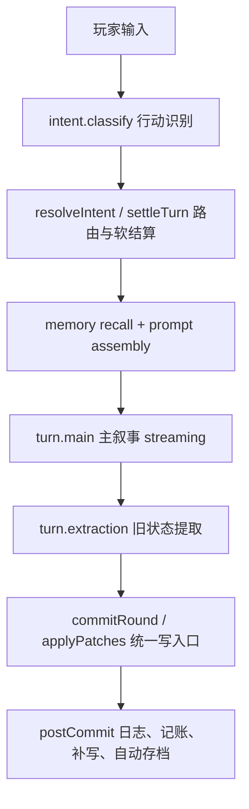
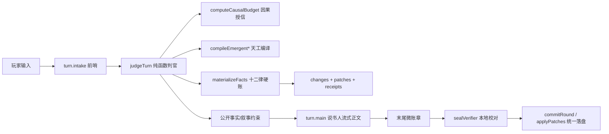

# AI 调用链架构说明（活文档）

> 本文是曲措乡「AI 调用线重构」的当前链路说明，不是历史设计稿。
> 凡是改动 AI 调用入口、回合管线、事实落盘、状态写入口、提示词冰山、结构化输出契约的 PR，都必须同步更新本文；否则视为 PR 不完整。
> 口径标记：**已落地** = main 已有代码；**基础已落地/未接主链** = 模块存在但还不是主回路；**施工中** = 有工单或 PR；**目标** = 尚未落地。

## 1. 一句话总纲

目标链路：**前哨听意 → 纯函数判官先定硬账 → 说书人流式写正文，末尾微账章 → 本地校对后统一落盘**。

核心分工：
- **系统定事实**：谁在场、有什么、能不能成、掉了什么、扣了多少，全部由确定性规则计算。
- **LLM 写叙事**：模型只负责把已定事实写得像江湖，不再凭 prose 决定数值。
- **账户先硬后软**：先产出可重放的事实账本，再让叙事对齐账本；正文末尾只允许微账章，不再用大段 hidden JSON 决定世界。

## 2. 当前 main 的真实链路

这条链路仍是线上主回路。前六期重构已经放进了若干新地基，但「判官先定硬账」尚未替换旧状态提取。

## 3. 已落地地基

| 模块 | 状态 | 说明 |
|---|---|---|
| `withAI` 单一调用网关 | 已落地 | 新调用必须 `definePrompt` 注册后走 `src/engine/ports/withAI.js`，不允许散调 `callModel`。 |
| 原生结构化输出 | 已落地 | OpenAI/Gemini/Anthropic 各有原生 schema 通道；`intent.classify`、软结算、劝服、锻造设计已接入。开放对象在 strict 通道回退 `json_object`，但本地 schema 校验仍跑。 |
| 流式与缓存观测 | 已落地 | Gemini 原生 SSE；OpenAI/Anthropic/Gemini 都采集 token/cache 命中；dev proxy 逐块转发。 |
| 冰山提示词 | 已落地 | `turn.main` 分成稳定前缀 `sysBlocks` 与动态聊天材料，稳定部分不因房间/人物/好感变化而改写。 |
| 场记板 Clapboard | 已落地 | 事实条目有实体 ID、类别、见证者、`rawText/publicText` 双文本；NPC 只能看见自己见证过且允许公开的内容。 |
| 体感态势与活人切片 | 已落地 | `@体感态势` 把气血/内外功/衣装/钱袋转成感官描述；`@在场活人切片` 按 NPC 分块写性情、状态、所见。 |
| 因果授信 CausalBudget | 已落地 | `computeCausalBudget` 按张力、风险、代价、交情、气运、支线高潮和每日搜刮额度算 T0–T3/GM。阈值为本实现自定刻度。 |
| 天工铸物/原型创招 | 已落地 | `compileEmergentItem`、`compileEmergentSkill` 把授信额度编译成可进战斗/背包的真实物品与武学；越界词条物理驳回。 |
| 首字超时兜底 | 基础已落地/未接主链 | `streamWithFirstTokenFallback` 支持插入过渡行、首字抵达原位替换、超时静默降级；主循环接线属于后续工单。 |
| 十二律落盘引擎 | 基础已落地/未接主链 | `materializeFacts` 已把十二类事实码编译成 `changes/patches/receipts/logs`；尚未进入主回路，接线属于后续主循环工单。 |
| 前哨 intake + 判官 | 基础已落地/未接主链 | 契约 B、`turn.intake` 与 `judgeTurn` 已落地；尚未接入主回路，切换属于后续主循环工单。 |

## 4. 目标链路分层

### 4.1 前哨听意

职责：把自然语言整理成结构化的行动意图，不做世界裁决。它是 LLM 与系统之间的第一道翻译。

已落地部分：`intent.classify` 原生 schema 已能稳定输出行动数组；候选合法性仍由本地 recognizer 校验。

### 4.2 判官先定硬账

职责：在写正文前确定本轮硬事实，输出 `JudgeVerdict`：事实列表、可公开材料、叙事约束、编译凭证引用。

关键约束：
- 判官必须纯函数：同一 `(state, facts/intent, warrants)` 输入必得同一输出。
- 判官不直接写 store，只产出账本。
- 授信额度、可掉品质、能否赐武学、能否洗髓，先由 `CausalBudget` 卡住。

### 4.3 十二律事实落盘

十二律是系统承认的世界事实操作集合。当前定义以工单为准，覆盖：授物、转移、重铸、授技、修行、七维、气血银两因果业障、状态、人情、契约、伙伴、场景。

`materializeFacts(state, facts, compiledWarrants)` 输出：
- `changes`：状态切片直写，走统一 changes 入口。
- `patches`：`varTree/companionState` 等深写指令，走 `applyPatches`。
- `receipts`：装备/丹药/武学卡所需的落账回执。
- `logs`：给日志层的短句。

### 4.4 说书人写正文

职责：只吃公开事实和叙事约束，写玩家看得见的正文。不能再靠散文里的描述倒推数值。

目标：正文 streaming，末尾带 `---SEAL---` 微账章。微账章只列已经由判官确定的账目引用，不允许新增世界事实。

### 4.5 本地校对后统一落盘

`sealVerifier` 将检查：正文宣称的事实是否有账、账目是否越授信、微账章是否和事实账本一致。校对通过后才统一写入 `commitRound/applyPatches`。

## 5. 当前旧新链路边界

| 位置 | 现状 | 迁移方向 |
|---|---|---|
| 主叙事 | `turn.main` streaming | 保留，但输入改成判官公开事实与叙事约束。 |
| 状态提取 | `turn.extraction` 从正文提取 JSON/MVU | 降级为兼容层，最终删除。 |
| MVU 文本命令 | 仍有大量历史消费方 | 只保留必要字段协议，不再让 AI 自由写状态。 |
| 账本写入 | `commitRound` + `applyPatches` | 保留统一写入口，新增事实账本先编译后提交。 |
| 结算回合 | 多数功能先改系统值再让 AI 补描写 | 全部过渡到「事实行先落、正文后补」。 |

## 6. 已确认的设计取舍

这些是实现时对手册字面的修正，后续文档与代码都应按这里的口径，不再按旧稿字面理解：

1. **劝服输出**：从「台词一行 + 末尾 JSON」改成单个 JSON；schema 强制下旧格式无法稳定成立。
2. **开放对象 schema**：OpenAI strict 不接受开放键对象；锻造等开放对象走 `json_object` 回退，但本地校验仍强制执行。
3. **图鉴物 ID**：用 `it_cat_<hash>`，不用拼音；`prep_seed` 用 `prep_<状态版本>_<序号>`。
4. **房间缓存**：内存状态叫 `roomCache`，存档兼容仍写旧 `roomMap` 键。
5. **送礼**：叙事硬文案改为按性格和礼物分量自然反应；底层送礼好感正增长数值规则暂未放开。
6. **CausalBudget 数值**：T1/T2/T3 阈值、每日搜刮封顶 3、好感/气运权重是当前实现刻度，手册未给精确数。
7. **内功/轻功 passiveBonus**：品阶数值表按现有武学中位数自定。
8. **契约了结**：打 `settled` 标记留档，不删除原契约。

## 7. 维护钩子

改以下内容时，必须在同一 PR 更新本文：

- `src/engine/ports/withAI.js`、`src/infra/providers.js`、`src/infra/apiTransport.js`
- `src/domain/rules/prompt/calls/`、`src/domain/rules/prompt/sysBase.js`
- `src/engine/intent/`、`src/engine/turn/`、`src/engine/act/`
- `src/domain/rules/judge/`、`src/domain/rules/effects/`、`src/domain/rules/clapboard/`
- `src/domain/rules/state/applyPatches.js`、字段声明或写入口语义
- 新增/修改十二律事实码、契约 B、TurnEnvelope、ClapboardEntry、receipt 结构

更新要求：
- 先改「当前 main 的真实链路」或「已落地地基」状态，再改目标图。
- 不写愿望当事实；未合入 main 的只能标「施工中」或「基础已落地/未接主链」。
- 设计稿和代码冲突时，在「已确认的设计取舍」里写清楚采用哪边。
- 文档可以用文字、表格、Mermaid 图或 LLM 可读契约片段，但必须落在仓库里，不能只留在会话记录。
