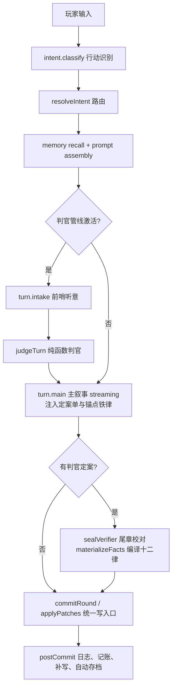
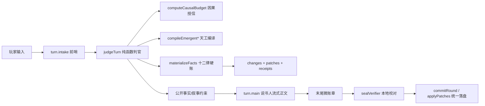
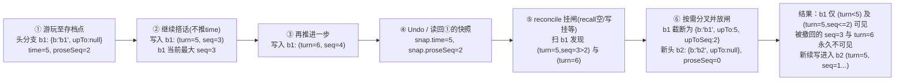

# AI 调用链架构说明（活文档）

> 本文是曲措乡「AI 调用线重构」的当前链路说明，不是历史设计稿。
> 凡是改动 AI 调用入口、回合管线、事实落盘、状态写入口、提示词冰山、结构化输出契约的 PR，都必须同步更新本文；否则视为 PR 不完整。
> 口径标记：**已落地** = main 已有代码；**基础已落地/未接主链** = 模块存在但还不是主回路；**施工中** = 有工单或 PR；**目标** = 尚未落地。

## 1. 一句话总纲

目标链路：**前哨听意 → 纯函数判官先定硬账 → 说书人流式写正文，末尾微账章 → 本地校对后统一落盘**。

核心分工：
- **系统定事实**：谁在场、有什么、能不能成、掉了什么、扣了多少，全部由确定性规则计算。
- **LLM 写叙事**：模型只负责把已定事实写得像江湖，不再凭 prose 决定数值。
- **账户先硬后软**：先产出可重放的事实账本，再让叙事对齐账本；正文末尾只允许微账章，不再用大段 hidden JSON 决定世界。

## 2. 当前 main 的真实链路

WO-15 起这就是线上主回路：**旧状态提取层（turn.extraction/extractionSpecs/extractionEngine/appeaseExtraction）与独立软结算通道（settleTurn/runSoftSettle/softRules/settle.judge）已整块删除**。`judgePipelineEnabled` 开启时，`turn.intake` 前哨听意 → `judgeTurn` 纯函数判官 → 定案单与锚点铁律注入主叙事 → 流式剥 `⟦F⟧` 锚点、`---SEAL---` 尾章校对 → `materializeFacts` 经 `commitRound` 落盘。双调用模式下不再有第二次"从叙事反推状态"的提取调用——自由行动状态只来自判官 facts；settle 回合状态靠 feature 前置硬结算。单调用 JSON 老路（extractionEnabled=false）仍保留到 WO-16。

**当前真实覆盖率**：web 端 `judgePipelineEnabled` 默认 `true`；原 CLI 入口与 `tests/cli/` 回放 fixture 已退役删除（单调用 JSON 老路仅剩显式配置/测试/紧急回退兜底）。激活还需同时满足两个条件——**非 settle 回合**（settle 回合状态在进叙事前已由 feature 层硬结算落账——giftNpc 已扣货、learnNpcSkill 已扣束脩授业、inviteCompanion 已写 companionState，判官再裁会双重结算）且 **`extractionEnabled` 双调用叙事模式**；WO-16A 起纯搭话回合也进判官，但 `envelope.talkOnly` 白名单只许产小额社交事实——give/take/inspect_container/learn 等硬事实整条拦截，不会因搭话误搬物品；任一不满足，新管线不激活、整链 no-op。WO-15 删除的只是「独立软结算通道」（AI 事后裁好感/收拒），feature 前置硬结算不在删除范围；settle 回合开放判官须等后续工单把前置硬写改成「事实请求先裁后落」。场记板 entries、容器坍缩态、备料物、悬空道具尚无宿主系统喂入（属 WO-17/18/22/24），判官多数回合签出空 facts。**WO-16A 替代覆盖后剩余过渡缺口**：respondedNpcs 已改系统推导（intake 听意单 talk target，SEAL 仅推导为空时兜底、低可信不得用于 pact 自证）；memory 已改系统模板串入账（facts 首条模板/搭话「玩家对X说」截断，无 AI 摘要）；搭话好感经 stance 确定性映射走系统好感账本。仍缺：mentionedNewNpcs 新 NPC 传闻注册（待 WO-17 场记板宿主）、判官 inactive 时全部零落账。原文段落记忆库归 WO-17。

**WO-15 保留边界（如实声明）**：
- `forgeDesign`（铸剑坊/金玉行定制设计）不属提取层，已迁入独立小文件 `src/engine/ports/forgeDesign.js` 保活。
- 旁白私语好感裁决（原 narrator_affinity 软结算）不走回合判官管线（私聊是独立流程），已改写为独立结构化调用 `narrator.affinity`：AI 只做三选一分类（投机贴心/寻常闲聊/敷衍冒犯），数值映射、幅度裁剪、日上限账本全部在系统侧（usePrivateTalk）。
- `buildExtractionCfg` 实为所有结构化小调用共用的 cfg 构造器，迁至 `src/domain/rules/prompt/structuredCallCfg.js` 存续（名称未改，供记忆召回/前哨听意/锻造设计等使用）。
- 单调用 JSON 模式（extractionEnabled=false，CLI 回放默认）不受本工单影响，parseResponse 链路留待 WO-16。
- **WO-16A 判官替代覆盖层（已补三项，余两项留宿主）**：
  - 搭话开闸：纯搭话回合进判官但 `talkOnly` 白名单只产小额社交事实（stance 确定性映射 sincere+2/clever+1/casual+1/forceful-1/perfunctory 不产事实，未知按 0），give/take/inspect_container/learn 等硬事实整条拦截不搬物品。
  - 好感落账统一走系统账本语义（复用 WO-16B 已合并的 `domain/rules/state/affection.js`）：魅力修正、0-100 clamp、每日 +12、无好感轨道整条事实跳过（含心账）；负向增量不经日涨上限但也做 clamp 与轨道跳过。
  - respondedNpcs 系统推导（intake 听意单 kind=talk target）永远优先；SEAL/单调用 JSON 的模型自证仅在推导为空时兜底，属低可信过渡，不得用于 pact 自证。
  - memory 过渡：判官 facts 首条模板串/纯搭话「玩家对X说：原文≤30字」系统模板入账，无 AI 摘要；原文段落记忆库归 WO-17。
  - 拾取：地上拾取全在 feature collectGranted 确定性通道，判官 take 不产 GRANT_ITEM（测试钉住防重复入包）；移动途中的掷骰拾取由 WO-16C 条件券通道接管（见状态板）。
  - **仍缺的过渡缺口**：①mentionedNewNpcs 新 NPC 传闻注册（待 WO-17 场记板宿主）；②判官 inactive 的双调用回合仍整体零落账。
- **appease 窄过渡补洞**：赔罪在 feature 层无前置硬结算，软结算删除后无人裁消气。双调用模式补窄结构化小调用 `turn.appease`（非软结算复活、不可扩展注册表）：AI 只三选一（奏效/未奏效/无法判断），奏效由系统钉死注入 `生气解除=true`+`好感度+3` 走既有 mvu 消费链；未奏效/无法判断零写入；settle 判官闸门不受影响、其余 settle 类型不触发；单调用模式不调（主模型 MVU 尾巴仍处理），WO-16 统一清。
- CLI 回归集适配结果：全部 CLI fixture 录制于单调用模式（`extractionEnabled:false`），本来就绕开被删链路；`softSettleEnabled` 开关已随通道删除（设置 UI、apiConfig 默认值、CLI 参数同步移除），3494 项测试全绿、零跳过。

## 3. 已落地地基

| 模块 | 状态 | 说明 |
|---|---|---|
| `withAI` 单一调用网关 | 已落地 | 新调用必须 `definePrompt` 注册后走 `src/engine/ports/withAI.js`，不允许散调 `callModel`。 |
| 原生结构化输出 | 已落地 | OpenAI/Gemini/Anthropic 各有原生 schema 通道；`intent.classify`、`narrator.affinity`、劝服、锻造设计已接入。开放对象在 strict 通道回退 `json_object`，但本地 schema 校验仍跑。**strict 静态门禁**：`scripts/checkStrictSchemas.mjs` 接入 verify:fast——走 strict 通道的 schema 每层 properties 键必须全入 required、禁止联合类型（`["string","null"]` 式可选一律改空串/枚举哨兵，如 persuasion.hit 用 `""` 表未命中）；`strictCompatible:false` 仅限开放词条对象（forge.design）显式豁免，不得作默认逃避；含 `definePrompt("call")` 的模块清单门禁自检，新模块漏登记直接失败。 |
| 流式与缓存观测 | 已落地 | Gemini 原生 SSE；OpenAI/Anthropic/Gemini 都采集 token/cache 命中；dev proxy 逐块转发。 |
| 冰山提示词 | 已落地 | `turn.main` 分成稳定前缀 `sysBlocks` 与动态聊天材料，稳定部分不因房间/人物/好感变化而改写。 |
| 场记板 Clapboard | 已落地 | 事实条目有实体 ID、类别、见证者、`rawText/publicText` 双文本；NPC 只能看见自己见证过且允许公开的内容。 |
| 体感态势与活人切片 | 已落地 | `@体感态势` 把气血/内外功/衣装/钱袋转成感官描述；`@在场活人切片` 按 NPC 分块写性情、状态、所见。 |
| 架构说明 CI 门禁 | 已落地 | `npm run docs-gate` 在 CI 前置执行；改动调用链关键文件而未同 PR 更新本文会失败。 |
| 因果授信 CausalBudget | 已落地 | `computeCausalBudget` 按张力、风险、代价、交情、气运、支线高潮和每日搜刮额度算 T0–T3/GM。阈值为本实现自定刻度。 |
| 天工铸物/原型创招 | 已落地 | `compileEmergentItem`、`compileEmergentSkill` 把授信额度编译成可进战斗/背包的真实物品与武学；越界词条物理驳回。 |
| 首字超时兜底 | 基础已落地/未接主链 | `streamWithFirstTokenFallback` 支持插入过渡行、首字抵达原位替换、超时静默降级；主循环接线属于后续工单。 |
| 十二律落盘引擎 | 已接主链/只承判官事实 | `materializeFacts` 已把十二类事实码编译成 `changes/patches/receipts/logs`，经 `finalizeTurn → commitRound` 统一落盘；`receipts` 挂到落账日志项。WO-15 起它承接判官管线签出的事实，是双调用模式唯一状态落账来源。 |
| 前哨 intake + 判官 + 锚点尾章管线 | 已接主链/常 no-op 退化 | 契约 B `turn.intake`、`judgeTurn`、`storytellerStream` 锚点剥离、`sealVerifier` 尾章校对、`materializeFacts` 落盘已全部接入 `runTurn`/`commitRound`；web 默认开、CLI 回放默认关；激活另需非 settle/非纯搭话回合 + extractionEnabled 双调用叙事模式，否则不激活。entries/containers/prepItems/floatingItems 无宿主喂入，多数回合签空 facts 退化运行。 |
| NPC 传闻/涌现过渡复接 | 已接主链（过渡方案） | SEAL 扩可选键 `mentionedNewNpcs`/`emergedNpc`；`validateEmergenceSeal` 五路校验（正文出现/玩家名/同伴雪豹/驻场册/已有传闻）；合法项接回 `p` 由 recordRumors/materializeEmergence/fixateNpcs 原管线接管，数值仍系统侧定量。判官裁登场（工单丁）等 WO-17。 |
| 任务推进扩展律 ADVANCE_QUEST | 已接主链（B1） | intake `quest_advance` 提议 + judgeTurn 白名单（候选仅系统 `questAdvanceCandidates` 生成）+ materializeFacts 写 flags；推进/奖励由 `questFlagRule` 接管。判官双调用不再要求模型吐 flags_add 任务旗。 |
| 雪豹灵性确定性结算 | 已落地 | 挠痒/自由喂食/送药/送礼肉食全部由系统判定发旗（resolveSnowInteraction 自由文本保守识别：否定/假设/询问不误触发、无肉不触发、flag 幂等），filterSnowModelFlags 剥除模型输出全部 snow 旗——无双通道。 |
| settle 社交好感硬结算 | 已落地 | 送礼/送银/求教/邀同行的好感增量由 feature 确定性写入（系统账本语义：魅力修正/每日 +12 上限/0-100 clamp/无好感轨道跳过），模型只写叙事不写好感 MVU。 |
| 天机落账卡 UI | 已落地/动作结构化直写 | `EffectReceiptCard` 消费 `receipts` 渲染落账条；按钮派发结构化 action（itemId/skillId/factId/op/kind），经 NarrativeLogFeed 原样透传进 `act`，useTurn 在 intent 识别前的系统边界按 id 寻址确定性幂等执行（features/receipts/logic，equip/activate 为 explicit-on 语义），行动识别关闭同样生效，写账走 applyResult 统一边界。例外：`viewPact` 无结构化面板入口，保留文本指令。 |

## 4. 目标链路分层

### 4.1 前哨听意

职责：把自然语言整理成结构化的行动意图，不做世界裁决。它是 LLM 与系统之间的第一道翻译。

已落地部分：`intent.classify` 原生 schema 已能稳定输出行动数组；候选合法性仍由本地 recognizer 校验。

### 4.2 判官先定硬账

职责：在写正文前确定本轮硬事实，输出 `JudgeVerdict`：事实列表、可公开材料、叙事约束、编译凭证引用。

关键约束：
- 判官必须纯函数：同一 `(state, facts/intent, warrants)` 输入必得同一输出。
- 判官不直接写 store，只产出账本。
- 授信额度、可掉品质、能否赐武学、能否洗髓，先由 `CausalBudget` 卡住。

### 4.3 十二律事实落盘

十二律是系统承认的世界事实操作集合。当前定义以工单为准，覆盖：授物、转移、重铸、授技、修行、七维、气血银两因果业障、状态、人情、契约、伙伴、场景。

**任务推进扩展律 `ADVANCE_QUEST`（十二律外的显式扩展，B1）**：十二律没有任务状态机语义，复用 APPLY_CONDITION 的 buff 旗或 ALTER_WORLD_SCENE 的场景键都会造假——任务旗是任务状态机的唯一合法输入。ADVANCE_QUEST 的形状 `{op, questId, flag, questTitle, witnesses}`：intake 以 `quest_advance` proposal 提议（questId/flag 只能抄系统现场生成的候选——两键为 strict 全 required 必填，非 quest_advance 提议一律填空串、空串视同未填；候选见 `questAdvanceCandidates`，口径与任务面板同源：requireLocation 锚定只看地点不看 giver、无锚点有 giver 才要在场、无锚点无 giver 走 stage.at；deliver 收件人在场+实物在包/collect 齐件/gate open/choices 默认不候选（script 模式非全战斗例外，combat 抉择旗与前提未开分支旗永不进候选）；「这里」判定与任务面板同源含 deliver 收件人在场支线/localOnly 与雪豹排除）；judgeTurn 只做白名单核验（questId+flag 必须命中本轮候选，自编/提前阶段/错地点安静丢弃）；`materializeFacts` 只把 flag 写进 flags——阶段推进/奖励/交付扣件全部由 `questFlagRule` 世界规则扫描 flags 自动接管，判官与落盘引擎都不直接碰 questProgress。判官双调用模式下 roundNotes 不再要求模型往 flags_add 吐任务旗（提示与现实矛盾）；单调用老路不变。

`materializeFacts(state, facts, compiledWarrants)` 输出：
- `changes`：状态切片直写，走统一 changes 入口。
- `patches`：`varTree/companionState` 等深写指令，走 `applyPatches`。
- `receipts`：装备/丹药/武学卡所需的落账回执。
- `logs`：给日志层的短句。

### 4.4 说书人写正文

职责：只吃公开事实和叙事约束，写玩家看得见的正文。不能再靠散文里的描述倒推数值。

目标：正文 streaming，末尾带 `---SEAL---` 微账章。微账章只列已经由判官确定的账目引用，不允许新增世界事实。

### 4.5 本地校对后统一落盘

`sealVerifier` 将检查：正文宣称的事实是否有账、账目是否越授信、微账章是否和事实账本一致。校对通过后才统一写入 `commitRound/applyPatches`。

## 5. 当前旧新链路边界

| 位置 | 现状 | 迁移方向 |
|---|---|---|
| 主叙事 | `turn.main` streaming | 保留，但输入改成判官公开事实与叙事约束。 |
| 状态提取 | **已删除（WO-15）** | `turn.extraction`/extractionSpecs/extractionEngine/appeaseExtraction/ports/extraction 整块移除；双调用模式状态只来自判官 facts。 |
| MVU 文本命令 | 仍有大量历史消费方 | 只保留必要字段协议，不再让 AI 自由写状态。 |
| 账本写入 | `commitRound` + `applyPatches` | 保留统一写入口，新增事实账本先编译后提交。 |
| 结算回合 | 软结算通道已删（WO-15） | settleTurn/runSoftSettle/softRules/settle.judge 整块移除；feature 前置硬结算（扣货/授业/入队）保留并继续排除判官。旁白私语好感走独立 `narrator.affinity` 调用。 |

## 5.1 关键契约速查

### 契约 B：`turn.intake` 听意单

形状冻结：`{ read, refIds, actions, proposals }`。
- `read`：不超过 40 字，拆清代词与意图核心。
- `refIds`：玩家援引的场记板条目 ID。
- `actions[]`：`kind/target/itemId/direction/stance`；kind 为封闭枚举，direction 为 `n/s/e/w/none`。
- `proposals[]`：玩家声称可促成的发现或交易，`fit` 分 `natural/stretch/absurd`。

原则：小模型只选择系统喂入的候选，不允许自造 ID；`normalizeIntakeResult` 不合形制就降级为空听意单。

### 契约 C：`JudgeVerdict` 判官定案单

形状：`{ causalTier, pacingWords, facts, warrants, allowSpontaneousPact, reactionGuides, notes, budget }`。
- `facts[]`：十二律铁案，ID 形如 `F<turn>_<seq>`。
- `warrants[]`：空白天机券，ID 形如 `W<turn>_<seq>`，只给额度、品类、来源，不给最终名字。
- `reactionGuides[]`：按 NPC 拆知情/不知情反应约束。
- `budget`：`maxQuality/maxPointBudget/remainingDailyQuota`。

### 尾章：`---SEAL---` 微账章

正文 streaming 中事实锚点写作 `⟦F42_1⟧`，上屏前剥除；检测到 `
---SEAL---` 后屏幕冻结，后续只进尾章缓冲。尾章 JSON 只负责填空：`fills`、可选 `spontaneousPact`、可选 `respondedNpcs`。它不能新增未经判官裁定的事实。

### 落账四件套

`materializeFacts` 只输出，不直接写 store：
- `changes`：背包/房间/角色/武学/修为等切片；
- `patches`：好感、契约、伙伴、场景等深写 patch；
- `receipts`：UI 落账卡数据；
- `logs`：事实短句。

`commitRound` 是唯一统一提交点；`companionState` patch 必须走 `setCompanionState`，不能静默丢弃。

## 5.2 当前施工状态看板

| 工单 | 状态 | 当前事实 |
|---|---|---|
| WO-01～WO-12 | 已合并 | 地基、场记板、因果授信、编译器、十二律、前哨判官都在 main。 |
| WO-13 | 已合并 | web 默认 `judgePipelineEnabled=true`；CLI 老录制默认 false。激活还需非 settle、非纯搭话且 `extractionEnabled` 双调用叙事模式。因 entries/containers/prepItems/floatingItems 还没宿主喂入，很多回合会 no-op 退化，不能当成旧提取已替换。 |
| WO-14 | 已合并；动作结构化直写随修包落地 | `EffectReceiptCard` 消费 receipts 并随判官落账日志显示；按钮结构化 action 按 id 寻址确定性执行，equip/activate 幂等 explicit-on；`viewPact` 保留文本指令例外。 |
| WO-15 | 本 PR | 旧提取层与独立软结算通道整块删除；forgeDesign 迁出保活；旁白私语好感改走 narrator.affinity；appease 走 turn.appease 窄过渡仲裁；settle 维持排除判官；CLI 回归集适配全绿。 |
| WO-16B | 已合并 | settle 社交好感（送礼/送银/求教/邀同行）前移到 feature deterministic 硬结算：`systemAffectionDelta/systemAffectionPin`（domain/rules/state/affection）按 giftRange/weight/preferLabel/learnRange/companion.example 定增量，保留魅力修正、0-100 clamp、每日 +12 上限、无好感轨道跳过；不再由判官或 AI 自由裁定。提示词对 gift/learn_skill/companion_invite 已禁写好感 MVU，commitRound 拦截模型乱写防双计；appease 仍走 turn.appease 窄仲裁过渡。 |
| WO-16 | 破坏性删除包搁浅 | 单调用/CLI 整体暂存 WIP 分支（devin/1795596800-wo16-single-call-delete），不开 PR；硬删会打穿主游戏，待覆盖层补齐后重估。 |
| WO-16A | 已合并 #445 | 判官替代覆盖层：搭话开闸白名单、respondedNpcs 系统推导、memory 模板串过渡、判官 MUTATE_SOCIAL 好感走统一系统账本语义（复用 WO-16B affection.js）；不删旧路纯增量。 |
| WO-16C-pickup | 已合并 #446 + #447 修包 | 移动拾取判官替代层：rollMovementEvents 掷中后判官只签条件券（quality/category 系统锁定、pointBudget=0 无词条保持旧行为），不进 facts；正文埋 ⟦F⟧ 锚点+尾章 fill 双证据齐备才由 sealVerifier 合成 GRANT_ITEM fact 落包，缺一券作废零落账（叙事可拒捡，系统绝不硬塞）。判官模式下 commitProposalWrites 不再保底发放/打误导 trace；单调用旧路 delta.items_add 原样保留。合并后 Review 修包：①条件券撞图鉴名不做 substitution（数值按 warrant 锁定、noCatalog 盾防读档回填、id 按 warrant 派生不撞重放）；②路遇拾取 memory 改用落盘回执作事实源（verdict 刻意无 facts 不漏记）；③sysBase narrativeOnly 判官路放行 ---SEAL--- 尾章（修「禁输出JSON」与判官铁律打架），判官不在时原样。 |
| WO-17 | 已合并 | 正文按段切分器+他人斜体心理剥离+老存档迁移器：proseChunker 产契约 A ProseChunk（witnesses/location/turn 全系统来源），stripOtherInnerThoughts 按邻近归属证据剥 *斜体心理*（拿不准保留）；qucuo_memory 统一升 v2 新增 prose_chunks（memoryDb.js 共享开库，memories 原表不动）；migrateLegacyConvoAndNotes 幂等无损迁移 convo/小纸条；memoryEval.mjs 封存评测小纸条 40% vs 原文段落+邻段 100% 召回。**尚未接入主链路，写挂与检索归 WO-18**。 |
| WO-18 | 本 PR | 原文段落检索接主链路+时间线谱系：写挂在 commitRound 成功且未 stale 后由 finalizeTurn 派发（回滚叙事永不入库），同步 seq allocator 原子预留防同回合撞号；proseLineage/proseSeq 随快照存取，读档按需分叉（seq 粒度：turn>saveTime 或同 turn seq>快照proseSeq 才算未来，upToSeq 同回合边界，reconcile 带 gameEpoch 护栏+失败不分叉降级；迁移 seq 水位只升不降 mergeProseSeqFloor），无谱系老档建根分支+迁移入根；chunk branchId/显式 seq，IDB v3 branchId 索引；检索按谱系分支索引逐支取段不全库扫（非头 turn<upTo 或同 turn seq<=upToSeq/头 turn<=currentTurn/无 branchId 不可见；运行时无 lineage 宁可无召回，宽松路径测试显式 opt-in）+witnesses viewer 硬过滤；写库 rawText 保全文召回侧按 viewer 动态剥心理；纯本地词法召回与向量开关解耦；邻段池化连续合并；场记板「往事正本」（众人皆知/见证名单/〔刻骨〕），弱相关退「往事索引」单行。 |
| WO-22A | 本 PR | 容器坍缩最小竖切：房间内容表声明 containers（presetItems 剧本写死），varTree.世界.容器 懒初始化记账（merge patch 自动建层，旧档不炸）；判官 inspect_container 先查坍缩——已坍缩只有「翻不出新东西」，未声明容器不进三关，未定容器首翻无论结局（预设/备料/券/残页）翻完即记 COLLAPSE_CONTAINER 事实坍缩；前哨渲染「可翻找容器」只列未坍缩。悬空秘宝/契约留 WO-22B 不实现 |
| WO-16C-snow | 本 PR | 雪豹挠痒/自由喂食确定性替代层：feature 叙事前硬结算 + prompt 改「系统已结算/禁写旗」+ 模型 snow 旗全剥，无双通道。 |
| WO-16E | 本 PR | 因果授信接线+天机券品阶品类：budgetInput.js 纯函数装配八参（tension 读 encounter.factionKey 势力张力、riskLevel 动作兜底+前哨 risk 覆盖接口预留 WO-16G、costPaid 有形代价保守口径、targetAffection 社交目标好感、luck 气运、questClimax 末阶段候选、gm、dailyLootUsed 读 varTree.世界.每日搜刮跨日归零），runTurn 与 WO-16D shadow 同一入口不再硬编码 riskLevel:0；resolveWarrantQuality 掷骰定品阶（GM 红/配额尽白/fit+气运概率取 maxQuality 或降一档）替换固定白阶，inferCategoryFromClaim 图鉴→剥句壳→五级正则定品类（仓内合法类目 weapon/armor/accessory/misc，耗材即 misc）替换固定 misc；配额账由 materializeFacts 在统一边界落账，只有天机券编译入袋新品计数，预设/备料/悬空/兜底不占。 |
| WO-16D | 本 PR | PR-D1 影子对账执行器：单调用模式下 dev 环境并行跑判官影子，对比单调用真实落账 diff 与判官 facts 投影，量出判官覆盖率缺口。`shadowJudgeEnabled` 显式存储值优先，未设置时 dev server（MODE=development）默认 true、test/production/player 默认 false，不进设置 UI；只在 extractionEnabled=false 单调用跑，结果只进 trace/内存聚合，绝不写 gameStore/convo/log/prompt/IndexedDB。影子吃回合前快照、commit 成功且未 stale 后 fire-and-forget；stale/epoch 丢弃、异常静默。diff 按四类目（inv/flags/affection/npcs——钱币无独立玩家状态不虚构 diff），系统归因排除：焚卡消费件、room.npcs 系统改写链（恒 excluded）、首识好感播种；移动/时间天然不在类目字段。判官多用同一 taxonomy 投影对比，verdict 分 match/single_only（判官漏判缺口）/judge_only（判官会判但单调用没落）/excluded。TraceViewer 覆盖率展示归 PR-D2。PR-D2 已落地：🧭全流程日志每回合影子对账折叠段（逐类目 verdict 含 excluded 盲区明示）+ 当前 epoch 内存聚合块（turns/一致/漏判/多判/byCategory/盲区计数，读档换档按 epoch 隔离）；未开/未跑零渲染零噪音，不落盘不进 prompt。 |
| 清理 talk 死代码 | 本 PR | 清理 `pendingQuestBranch.mode === "talk"` 不可达分支（`commitFlags`/`roundNotes`/`useQuestPanel`；现存全部 `resolve: "talk"` 抉择均带 `persuade` 走结构化 `persuasion.turn`），`mode === "combat"` 与结构化说服及既有调用链契约本次行为不变。 |
| 放行指标观测 | 本 PR | 新增 `src/engine/ports/releaseMetrics.js`，在 `withAI("turn.intake")` 与 `runTurn` 尾章校对回执处按 `provider/model` 与 save `epoch` 内存聚合 schema/SEAL 合格率；dev-only，production 零噪音，不落盘、不进 prompt、不写 `gameStore`；`TraceViewer` 增加只读聚合区与 Markdown「复制报告」按钮。判官/容器/saves 逻辑本次行为不变。 |

## 5.3 原文段落记忆与时间线谱系（WO-18）

原文段落库（IndexedDB `qucuo_memory` v3 `prose_chunks` 表，带 `turn` 与 `branchId` 索引）由所有存档共享，因此必须用时间线谱系隔离读档/回滚分支，防止被撤回的未来段落或跨存档内容串入当前回忆。

### 1. 快照字段与分支坐标：`proseLineage`、`proseSeq`、`branchId`、`upTo`、`upToSeq`

- **`proseLineage`** 与 **`proseSeq`** 列入 `GAME_KEYS`（`src/store/slices/narrative.js`），随 `snapshotFromStore` / `buildSnapshot` 自动存取，并在 `useAutosave` 的 `applySnapshot` 中显式恢复（老存档无此字段时置 `undefined` / `0`，随后触发异步 reconcile 补建根分支）。
- **`proseLineage`**：按时间顺序排列的分支数组 `[{ b, upTo, upToSeq? }]`：
  - `b`（写入段落后记为 **`chunk.branchId`**）：分支全局唯一 ID（`newBranchId()` 生成），防止多个存档共用同一 IndexedDB 库时撞支串档。
  - **`upTo`**：`null` 表示当前正在写入的**活头分支**（head branch）；非头分支的 `upTo` 表示该分支被截断时的**最后可见回合号（含）**。
  - **`upToSeq`**：仅用于非头分支在 `turn === upTo` 边界回合内的序位封顶（含）；缺 `upToSeq` 的老分支兼容为 `turn <= upTo` 全段可见。
- **`proseSeq`**：当前头分支内已分配的最大段落序号。每次写挂在主线程同一 tick 内调用 `allocProseSeq(count)` 同步原子递增预留；老存档首读迁移后调用 `mergeProseSeqFloor` 保证水位只升不降；每次分叉切换到新头分支时 `proseSeq` 归 `0`。
- **读取可见性（`branchVisible` & `recallProse`）**：必须 `chunk.branchId` 命中 `proseLineage` 某分支（无 `branchId` 旧段及运行时无 `lineage` 均保守不可见，只有显式传入 `unscoped: true` 的测试路径才全库扫描）；非头分支需 `turn < upTo` 或 `turn === upTo && seq <= upToSeq`；头分支需 `turn <= currentTurn`。`recallProse` 按 `proseLineage` 中的各分支 `b` 经 `branchId` 索引逐支拉取，不再全库扫描。

### 2. 读档按需分叉与搭话同回合 `seq` 判定

- 无论是槽位读档/undo（`applySnapshot`）还是页面启动恢复（`useGameStartup`），都会异步执行 `reconcileProseLineageAfterLoad(snap, { epoch })`：
  - 若存档尚无谱系，先建根分支 `{ b, upTo: null }` 并通过 `migrateLegacyConvoAndNotes` 将既有 `convo` 与小纸条迁移入根分支，把迁移占用的序号高位计入 `migratedSeqHigh`（不把自身旧内容误当成未来）。
  - 接着取头分支 `getProseChunksByBranch(head.b)`，对比快照基准 `saveTime = Number(snap?.time) || 0` 与 `saveSeq = Math.max(snap?.proseSeq ?? 0, migratedSeqHigh)`：只有检测到**旧未来段**（`c.turn > saveTime`，或 `c.turn === saveTime && c.seq > saveSeq`）时，才调用 `applyProseLineageFork(saveTime, saveSeq)` 把原头截断并接新头分支；没有旧未来段则沿原头分支继续，不每次读档盲目分叉、不产生空分支。
- **为什么搭话回合必须看 `seq`**：搭话回合不推进 `time`（游戏时间保持不变）。若玩家在 `turn=5` 存档后又搭话并写入正文，随后点击回滚或读回该档，这条被撤回的搭话正文与快照处于同一个 `turn=5`。仅比较 `turn > saveTime` 无法发现同回合未来段，undo 对搭话会漏判并导致已撤回对话继续被召回；借助头分支内单调递增的 `seq`、快照 `proseSeq` 与截断上限 `upToSeq`，即可在 `turn === saveTime` 内精确区分快照前与快照后。

### 3. 并发与回滚防护：`gameEpoch`、`reconcile-pending` 闸门与提交后写挂

- **写挂只在 `commitRound` 成功后触发**：`finalizeTurn` 在 `commitRound` 事务落盘、等待微任务且确认 `!ctx.isStale?.()` 后，才用 commit 后的实时 `live.time`、`live.room` 与在场 NPC 重算上下文并 fire-and-forget 调用 `writeTurnProse`。被中断、报错或过期的回合不会写库，回滚正文不会进入记忆库。
- **`gameEpoch` 拦迟到写**：每次新开局或读档覆盖（`initGameStore` / `applySnapshot` → `markGameReplaced`）都会递增 `gameEpoch`。`turnContext` 捕获回合起始代次作为 `proseEpochGuard`，`writeTurnProse` 在最终 `addChunks` 落库前再核一次 `guard?.()`（`isGameEpochStale`），拦截因读档/换档产生的跨局迟到异步写入；`reconcileProseLineageAfterLoad` 每步异步恢复前后也同样校验 `stale()`，过时即静默放弃（读库/异常一律按不分叉降级，宁可少叉也不错叉）。
- **`reconcile-pending` 双重闸门**：`reconcileProseLineageAfterLoad` 入口即在 `proseStore` 挂起 `gate` Promise（`setProseReconcilePending(gate)`，`finally` 中凭同一 `gate` token 调 `clearProseReconcilePending(gate)` 防并发覆盖）：
  - **召回侧**：`recallProse` 见 `isProseReconcilePending()` 为真时保守返回 `[]`，防止分叉未定前把旧未来段串入正文。
  - **写挂侧**：`writeTurnProse` 异步体内先 `await waitProseReconcile()` 等闸门放行，再核代次、切分、`allocProseSeq` 与写库，避免新正文错写到即将被截断的旧头分支上。

### 4. `rawText` 不出库，召回时按 `viewer` 动态剥他人心理

- 落库 `ProseChunk` 在 `rawText` 中完整保留原文（`proseChunker` 仅剥 `⟦F…⟧` 锚点并保存 `anchorFactIds`），同时由系统侧固化 `witnesses`（搭话为 `[playerName, talkTarget]`，其余回合为 `[playerName, ...roomNpcNames]`）。
- 召回时先由 `filterVisibleChunks` 按时间线谱系与 `witnesses` 做硬过滤（未传 `viewer` 仅可见公共段 `["*"]`），再由 `visibleTextFor(chunk, viewer)` 调用 `stripOtherInnerThoughts(rawText, viewer)` **按当前 `viewer` 实时剥除他人的 `*斜体心理*`**（仅缺失 `rawText` 的老数据才降级使用 `publicText`），保证同段原文在不同视角下既不泄密也不丢失本人心理；随后按本地词法打分、`expandWithNeighbors`（同回合可见邻段 ±1 合并，原字拼接不改写）、近期对话去重与 `RECALL_BUDGET_CHARS = 1200` 预算装配进「往事正本」/「往事索引」。

### 5. Undo 分叉示意

## 6. 已确认的设计取舍

这些是实现时对手册字面的修正，后续文档与代码都应按这里的口径，不再按旧稿字面理解：

1. **劝服输出**：从「台词一行 + 末尾 JSON」改成单个 JSON；schema 强制下旧格式无法稳定成立。
2. **开放对象 schema**：OpenAI strict 不接受开放键对象；锻造等开放对象走 `json_object` 回退，但本地校验仍强制执行。
3. **图鉴物 ID**：用 `it_cat_<hash>`，不用拼音；`prep_seed` 用 `prep_<状态版本>_<序号>`。
4. **房间缓存**：内存状态叫 `roomCache`，存档兼容仍写旧 `roomMap` 键。
5. **送礼**：叙事硬文案改为按性格和礼物分量自然反应；底层送礼好感正增长数值规则暂未放开。
6. **CausalBudget 数值**：T1/T2/T3 阈值、每日搜刮封顶 3、好感/气运权重是当前实现刻度，手册未给精确数。
7. **内功/轻功 passiveBonus**：品阶数值表按现有武学中位数自定。
8. **契约了结**：打 `settled` 标记留档，不删除原契约。

## 7. 维护钩子

CI 有硬门禁：`npm run docs-gate` 会读取 PR 相对 base 的文件清单；只要改到下列 AI 调用链关键文件而没有同 PR 更新本文，`verify` 直接失败。门禁只看文件触碰，不能判断设计是否真的变化；若行为确实没变，也要在本文补一句「本次行为不变/仍按现有契约」。

改以下内容时，必须在同一 PR 更新本文：

- `src/engine/ports/withAI.js`、`src/infra/providers.js`、`src/infra/apiTransport.js`
- `src/domain/rules/prompt/calls/`、`src/domain/rules/prompt/sysBase.js`
- `src/engine/intent/`、`src/engine/turn/`、`src/engine/act/`
- `src/domain/rules/judge/`、`src/domain/rules/effects/`、`src/domain/rules/clapboard/`
- `src/domain/rules/state/applyPatches.js`、字段声明或写入口语义
- 新增/修改十二律事实码、契约 B、TurnEnvelope、ClapboardEntry、receipt 结构

更新要求：
- 先改「当前 main 的真实链路」或「已落地地基」状态，再改目标图。
- 不写愿望当事实；未合入 main 的只能标「施工中」或「基础已落地/未接主链」。
- 设计稿和代码冲突时，在「已确认的设计取舍」里写清楚采用哪边。
- 文档可以用文字、表格、Mermaid 图或 LLM 可读契约片段，但必须落在仓库里，不能只留在会话记录。
