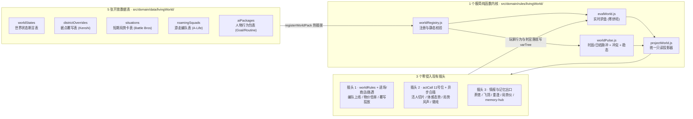

# 曲措乡 · 活世界架构设计（5 表 1 核 3 插头）与工单拆解（WO-25A ~ WO-25M）

> **范围与边界声明**：
> 1. **醉三江（`tavernSim`）暂搁置**，不纳入本系列工单范围；未来如需回接主世界，只需通过一张外部扩展包接入，不动本内核一行代码。
> 2. **绝不另造平行子系统**：完全复用并兼容既有主链底座，包括 `#685` 已合入的 [`src/domain/rules/npc/ocWander.js`](../src/domain/rules/npc/ocWander.js)（`varTree.世界.游走册` 持久定位与同内层房驻足锁）、`clapboard.js` 场记板、`npcAutoBattle.js` 纯函数战斗、`tension.js` 势力张力、`worldPrepRunner.js` 空档备料、`roamReactionBackfill.js` 原位白描及 `server/memory-hub` 云端同步。
> 3. **严守仓库红线（`AGENTS.md`）**：领域层 `domain/rules/` 100% 纯函数并用 `seededRand` 复现；所有状态写入只走 `applyResult` / `commitRound` 单一写边界；所有 AI 调用只走 `definePrompt` + `withAI`，异步回调必检 `isStale()` / epoch；超过 200 字的长中文提示词原文入 `src/copy/*.txt`；全系列不增加任何 `ratchet` 存量债务。

---

## 一、现状代码级断点审计（基于最新 `main`）

qucuo 的底层纯函数与反应式骨架已经非常扎实，世界迟迟没有“自己转起来”，根源不在缺引擎，而在以下五处代码级断点：

1. **活人底座造好却未通主电源，且存在字段错位**：
   - `src/domain/rules/state/fields.js:231-242` 已注册只读引用 `@体感态势` 与 `@在场活人切片`，`src/engine/act/actCall.js:198` 的注释也假定主叙事已携带二者。但 `src/domain/rules/prompt/promptRefs.js:40-41` 的 `MAIN_STATE_TEMPLATE` 并未引用这两项，非测试代码中 `renderNpcSoulFrames` 调用数为 0，主链也从未构造并传入 `clapboardEntries`。
   - `src/domain/rules/clapboard/npcSoulFrame.js:64` 仍在读取历史字段 `attrs?.旧账?.lines`，而全库现行账本字段早已统一为 `varTree.角色[name].心账`（由 `npcLedger.js` / `materializeFacts.js` 维护）。
2. **势力张力与 NPC 自动战处于零调用休眠态**：
   - `src/domain/rules/conflict/npcAutoBattle.js:88` 已实现确定性 1v1 / 2v2 纯函数战斗 `resolveNpcConflict`（含轻重伤与小兵阵亡），`src/domain/rules/conflict/tension.js:12-33` 已实现 `adjustTension` 与 `decayTension`。但非测试代码中这两组函数均无写入调用方，导致 `src/domain/rules/judge/budgetInput.js:57` 读取 `varTree.世界.tension` 时永远只命中静态基线 `BASE_TENSION`。
3. **传闻、事实、宿敌与备料各记一本账**：
   - `nemesisDaily.js` 与 `fakeDeadReturn.js` 写入 `varTree.世界.传闻`，目前仅 `src/ui/screens/buildings/TeahouseScreen.jsx:25` 读取；`knowledge.js` 的 `varTree.世界.知识领域` 仅在玩家当前房间内同框扩散，离开所在据点即信息停滞；`npcEmergence.js` 另看 `varTree.世界.传闻人物`；`prepSeeds` 的 `tavern_rumor` / `npc_plan` 只在本地缓存生效、随位置哈希变动即丢弃。
4. **个人游走已解决，但世界编队与人物社会网络仍缺席**：
   - `#685` 合入的 `ocWander.js` 通过 `varTree.世界.游走册` 解决了无固定据点 OC 冒险者跨据点游走、同内层房不跑路和十回合驻足锁的问题，但全图层面仍缺乏商队/巡哨编队、离线伤势与短期目标追踪、以及在场非同伴 NPC 之间的稀疏关系交互。
5. **缺少统一的“世界事件总线”与运行时派生态据点视图**：
   - 各界面与提示词直接深翻散落的 `varTree` 路径，导致新增一类动态事件或危机时必须同时修改规则、判官、写边界、提示词和 UI，难以低成本持续扩图扩玩法。

---

## 二、标杆沙盒机制取舍

参考 Kenshi（原版 FCS 及 Reactive World / Living World / Kaizo / UWE）、S.T.A.L.K.E.R. A-Life、Battle Brothers 与 Starsector，取其极简高可扩展的组合原语，同时用 qucuo 的纯函数优势避开原作缺陷：

| 机制来源 | 核心设计原语 | 在 qucuo 中的落地与改良 | 规避的坑 |
| :--- | :--- | :--- | :--- |
| **Kenshi FCS** | **World States + Town Overrides + Homeless Spawns + AI Packages** 四件套。据点不演过场变身，而是在玩家离境重返或跨日后，按匹配条件最多且优先级最高的覆写整包切换驻场与描述。 | 对应曲措乡 `QUCUO_MAP` 据点与 `residentNpcRule` 投放；**改为运行时纯函数实时求值，不往存档烤死覆写结果**。 | 彻底消除 Kenshi 加新 Mod 必须“导入存档”以及多 Mod 互踩变空城的顽疾；新扩展包对老存档即刻生效。 |
| **Kenshi 三大 Overhaul** | 兼顾三类演变方向：Reactive World 的**权力真空与接管**、Living World 的**废墟复兴与帮扶**、Kaizo 的**势力反制与巡防升级**，以及 UWE 的大扩展包拆分布局。 | 基于 `src/domain/data/map/factions.js` 既有 19 家势力与 `foes` 敌对关系表做成声明式数据。 | 学 Reactive World 在驿站放 World-State Checker 的做法，内置只读“江湖局势仪”，不让玩家对着暗门猜条件。 |
| **S.T.A.L.K.E.R. A-Life** | **离线/在线双态切换**。离玩家远去的编队退化为轻量数据包在地图节点间步进与结算冲突；进入玩家所在据点时无缝“上线”成为在场实体。 | 离线相遇直接调用既有 `resolveNpcConflict` 算结果；上线交给 `residentNpcRule` 与 `roam.js`。 | 离线推演限制在时辰/跨日脉冲，只把关键战果与变故记入事件录，避免高频率刷屏噪音。 |
| **Battle Brothers / Starsector** | **据点短期局势卡（Situations）+ 实体商队供需循环**。局势卡带有效期，商队在图上真实跑线，遇袭导致断货涨价，到站自动解除短缺。 | 用 2 到 5 天自动到期的短期局势卡承担经济与氛围波动，配合 `decayTension` 形成稳态负反馈。 | 防止无护栏的自由模拟在游戏前三天把弱势据点与中立势力全灭。 |

---

## 三、总体架构：5 张开放数据表 + 1 个纯函数内核 + 3 个现有插头

架构目标非常明确：**未来新增新势力、新商队、新据点结局、新地区危机，原则上只向数据目录加声明对象，不改引擎代码与主回合管线**。



### 3.1 5 张开放数据表契约（唯一内容扩展面）

所有开放数据置于 `src/domain/data/livingWorld/`，支持通过 `registerWorldPack(pack)` 注册独立地区扩展包。

1. **世界状态断言表（`worldStates`）**：
   只使用有限且可静态校验的内置谓词（`npcStatus`、`factionTensionGte`、`factionPowerLte`、`factionRepGte`、`districtOwner`、`flag`、`questDone`、`season`、`situationActive`），支持 `all` / `any` / `not` 组合：
   ```js
   {
     id: "ws_heifeng_weakened",
     label: "黑风寨元气大伤",
     when: {
       any: [
         { type: "npcStatus", npcId: "resident_basang", in: ["dead", "injured", "recruited"] },
         { type: "factionPowerLte", faction: "黑风寨", value: 35 },
       ],
     },
   }
   ```
2. **据点覆写表（`districtOverrides`）**：
   定义多条 `when` 世界状态同时成立时据点的替换方案；采用 Kenshi 式**匹配条件数最多优先、同数再比 `priority`、相同再按注册序**决胜，且仅在“离境重返或跨日”时切换驻场，绝不当着玩家面闪变：
   ```js
   {
     id: "ovr_yuquan_prosper",
     district: "玉泉寨",
     when: ["ws_heifeng_weakened", "ws_yuquan_allied"],
     priority: 10,
     patch: {
       ownerFaction: "玉泉寨",
       descAppend: "狼曲岸边新起了木栈，寨口不再剑拔弩张，马帮牵着驮牛往来不绝。",
       addResidents: ["pool_caravan_broker"],
       removeResidents: ["resident_heifeng_scout"],
       priceMod: { all: 0.92 },
       guardTier: 2,
     },
   }
   ```
3. **据点局势卡表（`situations`）**：
   描述持续 2 到 5 天的短期波动（危机/繁荣/封路/集市），自带过期时间与化解触发词：
   ```js
   {
     id: "sit_herb_shortage",
     label: "伤药紧俏",
     durationDays: 3,
     priceMod: { medicine: 1.3 },
     promptHint: "近来山道不靖、伤员增多，铺子里金疮药与草药格外紧俏。",
     rumorTemplate: "听说{district}那边伤药断了顿，一瓶金疮药卖到平日三成高。",
     resolveTriggers: ["caravan_arrived:medicine", "player_donate_herb"],
   }
   ```
4. **游走编队表（`roamingSquads`）**：
   描述真正在 `QUCUO_MAP` 外层节点间跑动的商队、巡哨、游骑与朝圣队伍（与 `#685` 的个人 OC `游走册` 互补，不重复个人游走）：
   ```js
   {
     id: "sq_chama_caravan",
     name: "康巴茶马帮",
     faction: "鱼定村",
     role: "caravan",
     cargo: "medicine",
     route: ["打箭炉", "鱼定村", "大草甸", "天都镇"],
     when: { not: ["ws_dajianlu_blockade"] },
     members: ["pool_caravan_leader", "pool_guard_1"],
     combatPower: 40,
     onArrive: { clearSituation: "sit_herb_shortage", boostPower: 2 },
     onDefeated: { addTargetSituation: "sit_herb_shortage", tensionDelta: 12 },
   }
   ```
5. **人物行为包表（`aiPackages`）**：
   只定义 6 到 8 种复用原型（`merchant` / `patrol` / `herbalist` / `ranger` / `bounty_hunter` / `sect_steward` / `injured_rest`），声明默认目标优先级、疗伤阈值和迁移偏好。

### 3.2 1 个纯函数内核（`src/domain/rules/livingWorld/`）

内核严格控制在 4 个文件、合计约 400 到 500 行纯函数，全量可测可复现：
- `worldRegistry.js`：热插拔扩展包合并 + 静态一致性校验（据点/势力/引用 ID/环检测）。
- `evalWorld.js`：纯函数实时计算 `activeStates`、`districtOverrides` 与势力战力。
- `worldPulse.js`：统一时钟脉冲（时辰推离线编队、跨日推局势衰减/张力回落/离线自动战/事件录按跳扩散）。
- `projectWorld.js`：单一只读投影器，给商店、进场、路遇、茶馆、飞鸽、备料和场记板提供同源数据视图。

### 3.3 存档增量约束（极轻 4 键）

只在 `varTree.世界` 下新增 4 个轻量可序列化键，不与 `#685` `varTree.世界.游走册` 重叠：
- `varTree.世界.事件录`：最近 80 条结构化 `WorldEvent`（含 `knownDistricts` 已扩散据点集合）。
- `varTree.世界.据点局势`：`{ [district]: [{ id, sinceDay, expireDay, sourceEventId }] }`。
- `varTree.世界.离线编队`：`{ [squadId]: { at, routeIndex, dir, hpRatio, cooldownUntil } }`。
- `varTree.世界.人物动态`：`{ [npcName]: { hpRatio, goal, targetDistrict, updatedTurn, edges } }`（仅记录偏离默认态的少量角色）。

---

## 四、细小工单拆解总表（WO-25A ~ WO-25M，共 13 单）

按“每个工单聚焦 1 到 3 个核心文件、可独立开 PR、独立通过 `verify:fast` 与 `ratchet`”的原则切分。

| 工单号 | 所属阶段 | 工单名称 | 前置依赖 | 预估体量 | 可否并行 |
| :--- | :--- | :--- | :--- | :--- | :--- |
| **WO-25A** | Phase 0 活人通电 | 修复 `npcSoulFrame` 心账/外观读取并建 `buildLivingClapboardEntries` | 无 | 小（~120 行 + 测试） | 与 WO-25C 并行 |
| **WO-25B** | Phase 0 活人通电 | `actCall` 11 号位动态区接入 `@体感态势` 与 `@在场活人切片` | WO-25A | 小（~80 行 + 快照） | 接在 WO-25A 后 |
| **WO-25C** | Phase 1 5+1底座 | `worldRegistry.js` 5 张表契约、`registerWorldPack` 与静态校验 | 无 | 小（~140 行 + 测试） | 与 WO-25A 并行 |
| **WO-25D** | Phase 1 5+1底座 | `evalWorld.js` 世界状态谓词求值与 Kenshi 式据点覆写裁决 | WO-25C | 小（~130 行 + 测试） | 可与 WO-25E 前半配合 |
| **WO-25E** | Phase 1 5+1底座 | `worldPulse.js` 离线编队/自动冲突/事件扩散/稳态护栏与 100 天模拟 | WO-25C, WO-25D | 中（~220 行 + 测试） | 顺接 WO-25D |
| **WO-25F** | Phase 1 5+1底座 | `projectWorld.js` 统一投影出口与只读「江湖局势仪」面板 | WO-25D, WO-25E | 中（~180 行 + UI） | 接在 WO-25E 后 |
| **WO-25G** | Phase 2 内容样板 | 曲措首批核心扩展包 `qucuoCorePack.js` 与 30 天剧本推演单测 | WO-25C~25F | 小（纯数据 + 测试） | 与 WO-25H 前期配合 |
| **WO-25H** | Phase 2 内容样板 | 进场编队上线、商店物价倍率、`budgetInput` 与 11 号位局势注入 | WO-25B, WO-25F, WO-25G | 中（~180 行 + 测试） | 顺接 WO-25G |
| **WO-25I** | Phase 2 内容样板 | 打通茶馆传闻、`worldPrepRunner` 与 `factionRep` 联动 `adjustTension` | WO-25F, WO-25G | 小（~120 行 + 测试） | 与 WO-25H 并行 |
| **WO-25J** | Phase 3 人物生活 | `aiPackages` 目标与伤势、`ocWander` 协同、重逢与飞鸽读真实事件 | WO-25E, WO-25F | 中（~200 行 + 测试） | 与 WO-25K 错开/后置 |
| **WO-25K** | Phase 3 人物生活 | 非同伴 NPC 稀疏关系边与同屋低频微互动异步白描 | WO-25A, WO-25J | 中（~160 行 + 测试） | 接在 WO-25J 后 |
| **WO-25L** | Phase 4 扩展闭环 | 雪域三宗与巴蜀门派纯数据扩展包热插拔 + 智谋/魅力接议价与打探 | WO-25G~25I | 小-中（数据 + 测试） | 与 WO-25M 并行 |
| **WO-25M** | Phase 4 扩展闭环 | 重大 `WorldEvent` 经 `proseUplink` 写入 `memory-hub` 编年史索引 | WO-25E, WO-25F | 小（~100 行 + 测试） | 与 WO-25L 并行 |

---

## 五、逐单详细执行规格

### Phase 0：活人通电（零新增 AI 调用，立刻提升人物质感）

#### WO-25A：修复 `npcSoulFrame` 心账/外观读取并建 `buildLivingClapboardEntries`
- **前置依赖**：无。
- **改动范围**：
  - `src/domain/rules/clapboard/npcSoulFrame.js`
  - `src/domain/rules/clapboard/livingEntries.js`（新建纯函数）
  - 对应单元测试 `npcSoulFrame.test.js` / `livingEntries.test.js`
- **核心契约与实现要点**：
  1. 将 `npcSoulFrame.js:64` 读取 `attrs?.旧账?.lines` 的错误路径改为复用 `normalizeLedgerEntries(attrs?.心账)`，按最近 2 条高权重恩怨渲染（保留原无记录兜底）。
  2. 引入 `deriveAppearance`（`npcContext.js`）提取显眼装束，以及读取可选 `varTree.世界.人物动态[name].hpRatio` 拼入当前伤势状态词。
  3. 新建纯函数 `buildLivingClapboardEntries({ varTree, visibleNpcNames, time })`，把现有 `varTree.世界.知识领域`、`varTree.世界.契约`、`varTree.世界.宿敌谱` 规范化输出为冻结的 `ClapboardEntry[]`（`kind` 严格取自 `CLAPBOARD_KINDS`）。
- **明确不做**：暂不接入 `actCall.js`（留给 WO-25B），不修改判官或写边界。
- **验收测试**：单测覆盖“有心账且有带伤/名器时渲染准确”、“非 `witnesses` 角色调用 `filterEntriesForViewer` 绝不泄密别人心理原文”。
- **护栏检查**：纯函数无 `infra/` 导入；如触及 `domain/rules/clapboard/`，同步更新 `docs/AI调用链架构说明.md` 状态行并过 `docs-gate`。

#### WO-25B：`actCall` 11 号位动态区接入 `@体感态势` 与 `@在场活人切片`
- **前置依赖**：WO-25A。
- **改动范围**：
  - `src/engine/turn/turnContext.js` / `src/engine/act/actCall.js`
  - `src/domain/rules/prompt/promptRefs.js`
  - `src/engine/act/__snapshots__/actCall*.snap`、`docs/AI调用链架构说明.md`
- **核心契约与实现要点**：
  1. 将 `@体感态势` 与 `@在场活人切片` 接入 `actCall.js:197-229` 的 11 号位 `inChatContent` 动态拼接区（放在 `rulesPrefix + dynPrefix + d.ctx` 段），**严禁放进 `sysBlocks` 前缀**以保护 Anthropic / Gemini 前缀缓存。
  2. `turnContext.js` 在组装提示词输入时调用 `buildLivingClapboardEntries` 注入 `clapboardEntries`；单调用/赌石轻量模式按既定开关保持瘦身不强塞。
  3. 控制 `@在场活人切片` 的 `entriesBudget`（单人默认 160 字、全屋总预算封顶），防止人多房间 token 膨胀。
- **明确不做**：不新增任何模型调用；不修改 `sysBlocks` 结构。
- **验收测试**：`actCall.test.js` 与快照测试验证前缀 `system` 字节完全不变、11 号位能输出玩家伤势/银两体感与在场 NPC 心账切片；`npm run verify` 与 `docs-gate` 全绿。
- **护栏检查**：若含任何超 200 字提示词文本改动必须入 `src/copy/*.txt` 过 `copy-gate`。

---

### Phase 1：5 张开放数据表 + 1 个纯函数内核 + 江湖局势仪

#### WO-25C：`worldRegistry.js` 五表契约、`registerWorldPack` 与静态校验
- **前置依赖**：无。
- **改动范围**：
  - `src/domain/rules/livingWorld/worldRegistry.js`（新建）
  - `src/domain/data/livingWorld/index.js`（新建空注册聚合入口 + 类型注释）
  - `src/domain/rules/livingWorld/worldRegistry.test.js`（新建）
- **核心契约与实现要点**：
  1. 定义 5 张开放表的规范结构与合并注册接口：`createLivingWorldRegistry()` 与 `registerWorldPack(pack)`，保证幂等注册与重名 ID 报错。
  2. 实现静态校验函数 `validateWorldPacks(registry)`：校验 `districtOverrides.district` 存在于 `QUCUO_MAP`、势力名存在于 `FACTION_NAMES`、引用的 `worldStateId` 全部已声明、无循环依赖、`situations.durationDays > 0`、`roamingSquads.route` 边连通。
- **明确不做**：不写具体曲措业务剧本数据（留给 WO-25G），不接入运行时规则。
- **验收测试**：单测覆盖合法扩展包加载、重名 ID 拒收、无效据点/势力/断裂路线报错。
- **护栏检查**：纯函数无副作用；`domain/` 不得导入 `infra/` 或 `ui/`。

#### WO-25D：`evalWorld.js` 声明式世界状态求值与 Kenshi 式据点覆写裁决
- **前置依赖**：WO-25C。
- **改动范围**：
  - `src/domain/rules/livingWorld/evalWorld.js`（新建）
  - `src/domain/rules/livingWorld/evalWorld.test.js`（新建）
- **核心契约与实现要点**：
  1. 实现内置谓词求值器 `evalPredicate(pred, state, ctx)`：`npcStatus`（复用 `varTree.世界.宿敌谱` 与 `人物动态`）、`factionTensionGte`、`factionPowerLte`、`factionRepGte`、`districtOwner`、`flag`、`questDone`、`season`、`situationActive`，支持 `all` / `any` / `not` 任意嵌套。
  2. 实现 `resolveDistrictOverride(district, activeStates, registry)`：筛选所有命中 `when` 的覆写，严格按 Kenshi 规则“匹配条件数量降序 -> `priority` 降序 -> 注册顺序”选出唯一胜出者，返回合并后的只读据点补丁。
  3. 明确**运行时求值语义**：不修改存档内固定拓扑 `QUCUO_MAP`，绝不烤死覆写结果进存档。
- **明确不做**：不做跨日脉冲推进，不碰 UI。
- **验收测试**：单测覆盖嵌套布尔逻辑、多覆写竞胜优先级（条件数更多者压过少条件高优先级者）、无命中时安全回落原据点。
- **护栏检查**：纯函数无 `Date.now` / `Math.random`。

#### WO-25E：`worldPulse.js` 离线编队、自动冲突、事件扩散与 100 天模拟
- **前置依赖**：WO-25C、WO-25D。
- **改动范围**：
  - `src/domain/rules/livingWorld/worldPulse.js`（新建）
  - `src/app/hooks/useWorldRulesRunner.js`（挂载 `livingWorldPulseRule`）
  - `src/domain/rules/livingWorld/worldPulse.test.js`（新建，含 100 天模拟压测）
- **核心契约与实现要点**：
  1. 编写 `stepLivingWorld(state, registry)` 纯函数（基于 `seededRand(state.time, ...)`），按两个节拍推进：
     - **时辰节拍（每 2 格）**：根据 `evalWorld` 结果激活/退场游走编队；每支编队沿 `route` 在 `QUCUO_MAP` 移动 1 步；敌对编队同节点相遇或动态张力 `>= 70` 时，抽样调用既有 `resolveNpcConflict` 结算离线胜负，结果写入 `人物动态.hpRatio`、势力战力及 `事件录`（`cap = 80`）。
     - **跨日节拍（每 24 格）**：移除过期 `据点局势`；调用 `decayTension` 向 `BASE_TENSION` 回落并执行势力战力稳态微恢复（防世界三天打死自毁）；将 `事件录` 沿 `QUCUO_MAP` 邻接边向外传播 1 跳（记录 `knownDistricts`）。
  2. 封装 `livingWorldPulseRule`（deps 监听 `Math.floor(time / 2)` 与关键状态），走 `applyResult` 的 `changes.varTree` 统一落盘，严守 `firstRun` 不补罚原则。
- **明确不做**：不碰具体商队/剧情数据包，不做 UI 展示，不改动 `npcAutoBattle.js` 核心算法。
- **验收测试**：100 天纯函数模拟单测跑通（同 seed 两遍字节一致，势力张力有起有落且不崩溃清零，事件录不超过 cap 80，冲突战果能产生有效局势卡与传播路径）。
- **护栏检查**：`ratchet` 全绿（`useWorldRulesRunner` 不新增直写债务）。

#### WO-25F：`projectWorld.js` 统一投影出口与只读「江湖局势仪」面板
- **前置依赖**：WO-25D、WO-25E。
- **改动范围**：
  - `src/domain/rules/livingWorld/projectWorld.js`（新建）
  - `src/ui/screens/LoreScreen.jsx`（或复用现有见闻录/调试页新增只读「江湖态势」标签页）
  - `src/domain/rules/livingWorld/projectWorld.test.js`（新建）
- **核心契约与实现要点**：
  1. `projectWorld.js` 对外提供 4 个干净的只读投影函数：
     - `getDistrictSnapshot(state, district, registry)`：返回生效覆写、活跃局势卡、品类物价倍率（钳制 `[0.80, 1.40]`）、当前在此节点的离线编队、已传到本据点的最近事件。
     - `getWorldOverview(state, registry)`：返回激活的 `worldStates` 列表、全图活跃局势与编队坐标、偏离基线的势力张力对子（对应 Kenshi Reactive World Checker 的可观测性）。
     - `getKnownEventsForDistrict(state, district, limit)`：只返回 `knownDistricts` 已包含该据点的事件。
     - `getNpcRecentEvents(state, npcName, limit)`：按人名查最近卷入的事件。
  2. 在见闻录或调试抽屉挂一个**只读** UI 标签页渲染 `getWorldOverview`，只通过 `useGameStore` 读快照，零状态写入、复用现有 CSS token（不新增 `style={{` 债务或自建 `position: fixed`）。
- **明确不做**：不修改商店价格逻辑，不改提示词注入。
- **验收测试**：投影单测 + UI 渲染测试（旧存档无 `事件录`/`据点局势` 字段时零报错安全降级）。
- **护栏检查**：重点核查 `scripts/ratchet.mjs` 的 `KNOWN_UI_STRUCTURE_CAP`（不增内联 `style={{`、不增直连 `infra`）。

---

### Phase 2：首批曲措活态内容包与主链消费接入

#### WO-25G：曲措首批核心扩展包 `qucuoCorePack.js` 与 30 天剧本推演测试
- **前置依赖**：WO-25C ~ WO-25F。
- **改动范围**：
  - `src/domain/data/livingWorld/qucuoCorePack.js`（新建纯数据文件）
  - `src/domain/data/livingWorld/index.js`（注册默认包）
  - `src/domain/data/livingWorld/qucuoCorePack.test.js`（新建）
- **核心契约与实现要点**：
  1. 围绕主线高活跃区（鱼定村 / 鱼定土司 / 玉泉寨 / 黑风寨 / 打箭炉 / 天都镇）编写第一套可玩示范包：
     - 6 条 `worldStates`（含巴桑/黑风寨受挫、土司府威势动摇、打箭炉商路吃紧、玉泉寨安稳复兴等）。
     - 4 条 `districtOverrides`（覆盖权力接管、防务加强、商路萧条、寨落复兴）。
     - 6 张 `situations`（伤药紧俏、茶马云集、山道封锁、粮米平价、江湖戒严、香客盈门）。
     - 4 支 `roamingSquads`（康巴茶马帮、土司府巡山队、黑风寨游骑、雪山弟子游历队）。
  2. 所有引用的 NPC ID、据点名、势力名全部来自既有 `residentNpcs.js` / `npcPool.js` / `qucuoMap.js` / `factions.js`，并通过 `validateWorldPacks` 静态门禁。
- **明确不做**：不写雪域三宗和巴蜀外地势力（留给 WO-25L）。
- **验收测试**：静态校验 100% 通过 + 模拟玩家击败黑风寨关键人物后推演 30 天，验证商队复兴与 `ovr_yuquan_prosper` 真实触发。

#### WO-25H：进场编队上线、商店物价倍率、`budgetInput` 与 11 号位局势注入
- **前置依赖**：WO-25B、WO-25F、WO-25G。
- **改动范围**：
  - `src/domain/rules/npc/rules.js`（`residentNpcRule` 按覆写与在线编队注入/剔除 NPC）
  - `src/domain/rules/economy/factionRep.js` 或商品定价读取处（叠加 `getDistrictSnapshot().priceMod`）
  - `src/domain/rules/judge/budgetInput.js`、`src/engine/act/actCall.js`、`docs/AI调用链架构说明.md`
- **核心契约与实现要点**：
  1. `residentNpcRule` 离开据点重返或跨日刷新时，读取 `getDistrictSnapshot` 生效的 `addResidents`/`removeResidents` 与经过当地的 `roamingSquads` 代表 NPC（经 `toRoomNpcWithCombat` 白名单注入 `room.npcs`）；注意在玩家与该编队同处同一内层房间时锁定该编队本拍不离场。
  2. 商店买价统一叠乘 `getDistrictSnapshot(state, district).priceMod[category]`，并在商店 UI 展示一句原因标签（如“伤药紧俏 +30%”）。
  3. `actCall.js` 11 号位动态区末尾（`prepPart` 之前）注入最多 3 行的 `【此地局势与风声】`（无活跃局势/未传到此地的事件则零注入，保持空档完全一致）。
- **明确不做**：不改自由文本消费解析逻辑，不增加 AI 调用。
- **验收测试**：覆写后进据点可见新驻场、商店价格随局势卡浮动并在解除后回落、11 号位快照与 `docs-gate` 通过。

#### WO-25I：打通茶馆传闻、`worldPrepRunner` 与 `factionRep` 联动 `adjustTension`
- **前置依赖**：WO-25F、WO-25G。
- **改动范围**：
  - `src/ui/screens/buildings/TeahouseScreen.jsx`
  - `src/app/hooks/worldPrepRunner.js`
  - `src/domain/rules/economy/factionRep.js`（或交任务/劫镖写点处）
- **核心契约与实现要点**：
  1. `TeahouseScreen.jsx` 同时混入 `getKnownEventsForDistrict(state, room.name)` 的已传播世界事件，使“距离近的先听到、远隔重山的后听到”。
  2. `worldPrepRunner.js` 在组装 `buildWorldPrepInput(state)` 时带入当前据点的活跃 `situations` 与近期传到当地的 `WorldEvent`（仍受 `prepSeeds` 非事实缓存纪律约束）。
  3. 玩家帮某势力涨声誉（`applyFactionRep` / `grantFactionRep`）时，同步在因果落账处对敌对势力调一次小幅 `adjustTension`，让玩家行为真能搅动局部张力。
- **明确不做**：不废弃现有 `varTree.世界.传闻` 老数据兼容。
- **验收测试**：单测验证玩家大幅帮助某势力后张力上升、远近据点茶馆看到的事件顺序符合地图跳数。

---

### Phase 3：人物离线生活、真实重逢与视野微戏

#### WO-25J：`aiPackages` 与 `人物动态`、`ocWander` 协同、重逢与飞鸽读真实事件
- **前置依赖**：WO-25E、WO-25F。
- **改动范围**：
  - `src/domain/rules/livingWorld/npcGoals.js`（新建，读取 `aiPackages` 给不在场关键 NPC 分配轻量目标与自然疗伤）
  - `src/domain/rules/npc/npcAwareness.js`（`buildReunionBlock` 接入 `getNpcRecentEvents`）
  - `src/features/pigeon/inbound.js`（`pickLetterSender` 与来信由头优先消费近期 `事件录`）
- **核心契约与实现要点**：
  1. 与 `#685` `ocWander.js` 清晰分工：`游走册` 继续作为 OC 冒险者位置唯一真源（严守同内层房不动与十回合驻足锁）；`人物动态` 仅记录 `hpRatio`（战伤回血）与短期轻量 `goal`（如去某处养伤/巡防/采药），不重复建第二套位置表。
  2. `buildReunionBlock` 对久别重逢的熟人附带最近 1 到 2 条其真实经历的 `WorldEvent` 摘要，若无真实事件才退回原通用补写提示。
  3. `inbound.js` 抽取写信人时，最近 3 天卷入 `事件录` 的已认识 NPC 权重提升，并把事件摘要传给来信生成与无 API 兜底句。
- **明确不做**：不改动 `ocWander.js` 的核心铁律（日抛龙套豁免、驻足锁、范围游走权重）。
- **验收测试**：单测验证 `ocWander` 游走册与 `人物动态` 零冲突、重逢提示包含真实经历、飞鸽优先由近期有遭遇的熟人寄出。

#### WO-25K：在场非同伴 NPC 稀疏关系边与同屋低频微互动异步白描
- **前置依赖**：WO-25A、WO-25J。
- **改动范围**：
  - `src/domain/rules/livingWorld/npcPairInteraction.js`（新建纯函数）
  - `src/app/hooks/useWorldRulesRunner.js` & `src/app/hooks/roamReactionBackfill.js`（复用现有白描渠道）
  - `docs/AI调用链架构说明.md`
- **核心契约与实现要点**：
  1. 纯函数筛选同内层房间内满足条件的一对非同伴 NPC（已有关系边、同门/敌对势力高张力、或一方掌握对方不知情的 `知识领域` 事实），受全局冷却（至少间隔 6 回合）与 `seededRand` 低概率门槛控制。
  2. 纯函数先确定性结算微结果（例如：同步一条传闻事实、小幅调整双方关系边、或标记一句台词由头），落公屏占位行。
  3. 复用 `roamReactionBackfill.js` 既有模式异步跑一次 `disableThinking` 轻白描并原位替换占位行；严格检查 `isGameEpochStale` 与房间变化防串房，**绝不写入 `convo`（S2）**，不干扰主叙事上下文与缓存。
- **明确不做**：不重造新的 AI 调用通道，完全复用 `withAI`。
- **验收测试**：单测覆盖冷却防刷屏、切房/读档后 stale 静默丢弃、不污染 `convo`。

---

### Phase 4：全图扩展包热插拔与长期编年史闭环

#### WO-25L：雪域三宗与巴蜀门派扩展包 + 智谋/魅力接议价与打探
- **前置依赖**：WO-25G ~ WO-25I。
- **改动范围**：
  - `src/domain/data/livingWorld/snowlandSectsPack.js`（新建，萨迦世家/噶举山人/古象雄苯门 + 雪山/白塔）
  - `src/domain/data/livingWorld/bashuSectsPack.js`（新建，青城/峨眉/唐门/五仙/天龙 + 雅江/锦官城/蜀南唐堡/雾隐寨）
  - `src/domain/rules/economy/factionRep.js` / 茶馆打探与商店议价公式（消费主角智谋与魅力）
- **核心契约与实现要点**：
  1. 以独立数据包形式接入 19 家势力的完整中远域生态，验证**新增两大片区零修改 `evalWorld` / `worldPulse` / `projectWorld` 代码**。
  2. 在茶馆打探暗线消息（高智谋额外解出局势背后的势力原委或剩余持续天数）与动态行情议价（智谋/魅力微调局部溢价幅度的 5% 到 15%，受统一区间钳制）中给出硬数值反馈，补全七维契诃夫之枪缺口。
- **明确不做**：暂不接入七维永久修炼体系改造。
- **验收测试**：全包联合注册通过 `validateWorldPacks`、50 天全图模拟无异常、智谋/魅力边界钳制测试全绿。

#### WO-25M：重大 `WorldEvent` 经 `proseUplink` 写入 `server/memory-hub` 编年史索引
- **前置依赖**：WO-25E、WO-25F。
- **改动范围**：
  - `src/infra/proseUplink.js` / `src/engine/ports/recallBlock.js`
  - `docs/AI调用链架构说明.md`
- **核心契约与实现要点**：
  1. 当 `事件录` 写入重要度较高的大事（如据点覆写切换、重要角色战伤/陨落、商路断绝）时，在 `driver === "cloud"` 且已绑定时，将一句短结构化编年史摘要（带 `branchId`、涉事 `entities` 与公开 `witnesses`）并入既有 `proseUplink` 异步队列，复用 `/api/spaces/:spaceId/prose` 幂等落库。
  2. 严格维持 `server/memory-hub` 现有协议、按空间鉴权、密文存档隔离及客户端 `cloudRecallMerge` 谱系过滤口径，**零改动服务端代码与鉴权模型**。
- **明确不做**：不修改 `server/memory-hub/hubCore.mjs` 路由与数据库 schema；离线/未绑定时零网络请求。
- **验收测试**：`proseUplink` 幂等重发、断网降级、`recallProse` 按人物名跨设备召回编年史单测通过。

---

## 六、推荐开工节奏

1. **第一批并行起步**：同时开 **WO-25A**（修复活人切片）与 **WO-25C**（5 张表注册表与静态校验），零文件冲突，1 天内双双合入 `main`。
2. **第二批接力上线**：**WO-25B**（11 号位通电，立刻让玩家在对话体验上见到质变）并行 **WO-25D + WO-25E**（实时求值与 100 天纯函数世界模拟）。
3. **第三批可见可玩**：**WO-25F**（投影与江湖局势仪）紧接 **WO-25G / WO-25H / WO-25I**（首批曲措活态包与物价/茶馆/飞鸽闭环）。
4. **第四批长尾丰满**：最后推进 **WO-25J ~ WO-25M**，把跨据点离线生活、房间微戏、雪域/巴蜀大扩展包与云端编年史全部收口。
