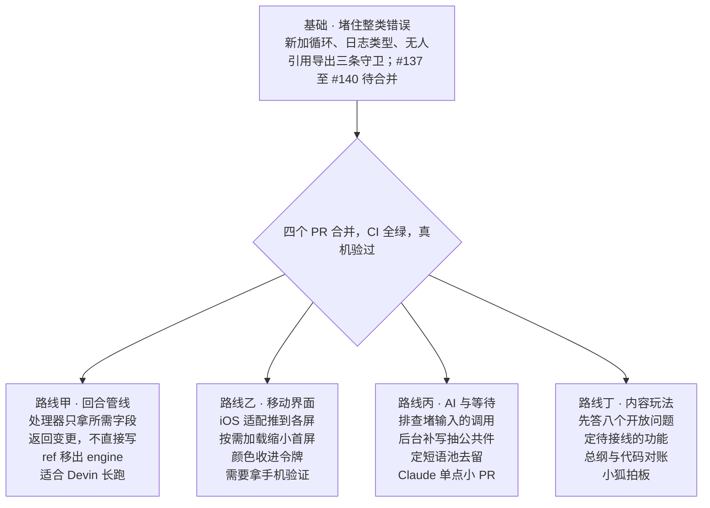

# 天都·曲措 长期路线图

> 截至 2026-11-22。在线可编辑版本是 Claude Docs 里的同名文档；本文件是同一内容的仓库快照，改动后请同步。

## 总述

路线图分两层：先打基础，再分四条路线并行。基础管的是「同一类错误会不会再犯」；四条路线各管一片互不重叠的代码，可以同时交给不同的人或 agent。

判断依据是 11 月 22 日对 main（#133）的审计。生产代码约 6.2 万行、554 个文件，越层引用为零，重复代码 0.46%，`MudRPG.jsx` 已从 7341 行拆到 368 行。风险集中在两类没有约束的东西：回合管线里 88 个字段的上下文对象 `d`，和随手写的日志类型字符串。

基础的代码部分已经写完：#137 到 #140 四个 PR 合在一起跑过，176 个测试文件、共 2133 条全过，没有循环依赖。合并它们、再做完三件非代码的事，四条路线就可以同时开工。

四条路线只有一处交界：路线丙要改 `actCall` 时须先和路线甲对好；各自的目录和验收方式见「并行的规矩与分工」。

## 基础：堵住整类错误

基础只做一件事：让已经出过的错误在 CI 里就被拦住，并定下四条路线共用的约定。代码部分已全部写完，等合并。

| 事项 | 状态 | PR |
| --- | --- | --- |
| 地名标题、首页 iOS 一屏、切磋战报改成事实行加后台补写 | 已合并 | #134、#135、#136 |
| 断开唯一的循环依赖，加循环守卫 | 待合并 | #137 |
| 日志类型唯一清单 `LOG_T` 加守卫；角色卡开场 `narr` 改为 `desc`（请确认） | 待合并 | #138 |
| 删除旧的「AI 回合写切磋战报」整条链路，净删约 450 行 | 待合并 | #139 |
| 删 5 个无人引用的导出加守卫；4 个待定的登记原因 | 待合并 | #140 |

基础合入后，CI 里会有五条守卫把住四条路线共同的底线：不越层、不留零入度文件（这两条原来就有），不成环、日志类型不出清单、不留无人引用的导出（这三条是新加的）。

还剩三件非代码的事：

- [ ] 真机验证已合并的三处：首页一屏放下、去喇嘛庙看地名标题、连打两场切磋。
- [ ] 撤销 `gho_` 开头的旧 GitHub 令牌，它在多场对话里以明文出现过，权限覆盖整个账号。
- [ ] `docs/项目状态.md` 停在 7 月 30 日，改成由 `npm run stats` 生成的快照。

完成标准：#137 到 #140 合入 main、CI 全绿，上面三件勾完。

## 路线甲：回合管线减耦

范围是 `src/engine/act/**`、`src/engine/turn/**`，以及 features 和 engine 之间的依赖方向。这是唯一的大重构，适合交给 Devin 长时间异步跑，每个处理器一个 PR，任何时候停下来都是可用状态。

1. **给 `d` 建清单。** 88 个字段分四组：AI 的提议（`d.p` 等）、回合开始时的状态快照、写状态和写日志的函数、React 的 ref。清单本身就能看出哪些处理器在悄悄互相传值。
2. **处理器改成纯函数。** 只收自己用的字段，返回 `{ logs, changes }`，由 `commitRound` 统一落盘。从最熟的 `roomWrite`、`narrative`、`choices` 开始，记忆和 NPC 相关的放最后。
3. **把 React ref 赶出 engine。** `roomWrite.js` 一个文件就用了 7 次 `.current`，如 `roomMapRef`、`outerDepartRef`、`pendDirRef`，它们该作为输入值传进来，或搬进 store。
4. **理顺 features 与 engine 的方向。** engine 引 features 是调度，方向对；features 有 3 个文件反过来引 engine。把 `turnMonitor` 下沉，把 `innerMove` 的纯逻辑搬进 features 或 domain，再在 ratchet 里加「features 不得引 engine」。

完成标准：后置处理器都不再直接调用 `d.addLog` 或 `d.setX`；engine/act 里没有 `.current`；features 到 engine 的引用为零并由 ratchet 守住。

## 路线乙：移动界面

范围是 `src/ui/**`、`mobile.css`、`tokens.css` 和构建配置，目标是 iPhone 上少滚、首屏快。每一步都要有人拿手机看，容器里装不了浏览器。

- **iOS 适配推广。** #134 只管开始界面。把同一套 `@supports (-webkit-touch-callout: none)` 的做法推到创角、切磋、角色卡导入和设置页，每个界面配一条真机检查项：竖屏、横屏、主屏幕全屏。
- **首屏体积。** 主包压缩后约 406 KB。角色卡导入、酒馆经营、斗蛐蛐、团战改成按需加载，每拆一个记一次 `npm run stats`。
- **颜色。** 340 种十六进制颜色按界面分批换成 `tokens.css` 变量，ratchet 已在测这个数，只许降。
- **超长界面文件。** 先拆设置页 API 标签页（501 行）、角色卡的 `CarryPicker`（485）和 `widgets`（453）、团战界面（435）、`CardImportScreen`（424）。

完成标准：五个主要界面在 iPhone 上各验过一遍；主包、颜色数、超长文件数达到文末度量表的目标。

## 路线丙：AI 调用与等待

范围是 `src/app/hooks/**` 和 `src/engine/ports/**`，目标是刷级时少等 AI。#136 已经把切磋战报和邀战改成不占回合，这条路线把同一种做法系统化。

- **排查。** 列出所有会堵住输入排队的 AI 调用，逐个标注「系统先给事实、描写后台补」能不能套，哪些必须等。清单给小狐定，再动代码。
- **抽公共件。** 把 #136 里「事实行先落日志、描写按 key 原位插回、回滚即作废」抽成通用工具，不再每处各写一份。
- **定短语池去留。** #139 之后，按招式类型抽句拼描写的短语池已经没有地方显示。要么删掉，要么接回去作没配 API 时的兜底。

完成标准：清单里标为「能套」的调用都不再占回合；公共件有自己的测试。若要改 `actCall`，先和路线甲对好，那是两条路线唯一的交界。

## 路线丁：内容与玩法

范围是 `src/domain/data/**`、`src/content/**`、任务与物品数据，以及 `docs/` 里的设计稿。小的内容补充（新物品、新任务、新词条）随时可做；会往回合管线里加字段的新系统，等路线甲把处理器改成纯函数以后再开，省得回头重写。

这条路线先要小狐回答下面这些问题。代码里没有答案，路线图也不替你预设结论。

- [ ] 角色卡开场改写按正文显示（`narr` 改 `desc`），是否同意？见 #138。
- [ ] 按招式类型抽句拼描写的短语池：删掉，还是接回去作没配 API 时的兜底？见 #139。
- [ ] 赌石「委托做装备」：逻辑已写好未接线，接还是删？见 #140。
- [ ] 预设编辑器：界面已不在，现在没有任何代码会写入预设。恢复编辑器，还是把遗留的保存和酒馆格式导入导出整组删掉？见 #140。
- [ ] 酒馆经营和角色入册：暂时隐藏、改好再放出来，还是长期下线？长期下线的话对应代码可以删，主包也会变小。
- [ ] 切磋是否应该推进游戏时间？#136 之后它不再推进。
- [ ] 公开仓库里的 NSFW 开关：之前改简历时提过它可能影响投递，是否拆到私有分支或私有仓库？
- [ ] 《曲措乡_总纲_v3》有 3251 行，哪些章节仍是待实现的设计、哪些已过时？做一次和代码的对账，这条路线的待办单从那里长出来。

完成标准：上面的问题都有答案；总纲对账后产出一份按优先级排好的内容待办单。

## 并行的规矩与分工

四条路线能并行，靠的是每条路线只改自己的目录。分工按各自擅长的事来定：现在的提交里 Devin 的机器人账号占 119 次，最适合接长重构。

| 路线 | 只改这些目录 | 主力 | 验收靠什么 |
| --- | --- | --- | --- |
| 甲 回合管线 | `src/engine/act`、`src/engine/turn`、features 对 engine 的引用 | Devin | 测试全绿 |
| 乙 移动界面 | `src/ui`、样式、构建配置 | Claude 或 Devin 写，拿手机的人验 | iPhone 真机截图 |
| 丙 AI 调用与等待 | `src/app/hooks`、`src/engine/ports` | Claude 单点小 PR | 测试加连打体验 |
| 丁 内容与玩法 | `src/domain/data`、`src/content`、`docs` | 小狐拍板，谁空谁写 | 小狐试玩 |

规矩：

- **跨路线的改动单独成 PR。** 标题写明碰了哪条路线，不夹在别的改动里。唯一已知的交界是 `actCall`：路线丙要改它，先和路线甲对好。
- **共用的约定只在基础里改。** `LOG_T` 清单、ratchet 分层表、五条守卫测试和其 `KEEP` 表，改动都单独成 PR，小狐看过再合。
- **分支按来源命名。** `claude/…`、`devin/…`，谁都不直接推 main；开 PR 前先变基到最新的 main。
- **PR 说明写清三件事。** 改了什么、有哪些行为变化要小狐确认、是否做过真机验证。
- **校验必须拦得住。** 提交前跑 `npm run verify` 和 `npm run ratchet`，失败就停，不能一边失败一边推送。#138 上出过一次这种差错，已纠正。
- **令牌用短期的。** GitHub App 安装令牌一小时过期，或只授权单个仓库的 fine-grained 令牌，不再贴覆盖整个账号的长期令牌。

## 度量与检查点

每条路线告一段落时重跑下表的命令，更新「现在」一列。「审计时」测于 main 的 #133；「基础合入后」测于把 #137 到 #140 合在一起的本地分支。目标是建议值，可以改；重要的是只降不升。

| 指标 | 审计时 | 基础合入后 | 目标 | 路线 | 测量命令 |
| --- | --- | --- | --- | --- | --- |
| 越层引用 | 0 | 0 | 0 | 全部 | `npm run stats` |
| 循环依赖 | 1 | 0，守卫在 CI | 0 | 基础 | `src/tests/importCycles.test.js` |
| 无人引用的导出 | 9 | 0，另 4 个登记待定 | 0 | 基础、丁 | `src/tests/unusedExports.test.js` |
| 清单外的日志类型 | 2 处笔误 | 0，守卫在 CI | 0 | 基础 | `src/tests/logTypes.test.js` |
| 回合上下文字段 | 88 | 88 | 每个处理器只拿自己用的 | 甲 | `grep -rhoE "\bd\.[A-Za-z_]+" src/engine/act \| sort -u \| wc -l` |
| features 引 engine 的文件 | 3 | 3 | 0 | 甲 | ratchet 新规则 |
| 超 400 行文件 | 18 | 未重测 | ≤ 8 | 乙 | `npm run stats` |
| 不同十六进制颜色 | 340 | 未重测 | ≤ 60 | 乙 | `npm run stats` |
| 主包压缩体积 | 约 406 KB | 未重测 | ≤ 250 KB | 乙 | `npm run stats` |
| 占回合的 AI 调用 | 未清点 | 切磋、邀战已移出 | 清单里「能套」的全部移出 | 丙 | 路线丙的排查清单 |
| 重复代码 | 0.46% | 未重测 | < 1% | 全部 | `npx jscpd src --min-lines 12` |
| 测试条数 | 2133 | 2133 | 不因删功能以外的原因减少 | 全部 | `npm run verify` |

测试条数前后都是 2133，并不是没动：#139 删去 19 条只测旧链路的用例，基础的其余 PR 新增了守卫和回归用例。哪一项在某个 PR 里变坏了，那个 PR 就不该合，除非说明里写清了为什么。
